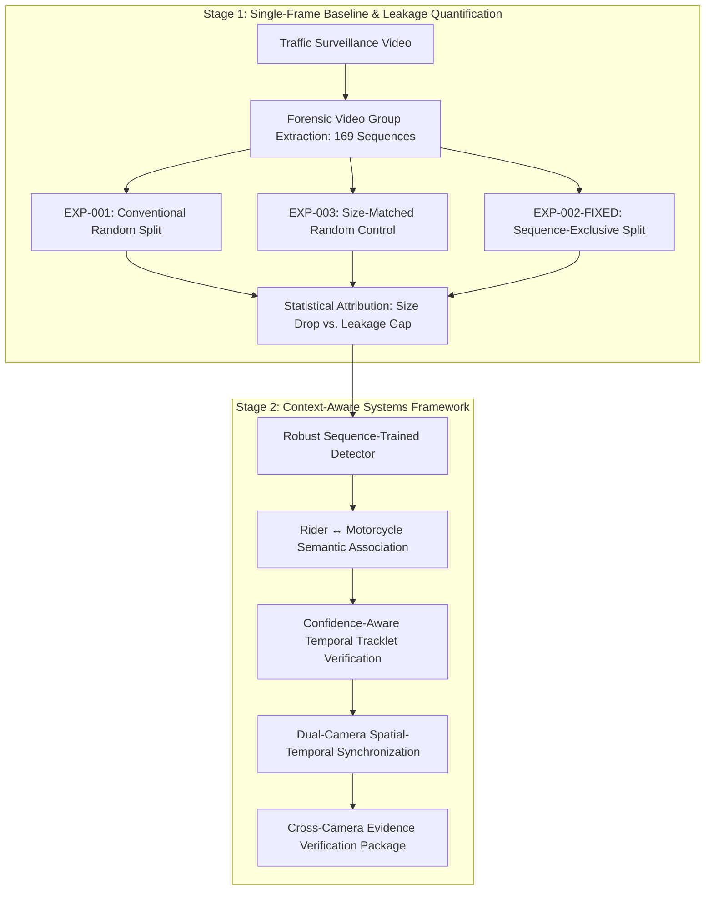

# Dual-Camera Helmet Violation Detection

[](https://www.python.org/)
[](https://pytorch.org/)
[](LICENSE)
[-green.svg)]()

A reproducible, standalone computer vision research framework investigating **context-aware motorcycle helmet violation detection** across traffic surveillance video feeds.

---

## 1. Research Motivation & Core Problem

Conventional deep learning benchmarks for traffic enforcement typically report high detection accuracy ($80\text{--}90\%\text{ mAP}$) by applying standard random frame-level dataset splitting. However, in video-sourced datasets, adjacent frames captured fractions of a second apart share identical camera viewpoints, lighting conditions, background clutter, and vehicle colors. 

When randomly distributed between training and testing sets, this creates severe **temporal autocorrelation data leakage**, causing models to memorize environmental artifacts rather than learning generalizable helmet compliance features.

This repository establishes a rigorous scientific evaluation protocol to:
1. **Empirically quantify temporal leakage bias** in traffic video benchmarks.
2. **Isolate confounding variables** (e.g., training set size vs. split strategy).
3. **Establish a robust baseline detector** evaluated on true out-of-sequence video footage.
4. **Develop a multi-modal context-aware system** incorporating rider–motorcycle association, temporal tracklet verification, and dual-camera spatial-temporal evidence fusion.

---

## 2. Research Architecture & System Workflow



---

## 3. Implementation Status

### ✅ Currently Implemented & Validated
* **Dataset Quality & Provenance Audit**: Single-pass automated verification across 5,547 images (8,248 annotations) with zero corruptions or missing labels.
* **Forensic Group Extraction**: Robust regex parsing separating video frames into **169 atomic video sequences** (55 Timestamp sessions, 28 parent `VID` recordings, and 86 video clips).
* **Mathematical Disjointness Proof**: Automated verification ensuring strictly $\text{Train} \cap \text{Val} \cap \text{Test} = \emptyset$ (0.0% sequence overlap).
* **EXP-001 Benchmark**: Baseline YOLOv8n detector trained on conventional Roboflow frame-level split ($83.42\%\text{ mAP@50}$).
* **Controlled Split Generation**:
  * `v1_random_matched` (EXP-003): 3,866 size-matched random training frames.
  * `v1_group_split_fixed` (EXP-002-FIXED): 3,866 sequence-isolated training frames across 117 independent video groups.
* **Statistical Attribution Pipeline**: Automated tooling to calculate $\Delta_{\text{size}}$ and $\Delta_{\text{leakage}}$ with paired Student's t-tests and confidence intervals.

### 🔄 In Progress / Planned
* **EXP-003 & EXP-002-FIXED Model Training**: Running controlled single-seed and multi-seed training runs.
* **Multi-Seed Statistical Verification**: 5-seed repetition (`[42, 123, 2026, 7, 99]`) for publication-grade error bounds.
* **Rider–Motorcycle Spatial-Semantic Association**: Bounding-box overlap and spatial affinity heuristics.
* **Temporal Confidence Accumulation**: Multi-frame confidence smoothing over DeepSORT/ByteTrack trajectories.
* **Dual-Camera Cross-View Fusion**: Synchronized license plate and helmet violation evidence pairing.

---

## 4. Controlled Benchmark Protocol

To disentangle dataset size effects from genuine temporal autocorrelation bias, experiments follow a 3-way controlled comparison:

| Experiment ID | Split Protocol | Training Images | Sequence Overlap | Research Purpose |
| :--- | :--- | :---: | :---: | :--- |
| **`EXP-001`** | Conventional Random Frame Split | 4,854 | $\approx 98.4\%$ | Measures baseline performance under standard Roboflow splitting |
| **`EXP-003`** | Size-Matched Random Frame Split | 3,866 | $\approx 98.4\%$ | **Controls for training size** ($\Delta_{\text{size}} = \text{EXP-003} - \text{EXP-001}$) |
| **`EXP-002-FIXED`** | Audited Sequence-Exclusive Split | 3,866 | **0.0% (Zero)** | **Measures true sequence generalization** ($\Delta_{\text{leakage}} = \text{EXP-002-FIXED} - \text{EXP-003}$) |

---

## 5. Repository Structure

```text
Dual-Camera-Helmet-Violation-Detection/
├── configs/
│   ├── dataset.yaml                               # EXP-001 dataset configuration
│   ├── dataset_group_split_fixed.yaml             # EXP-002-FIXED dataset configuration
│   ├── dataset_random_matched.yaml                # EXP-003 dataset configuration
│   └── experiments/
│       ├── exp_001_baseline.yaml                  # EXP-001 configuration
│       ├── exp_002_group_split_fixed.yaml         # EXP-002-FIXED configuration
│       └── exp_003_size_matched_baseline.yaml     # EXP-003 configuration
├── data/
│   ├── metadata/
│   │   └── source_groups.csv                      # Provenance mapping for 169 video groups
│   ├── raw/                                       # Raw surveillance footage
│   └── splits/
│       ├── v1_group_split_fixed.csv               # Zero-leakage sequence-exclusive manifest
│       └── v1_random_matched.csv                  # Size-matched random split manifest
├── experiments/                                   # Versioned experiment logs and metadata
├── models/
│   ├── checkpoints/                               # Checkpoint storage (best.pt / last.pt)
│   └── final/                                     # Exported deployment weights
├── results/
│   ├── confusion_matrices/                        # Normalized confusion matrices
│   ├── metrics/                                   # Machine-readable JSON evaluation outputs
│   ├── plots/                                     # Training loss & PR curves
│   └── tables/                                    # Markdown & CSV comparison tables
├── scripts/
│   ├── analysis/
│   │   ├── analyze_training.py                    # Loss convergence and overfitting analysis
│   │   ├── compute_statistical_comparison.py      # 3-way statistical attribution calculator
│   │   └── visualize_predictions.py               # Qualitative prediction visualizer
│   ├── data/
│   │   ├── check_duplicates.py                    # Perceptual near-duplicate detection
│   │   ├── create_group_split.py                  # Sequence-exclusive partition generator
│   │   ├── create_matched_random_split.py         # Size-matched random partition generator
│   │   ├── materialize_split.py                   # Split materialization engine
│   │   ├── run_audit.py                           # Full dataset quality and leakage scanner
│   │   └── verify_split_disjointness.py           # Mathematical split disjointness auditor
│   ├── evaluation/
│   │   └── evaluate_yolo.py                       # Standardized evaluation pipeline
│   └── training/
│       └── train_yolo.py                          # Configurable deterministic training driver
├── src/                                           # Core modular Python packages
│   ├── data/yolo_dataset.py                       # Fast zero-overhead dataset verification
│   └── utils/                                     # Path resolvers and YAML utilities
├── CITATION.cff                                   # Citation metadata
├── LICENSE                                        # MIT License
├── requirements.txt                               # Environment dependencies
└── README.md
```

---

## 6. Quickstart & Reproducibility Guide

### 6.1 Environment Setup

```bash
# 1. Create and activate Python virtual environment
python3 -m venv .venv
source .venv/bin/activate

# 2. Install dependencies
pip install --upgrade pip
pip install -r requirements.txt

# 3. Verify hardware acceleration (Apple Silicon MPS / CUDA GPU / CPU)
python -c "import torch; print('Device:', 'mps' if torch.backends.mps.is_available() else 'cuda' if torch.cuda.is_available() else 'cpu')"
```

### 6.2 Data Quality & Disjointness Audit

```bash
# Run dataset audit and extract 169 atomic video groups
python scripts/data/run_audit.py

# Verify mathematical disjointness of the sequence-exclusive split
python scripts/data/verify_split_disjointness.py --manifest data/splits/v1_group_split_fixed.csv
```

### 6.3 Running Controlled Experiments

```bash
# EXP-003 (Size-Matched Random Baseline)
python scripts/training/train_yolo.py --config configs/experiments/exp_003_size_matched_baseline.yaml

# EXP-002-FIXED (Sequence-Exclusive Zero-Leakage Split)
python scripts/training/train_yolo.py --config configs/experiments/exp_002_group_split_fixed.yaml

# Compute 3-Way Statistical Attribution Table
python scripts/analysis/compute_statistical_comparison.py
```

---

## 7. Citation

```bibtex
@misc{uddin2026dualcamerahelmet,
  author = {Mohammad Sayem Uddin},
  title = {Dual-Camera Helmet Violation Detection: A Context-Aware Spatial-Temporal Computer Vision Framework},
  year = {2026},
  publisher = {GitHub},
  journal = {GitHub repository},
  howpublished = {\url{https://github.com/mohammad-sayem-uddin/Dual-Camera-Helmet-Violation-Detection}}
}
```

---

## 8. License

This project is licensed under the MIT License — see the [LICENSE](LICENSE) file for details.
