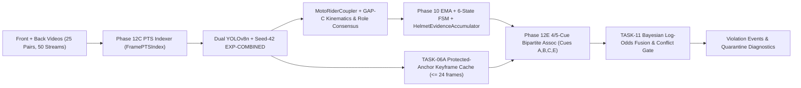

# Dual-Camera Context-Aware Motorcycle Helmet Violation Detection

[](https://www.python.org/)
[](https://pytorch.org/)
[](https://ultralytics.com/)
[](LICENSE)
[](docs/phase12/ANNOTATION_RELEASE_ACCEPTANCE_AND_PROVENANCE.md)

An integrated, engineering-audited **dual-camera computer vision framework** for roadside motorcycle helmet violation detection, combining cross-domain sequence-isolated YOLOv8 detection, PTS-accurate container synchronization, hierarchical motorcycle–rider tracking (`GAP-C`), protected-anchor keyframe retention and coordinate-scaled appearance association (`GAP-B` / `TASK-10`), and Beta-smoothed Bayesian log-odds belief fusion with explicit conflict abstention (`TASK-11` / `TASK-12`).

> **Canonical Ground Truth Policy (`v1.0` Accepted Reference vs. `v1.1` Preserved Protocol):**
> Dual-camera real-video experiments are evaluated against the cryptographically frozen release [`dual_camera_gt_v1.0_ai_assisted_audited`](data/dual_camera_test_v1/releases/dual_camera_gt_v1.0_ai_assisted_audited/README.md) (`AI_ASSISTED_AUDITED`, `human_verified = false`, `70` global physical passes across `25` video pairs). Per Principal Investigator directive, the blind human review queue [`dual_camera_gt_v1.1_blind_human`](data/dual_camera_test_v1/releases/dual_camera_gt_v1.1_blind_human/README.md) (`PENDING_HUMAN_REVIEW`, `0 / 92` completed human units) is preserved untouched without fabrication. See [`ANNOTATION_RELEASE_ACCEPTANCE_AND_PROVENANCE.md`](docs/phase12/ANNOTATION_RELEASE_ACCEPTANCE_AND_PROVENANCE.md) and [`FINAL_RESEARCH_LIMITATIONS.md`](docs/phase12/FINAL_RESEARCH_LIMITATIONS.md).

---

## 1. End-to-End Architecture



For mathematical formulations, subsystem APIs, and YAML configuration bindings, see [`docs/phase12/FINAL_SYSTEM_ARCHITECTURE.md`](docs/phase12/FINAL_SYSTEM_ARCHITECTURE.md).

---

## 2. Core Quantitative Results (All Verified Offline & Real-Video Replay)

### 2.1 Cross-Domain Detector Generalization & 3-Seed Stability (Phases 8–9)
- **Catastrophic Domain Collapse Avoided:** Mobile-only training (`EXP-NEW`, 3 seeds `42, 123, 2026`) collapses on held-out overhead CCTV (`mAP@0.50 = 0.1164 ± 0.0419`, recall `0.1386 ± 0.0336`). Multi-domain union training (`EXP-COMBINED`, `5,151` train / `1,128` val / `1,109` test) recovers overhead CCTV to **`mAP@0.50 = 0.7595 ± 0.0090`** (`+64.31 pp`, Cohen's $d = +19.55$), exceeds CCTV-only baseline `EXP-002-FIXED` (`0.6694 -> 0.7517` on seed 42), and preserves mobile test performance (`0.9601 ± 0.0015` vs. `0.9609 ± 0.0029`, $\Delta = -0.0008$).

### 2.2 Temporal Verification & Track Evidence Redesign (Phase 10 & TASK-04)
- **Zero False-Positive Burst Citations:** On `21` synthetic benchmark runs (`simple_voting`, `confidence_weighted`, `ema` across `7` scenarios), all aggregators achieve `Precision = 1.00, Recall = 1.00, False Alerts = 0` with `5`-frame (`0.167 s` at 30 fps) confirmation latency.
- **Resolving `WINDOW_FLUSH_ZERO_MASS` Track Abstentions (`TASK-04`):** `HelmetEvidenceAccumulator` (`conf_weighted`) raises agreement on all `209` decided eligible GT rider tracks from **`0.6411` (`134/209`, `73` `UNCERTAIN`)** to **`0.9904` (`207/209`, `0` abstentions)** and **`1.0000` (`85/85`)** on single-observation $K=1$ tracks without changing any online alerts (`0 / 85` regressions).

### 2.3 Dual-Camera Tracking (`GAP-C`), Keyframes (`GAP-B`/`TASK-10`), Fusion (`TASK-11`) & `tIoU` (`TASK-12`)
- **PTS Container Synchronization (`Phase 12C`):** Eliminates up to `2,870.00 ms` `CAP_PROP_POS_FRAMES` random-seek VFR error (`pair_013_back.mp4`); sequential `CAP_PROP_POS_MSEC` matches `ffprobe` rational PTS within `0.000000 ms` across all `50 / 50` videos.
- **Protected Keyframes & Coordinate Scaling (`TASK-06/06A`, `TASK-10`):** Within a hard `24`-frame memory cap, keyframe descriptor availability across real-video tracks increases from `6 / 75` (`8.0%`) in pre-GAP-B Stage J to **`55 / 55` (`100.0%`)** in both `720p` and `4K`, with `0.9971` mean `720p vs 4K` self-similarity (`9 / 9` PNG examples recovered). However, raw HSV histograms exhibit overlapping opposing-view discrimination (`0.7223` positive vs. `0.6641` negative), causing one `+0.0003` borderline false link (`pair_005` in 4K).
- **Hierarchical Rider Tracking (`GAP-C`):** Motorcycle-anchored kinematics, conflict unlocking, longitudinal role consensus, and orphan lifecycle gating raise back-camera coupled head retention from **`28.69%` to `91.66%`** (`28.69% -> 91.66%`; combined `66.61% -> 94.50%`), cut abstained updates by `92.2%` (`2,943 -> 230`), eliminate `660` out-of-bounds boxes, keep role mismatches at `0`, and remove all `56` 1-hit orphan clutter exports.
- **Dual-Camera Fusion vs. Single Camera (`TASK-11`):** On `70` physical motorcycle passes (`40` violations, `46` decided passes), `A4_DUAL_FUSED_SPLIT` achieves **`97.14%` (`68/70`)** physical pass coverage (vs. `60.00%` front-only, $p = 5.77 \times 10^{-8}$ back / $2.16 \times 10^{-7}$ front exact McNemar) and **`82.50%` (`33/40`)** binary violation recall (vs. `60.00%` front-only, $p = 0.0117$, and `45.00%` back-only, $p = 6.10 \times 10^{-5}$), resolving all `3/3` Stage J $K=1$ vetos and quarantining cross-view contradictions (`K >= 0.35`, e.g., `pair_015`). Under strict `v1.0` schema (`N=70`), fixed point-interval `tIoU` (`TASK-12`) recovers Stage K event F1 from **`0.8258` (`64 TP`)** to **`0.8516` (`66 TP`)**.

---

## 3. Quick Start & Full Reproduction

> [!IMPORTANT]
> On Apple Silicon local setups, any legacy `.venv/` missing `torch.torch_version` should not be used; verified reproduction uses `/opt/homebrew/opt/python@3.11/bin/python3.11` (Python `3.11.15`) and `node v26.9.0`. See [`docs/REPRODUCIBILITY_GUIDE.md`](docs/REPRODUCIBILITY_GUIDE.md).

```bash
# Run complete non-destructive CPU verification suite (checksums, Stage K, GAP-B, GAP-C, TASK-10..12, JS check, full pytest)
bash scripts/reproducibility/run_full_research_reproduction.sh /tmp/research_repro_run

# Run full pytest regression suite directly
/opt/homebrew/opt/python@3.11/bin/python3.11 -m pytest -q tests/

# Run single dual-camera pair in Bayesian dual-fusion mode
PYTHONPATH=. /opt/homebrew/opt/python@3.11/bin/python3.11 src/pipeline/dual_camera_pipeline.py \
  --pair-id pair_019 --fusion-mode dual_fused --device mps --output-dir /tmp/pair_019_dual
```

---

## 4. Complete Documentation & Artifact Index

| Document | Scope |
|---|---|
| [`docs/phase12/FINAL_SYSTEM_ARCHITECTURE.md`](docs/phase12/FINAL_SYSTEM_ARCHITECTURE.md) | Integrated multi-layer architecture, equations, Mermaid workflows, and module bindings |
| [`docs/phase12/FINAL_EXPERIMENTAL_METHODOLOGY.md`](docs/phase12/FINAL_EXPERIMENTAL_METHODOLOGY.md) | Dataset partitioning, multi-seed protocol, synchronization forensics, and ablation designs |
| [`docs/phase12/FINAL_EXPERIMENTAL_RESULTS.md`](docs/phase12/FINAL_EXPERIMENTAL_RESULTS.md) | Reconciled tables, 95% Wilson/bootstrap CIs, exact McNemar tests, and forensic case studies |
| [`docs/phase12/FINAL_RESEARCH_LIMITATIONS.md`](docs/phase12/FINAL_RESEARCH_LIMITATIONS.md) | Exhaustive validity boundaries, `v1.0` circularity, `0/92` `v1.1` status, and failure modes |
| [`docs/phase12/ANNOTATION_RELEASE_ACCEPTANCE_AND_PROVENANCE.md`](docs/phase12/ANNOTATION_RELEASE_ACCEPTANCE_AND_PROVENANCE.md) | SHA-256 verification and formal `v1.0` acceptance / `v1.1` preservation audit |
| [`docs/phase12/FINAL_PROJECT_COMPLETION_AUDIT.md`](docs/phase12/FINAL_PROJECT_COMPLETION_AUDIT.md) | Engineering audit and Defect `D1–D6` remediation register |
| [`docs/REPRODUCIBILITY_GUIDE.md`](docs/REPRODUCIBILITY_GUIDE.md) | Environment setup, CLI flags, reproduction runner, and excluded heavy GPU stages |
| [`docs/paper/RESEARCH_MANUSCRIPT_DRAFT.md`](docs/paper/RESEARCH_MANUSCRIPT_DRAFT.md) | Complete publication-ready academic manuscript draft |

---

## 5. License & Citation

Released under the [MIT License](LICENSE). If you use this codebase, audit methodology, or dual-camera synchronization/fusion design, cite:

```bibtex
@article{uddin2026dualcamera,
  title={An Integrated Dual-Camera Framework for Context-Aware Motorcycle Helmet Violation Detection with Confidence-Aware Temporal Verification},
  author={Uddin, Mohammad Sayem and collaborators},
  journal={Working Manuscript (Repository Technical Release)},
  year={2026}
}
```
