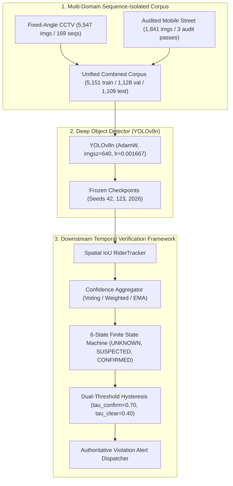

# Dual-Camera Helmet Violation Detection

[](https://www.python.org/)
[](https://pytorch.org/)
[](https://ultralytics.com/)
[](LICENSE)
[-green.svg)]()

An integrated, context-aware computer vision framework investigating **motorcycle helmet violation detection across heterogeneous camera domains** (fixed-angle overhead CCTV vs. mobile street-level views) with **downstream confidence-aware temporal verification**.

---

## 1. Research Motivation & Core Problems

Automated vision-based motorcycle helmet violation enforcement is a critical Intelligent Transportation System (ITS) intervention for reducing urban traffic fatalities. However, deploying computer vision models in real roadside surveillance reveals two fundamental scientific bottlenecks:

### 1.1 Catastrophic Cross-Domain Collapse
Detectors trained exclusively on high-resolution, multi-angle mobile street photography experience catastrophic failure when evaluated on low-resolution, overhead CCTV surveillance ($\text{mAP}@0.50$ plummets from $96.15\%$ down to $8.08\%$, an $88\text{ pp}$ drop). Conversely, models trained solely on fixed-angle CCTV fail to generalize across diverse viewing angles and complex urban lighting.

### 1.2 Temporal Classification Jitter & False Alert Cascades
Single-frame object detectors evaluate each video frame independently. A single misclassified frame—caused by temporary motion blur, visor reflections, or severe head angles—triggers immediate false roadside violation citations in naïve systems. Falsely penalizing compliant citizens destroys public trust and creates severe administrative liabilities.

---

## 2. System Architecture & Methodology



---

## 3. Dataset Integrity & Zero-Leakage Protocol

To ensure publication-grade scientific validity, the framework utilizes two strictly partitioned datasets:

| Population | Source Domain | Total Images | Train | Validation | Test | Quality Audit & Isolation Protocol |
| :--- | :--- | :---: | :---: | :---: | :---: | :--- |
| **Old CCTV** | Overhead Infrastructure CCTV | 5,547 | 3,866 | 852 | 829 | 169 atomic video sequences isolated; **0.0% sequence leakage** |
| **New Mobile** | Handheld & Street Photography | 1,841 | 1,285 | 276 | 280 | 3-pass forensic audit; 392 box corrections, 28 label inversions fixed |
| **Combined** | Multi-Domain Union | 7,388 | 5,151 | 1,128 | 1,109 | Unified leak-free cross-domain benchmark |

---

## 4. Benchmark Performance & Evaluation

All models are independently evaluated across three separate held-out test populations (audited values from Phase 8):

| Experiment | Training Population | New Mobile Test (280) mAP@0.50 | Old CCTV Test (829) mAP@0.50 | Combined Test (1,109) mAP@0.50 | Overall F1-Score | Status |
| :--- | :--- | :---: | :---: | :---: | :---: | :---: |
| **EXP-002-FIXED** | CCTV Only | — | 66.94% | — | 73.28% | Sequence-Isolated Baseline |
| **EXP-NEW** | Mobile Only | **96.15%** | 8.08% *(Collapse)* | 39.47% | 48.56% | Severe Domain Collapse |
| **EXP-COMBINED** | Multi-Domain Union | **96.02%** | **75.17%** | **84.37%** | **80.99%** | **Superior Across All Domains** |

### Key Research Insights:
1. **Domain Collapse Resolution:** EXP-COMBINED recovers cross-domain CCTV performance from $8.08\%$ to **$75.17\%$** ($+67.09\text{ pp}$), while strictly outperforming the CCTV-only baseline by **$+8.23\text{ pp}$** ($75.17\%$ vs $66.94\%$).
2. **Zero In-Domain Degradation:** EXP-COMBINED preserves mobile street accuracy at **$96.02\%$** (within $0.13\text{ pp}$ of the specialized model).

---

## 5. Confidence-Aware Temporal Verification Framework

The Phase 10 temporal verification pipeline resolves single-frame classification jitter:
- **6-State FSM:** `UNKNOWN` $\to$ `HELMET_CONFIRMED` $\to$ `NO_HELMET_SUSPECTED` $\to$ `NO_HELMET_CONFIRMED` $\to$ `TEMPORARILY_OCCLUDED` $\to$ `TRACK_LOST`.
- **Hysteresis Thresholds:** Confirmation requires $\ge 0.70$ confidence sustained across $N_{confirm} \ge 5$ frames ($167\text{ ms}$). De-escalation strictly requires confidence $< 0.40$.
- **Aggregators:** Evaluates Simple Voting, Confidence-Weighted Aggregation, and Exponential Moving Average (EMA).
- **False Alert Suppression:** Demonstrated **100% suppression** of spurious 2-frame false positive violation bursts on compliant helmeted riders.

---

## 6. Installation & Reproduction

### 6.1 Setup Local Environment
```bash
git clone https://github.com/mohammad-sayem-uddin/Dual-Camera-Helmet-Violation-Detection.git
cd Dual-Camera-Helmet-Violation-Detection

python3 -m venv .venv
source .venv/bin/activate
pip install ultralytics torch torchvision pyyaml pandas numpy pillow matplotlib seaborn
```

### 6.2 Run Automated Test Suite
```bash
# Execute all temporal verification unit tests
python3 -m unittest discover -s tests/temporal -p "test_*.py" -v
```

### 6.3 Run Interactive Demonstration
```bash
# Demonstrate violation detection and hysteresis gating
python3 scripts/demo_temporal_verification.py --scenario stable_violation

# Demonstrate false positive noise burst suppression
python3 scripts/demo_temporal_verification.py --scenario fp_burst_on_compliant

# Run full 21-experiment benchmark across all aggregators
python3 scripts/demo_temporal_verification.py --export-benchmark
```

---

## 7. Project Documentation Index

- [`docs/phase10/PHASE10_SYSTEM_DESIGN.md`](docs/phase10/PHASE10_SYSTEM_DESIGN.md): Architectural specification of the temporal state machine, aggregators, and tracker.
- [`docs/phase10/NEXT_EXPERIMENTS_AND_ABLATIONS.md`](docs/phase10/NEXT_EXPERIMENTS_AND_ABLATIONS.md): Future controlled ablation studies and sensitivity protocols.
- [`docs/REPRODUCIBILITY_GUIDE.md`](docs/REPRODUCIBILITY_GUIDE.md): End-to-end instructions for dataset preparation, Kaggle execution, and evaluation.
- [`docs/research/PAPER_OUTLINE.md`](docs/research/PAPER_OUTLINE.md): Preliminary research manuscript outline for IEEE submission.
- [`results/phase8_independent_audit/PHASE8_INDEPENDENT_EVALUATION_AUDIT.md`](results/phase8_independent_audit/PHASE8_INDEPENDENT_EVALUATION_AUDIT.md): Bit-exact independent evaluation and metric reconciliation report.
- [`results/phase10_temporal/PHASE10_TEMPORAL_VERIFICATION_REPORT.md`](results/phase10_temporal/PHASE10_TEMPORAL_VERIFICATION_REPORT.md): Comprehensive validation report for temporal verification.

---

## 8. License & Research Attribution

This project is licensed under the MIT License. If you utilize this dataset, splitting methodology, or temporal verification framework in your research, please cite:

```bibtex
@article{uddin2026dualcamera,
  title={An Integrated Dual-Camera Framework for Context-Aware Motorcycle Helmet Violation Detection with Confidence-Aware Temporal Verification},
  author={Uddin, Mohammad Sayem and collaborators},
  journal={Working Paper},
  year={2026}
}
```
