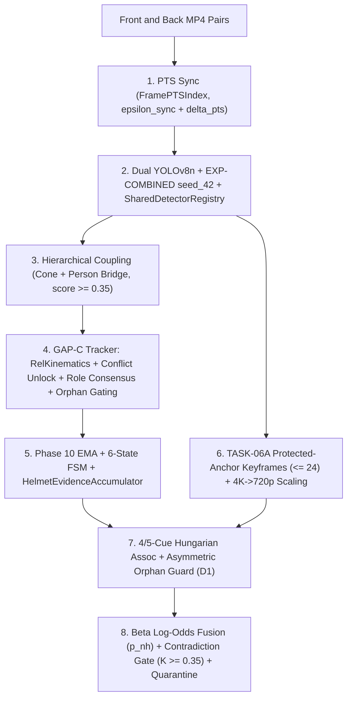

# An Integrated Dual-Camera Framework for Context-Aware Motorcycle Helmet Violation Detection with Confidence-Aware Temporal Verification

**Mohammad Sayem Uddin and Collaborators**  
*Working Academic Manuscript Draft — Prepared for IEEE Transactions on Intelligent Transportation Systems (T-ITS) / Pattern Recognition*  
*Repository Reference Baseline:* `Dual-Camera-Helmet-Violation-Detection` (`main`, 2026-11-13)

---

## Abstract

Automated roadside motorcycle helmet violation detection must jointly overcome cross-domain detector degradation across heterogeneous camera viewpoints, temporal classification jitter, rider-to-motorcycle fragmentation under rear-view occlusion, and silent over-confidence when integrating uncalibrated dual-camera perspectives. We present an integrated, end-to-end dual-camera computer vision framework combining: (1) sequence-isolated multi-domain YOLOv8 training (`7,388` images across overhead CCTV and mobile street photography); (2) forensic Presentation Timestamp (`PTS`) container synchronization eliminating up to `2,870.00 ms` variable-frame-rate random-seek drift across `50` roadside videos; (3) hierarchical motorcycle-anchored relative rider kinematics, conflict-unlocked association, motion-aligned longitudinal driver/pillion role consensus, and gated orphan lifecycle tracking (`GAP-C`); (4) dual-threshold hysteresis finite state verification with genuine-observation evidence accumulation (`HelmetEvidenceAccumulator`); (5) protected-anchor keyframe retention (`<= 24` frames/stream) with explicit native-to-stored coordinate scaling for multi-cue cross-camera tracklet matching; and (6) Beta-smoothed quality-weighted Bayesian log-odds belief fusion with semantic contradiction gating ($K_{\text{conflict}} \ge 0.35$) and association ambiguity quarantine. Evaluated across three random seeds (`42, 123, 2026`), multi-domain union training eliminates mobile-to-CCTV domain collapse (`mAP@0.50`: `0.1164 ± 0.0419` $\to$ `0.7595 ± 0.0090`, Cohen's $d = +19.55$) while preserving in-domain mobile accuracy (`0.9601 ± 0.0015`). On `25` synchronized dual-camera video pairs (`15,241` decoded frames, `70` physical motorcycle passes) evaluated against the cryptographically frozen `v1.0` `AI_ASSISTED_AUDITED` reference (`human_verified = false`), hierarchical tracking raises back-camera coupled rider retention from `28.69%` to `91.66%` (`-92.2%` abstained updates), while dual-camera log-odds fusion with split ambiguity handling (`A4_DUAL_FUSED_SPLIT`) elevates physical pass coverage to `97.14%` (`68/70`) and violation recall to `82.50%` (`33/40`) versus front-only (`60.00%`, $p = 0.0117$ exact McNemar) and back-only (`45.00%`, $p = 6.10 \times 10^{-5}$). We report all methodological boundaries transparently, including `v1.0` AI-assisted circularity, unexecuted blind human review (`0/92`), weak opposing-view raw HSV appearance discrimination (`pair_005` knife-edge false link), and out-of-scope license plate assessment (`0/70`).

**Index Terms:** Intelligent transportation systems, motorcycle helmet detection, dual-camera fusion, multi-object tracking, Bayesian log-odds pooling, domain shift, variable-frame-rate synchronization, conservative abstention.

---

## 1. Introduction

Powered two-wheelers carry disproportionate road fatality risk in dense urban corridors where helmet non-compliance remains widespread. Manual roadside enforcement scales poorly and creates traffic bottlenecks, motivating automated camera-based helmet violation detection. Yet real-world deployment reveals four coupled technical gaps rarely addressed within one reproducible system:

1. **Cross-Domain Perspective Collapse:** Single-frame object detectors trained on street-level mobile photographs fail dramatically on elevated roadside CCTV viewpoints—and models evaluated on frame-correlated video splits overstate field generalization due to sequence data leakage.
2. **Temporal Flicker vs. Track-Evidence Starvation:** Single-frame classification jitter triggers false citations under brief visor glare or motion blur. Conversely, naive state-machine window flushing over Kalman-coasted gap frames can starve track-level summaries into spurious `UNCERTAIN` verdicts even when valid detections were observed earlier in the track.
3. **Receding Rear-View Rider Fragmentation & Role Instability:** Paired front- and back-facing roadside cameras offer complementary visibility of approaching drivers versus receding pillions, yet rapidly shrinking bounding boxes and mutual occlusion in rear views cause global-coordinate trackers to drop coupled rider subtracks, lose `driver` vs. `pillion` ordering, and emit unconfirmed 1-hit orphan fragments.
4. **Uncalibrated Asynchronous Multi-View Integration:** Handheld consumer cameras start seconds apart (`-2.380 s` to `+6.695 s`), lack hardware genlock, occasionally drop to variable frame rates (`40.15 fps` VFR), and possess unknown camera extrinsics. Naive concatenation of cross-camera detections either propagates association errors or silently masks direct inter-view contradictions (`HELMET` vs. `NO_HELMET`).

### Summary of Contributions
We distinguish clearly between **research contributions**, **system integration contributions**, **reproducibility engineering**, and **empirical failure-mode findings**:

| Category | Verified Contribution / Finding |
|---|---|
| **Architectural & Methodological Integration** | Unified dual-camera enforcement architecture decoupling container PTS indexing, dual-model hierarchical coupling, motorcycle-anchored rider kinematics (`GAP-C`), genuine-observation accumulation (`TASK-04`), missing-cue-renormalizing multi-cue association (`Phase 12E`), and sync-discounted Beta log-odds fusion with explicit semantic contradiction and ambiguity quarantine (`TASK-11`). |
| **Engineering & Metrological Hardening** | Four-way synchronization metrology separation (eliminating up to `2,870.00 ms` VFR random-seek errors); explicit coordinate-space contract recovering `9 / 9` PNG crops and eliminating `93` legacy `1080p` border FPs; shared protected-anchor keyframe retention (`<= 24` frames/stream) achieving `100%` descriptor availability; fixed zero-duration point-interval `tIoU` (`+2 TP`, `+0.0258` F1); and full defect hardening (`D1–D6`). |
| **Empirical Findings & Negative Results** | (i) `64.31 pp` CCTV recovery via sequence-isolated multi-domain union training across 3 seeds (`d=+19.55`); (ii) `+62.97 pp` back-camera coupled retention gain via motorcycle-relative kinematics and conflict unlocking; (iii) significant dual-camera physical pass coverage (`97.14%`) and violation recall (`82.50%`) gains over single views; (iv) negative empirical proof that uncalibrated coarse HSV+achromatic histograms are resolution-invariant (`0.9971`) yet overlap across opposing viewpoints (`0.7223` vs `0.6641`, triggering a `+0.0003` borderline FP in `pair_005`); and (v) rigorous accounting of `A4` vs `v1.0` reference divergence (`p=0.00098`) caused by pre-GAP-C `v1.0` labeling bias. |

---

## 2. Related Work

**Object Detection in Traffic Surveillance.** Modern real-time traffic perception builds on one-stage architectures introduced by Redmon et al. [1] and refined through the Ultralytics YOLOv8 family [2], benchmarked against standard COCO object detection conventions [3] using decoupled weight-decay optimization (AdamW) [9]. While YOLO detectors achieve millisecond per-frame inference, standard detectors treat each frame independently and remain vulnerable to severe perspective domain shift.

**Multi-Object Tracking & Association.** Tracking-by-detection paradigms progressed from Kalman-predicted [7] IoU + Hungarian assignment [8] in SORT [4], to appearance-augmented Deep SORT [5], and two-stage low-confidence detection recovery in ByteTrack [6]. Our work adapts ByteTrack [6] to a three-tier motorcycle–rider–orphan hierarchy (`KalmanByteTrack`), introducing motorcycle-anchored dimensionless relative kinematics (`GAP-C1`) and finite-horizon conflict unlocking so small, fast-receding rear-view head boxes remain locked to their parent vehicle without drifting off-frame.

**Cross-Camera Appearance Matching & Evidential Fusion.** Classic re-identification benchmarks (e.g., Market-1501 [12]) assume overlapping human-centric camera viewpoints suitable for deep metric embeddings, whereas opposing roadside cameras view riders head-on versus from behind under scale mismatch. We investigate lightweight azimuth-invariant color histograms compared via Bhattacharyya similarity [10] as an explicitly renormalizable optional cue (`Cue C`), avoiding neural Re-ID overfitting on uncalibrated pairs. For combining uncertain, potentially conflicting multi-view posteriors, classic Dempster–Shafer conflict principles [11] motivate explicit separation of epistemic agreement from high-contradiction states ($K_{\text{conflict}}$), implemented here through Beta-smoothed log-odds opinion pooling paired with an explicit conflict abstention gate.

**Statistical Evaluation & Annotation Reliability.** Proportion intervals and paired architectural comparisons on finite video-pass cohorts follow Wilson score intervals [13] and exact two-sided McNemar binomial tests [14], while our unexecuted blind multi-annotator schema specifies Cohen's $\kappa$ [15] inter-rater agreement targets. Auxiliary license-plate OCR tooling incorporates CRAFT [16], CRNN [17], and Tesseract [18] adapters, though plate recognition remains outside evaluated dual-camera scope.

---

## 3. Datasets & Sequence-Isolated Corpus Design

### 3.1 Single-Camera Multi-Domain Corpus (Phases 1–9)
To eliminate consecutive-frame leakage common in surveillance benchmarks:
- **Old CCTV (`old-dataset-v1-fixed`, `5,547` images):** Partitioned strictly by `169` atomic video sequences (`3,866` train, `852` val, `829` test with `1,170` instances: `600` `no_helmet`, `570` `helmet`). SHA-256 verification confirms `0.0%` sequence leakage.
- **New Mobile Street (`helmet-dataset-expansion-v2`, `1,841` images):** Multi-angle handheld and street corpus (`1,285` train, `276` val, `280` test with `552` instances) hardened over three human inspection passes, refining `392` torso-bleeding bounding boxes across `318` images to tight cranial head-only boundaries (max aspect ratio `4.20 -> 1.47` across `3,733` annotations, `0` class inversions).
- **Combined Multi-Domain Union (`7,388` images):** Leak-free union comprising `5,151` training, `1,128` validation, and `1,109` held-out test images (`1,722` instances).

### 3.2 Dual-Camera Real-Video Corpus (`data/dual_camera_test_v1/`)
The dual-camera testbed comprises `25` synchronized roadside motorcycle corridor video pairs (`pair_001`–`pair_025`, `50` MP4 videos, `15,241` decoded corpus frames: `6,557` Front / `8,684` Back), recorded with independent un-genlocked consumer mobile devices (Android Front, iOS Back). Stream composition spans `43` `60 fps` CFR streams, `4` `30 fps` CFR back streams (`pair_015`–`018`), and `3` forensically detected VFR streams (`pair_001_front.mp4` `59.72 fps`, `pair_013_back.mp4` `40.15 fps`, `pair_014_back.mp4` `48.47 fps`).

**Evaluated Reference Provenance Disclosure:** All dual-camera system evaluations use [`dual_camera_gt_v1.0_ai_assisted_audited`](../../data/dual_camera_test_v1/releases/dual_camera_gt_v1.0_ai_assisted_audited/README.md) (`AI_ASSISTED_AUDITED`, `human_verified = false`), built from Stage E frozen detections audited via `86` correction operations into `70` global physical passes (`40` violations, `6` compliant, `24` `INSUFFICIENT_VISUAL_EVIDENCE`; `29` front-only, `27` back-only, `10` dual-linked, `4` ambiguous) and `202` identity links (`70` moto, `115` orphan, `17` rider). A blinded `92`-item multi-reviewer release ([`v1.1`](../../data/dual_camera_test_v1/releases/dual_camera_gt_v1.1_blind_human/README.md)) and role-isolated web dashboard remain preserved untouched (`0 / 92` completed human units) per PI scope decision.

---

## 4. Proposed Framework

### 4.1 Metrological Four-Way Video Synchronization (`Phase 12C`)
Rather than conflating synchronization inaccuracies into a single number or issuing VFR-unsafe `CAP_PROP_POS_FRAMES` random seeks, `SynchronizedDualCameraReader` separates: (1) initial manual trigger offset $\Delta t_{\text{rec}} \in [-2.380, +6.695]\text{ s}$, (2) sequential container PTS discretization residuals $(\delta_{\text{pts},F}, \delta_{\text{pts},B})$, (3) Phase 11.6 correlation envelope uncertainty $\epsilon_{\text{sync}} \in [3.0, 38.0]\text{ ms}$, and (4) un-genlocked rolling-shutter exposure phase. Clock-rate drift ($\dot{\delta}_{\text{clock}}$, up to `76 ms` in `pair_008`) is reported as additive worst-case bounds ($\epsilon_{\text{sync}} + |\text{drift}| \le 114\text{ ms}$) and passed explicitly into association and fusion uncertainty discounting.

### 4.2 Hierarchical Detection, Motorcycle-Anchored Kinematics & Role Consensus (`Phase 12D`, `GAP-C`)
Per-frame vehicle (`yolov8n.pt`, dual thresholds `0.45`/`0.18`) and helmet (`EXP-COMBINED` `seed_42`, `0.25`) predictions pass through [`MotoRiderCoupler`](../../src/tracking/moto_rider_coupler.py), which scores candidate heads against an upper-motorcycle cone and optional `person`-box bridge (`min_coupling_score=0.35`, `ambiguity_margin=0.08`, up to `3` riders/moto).

Under `GAP-C`, coupled heads are tracked inside parent-normalized dimensionless coordinates $(u, v, \tilde{w}, \tilde{h}) = \big(\frac{c_x - m_{x_1}}{W_m}, \frac{c_y - m_{y_1}}{H_m}, \frac{w_h}{W_m}, \frac{h_h}{H_m}\big)$ with damped relative velocity prediction (`rel_damping_factor=0.20` in YAML config; `vel_damping` field), unlocking stalled multi-rider conflict assignments (`sibling_overlap_max_iou=0.35`, `conflict_distinct_min_rel_dist=0.58`) across finite coasting (`15` confirmed / `3` tentative frames). Across multi-frame trajectories (`>= 3` frames with motorcycle motion speed `>= 8.0 px`), motion-aligned longitudinal ranking establishes stable `driver` vs. `pillion_1` consensus across opposing views. Uncoupled heads undergo confirmed-only orphan gating (`orphan_min_confirm_hits=2`, `orphan_tentative_max_lost_frames=4`, `export_confirmed_orphans_only=true`).

### 4.3 Temporal Verification & Genuine Observation Accumulation (`Phase 10`, `TASK-04`)
Each rider subtrack and orphan maintains a `TemporalVerificationEngine` executing EMA confidence smoothing ($\alpha = 0.35$) and a 6-state hysteresis finite state machine (`UNKNOWN`, `HELMET_CONFIRMED`, `NO_HELMET_SUSPECTED`, `NO_HELMET_CONFIRMED`, `TEMPORARILY_OCCLUDED`, `TRACK_LOST`; escalation $\ge 0.70$ for `5` frames, de-escalation $< 0.40$). To prevent end-of-track `UNCERTAIN` starvation caused by sliding-window zeroing during coasting gaps, `HelmetEvidenceAccumulator` (`TASK-04`) accumulates strictly coupled frame evidence weights across valid detections while leaving online alerts unmodified.

### 4.4 Protected Keyframes, Coordinate Scaling & Cross-Camera Association (`TASK-06/06A`, `Phase 12E`)
To bound host memory under 4K multi-stream processing, a 24-frame keyframe buffer per camera retains observed frames while protecting sole-observation anchors shared by co-occurring tracks against LRU eviction (`TASK-06A`). [`crop_native_box`](../../src/association/coordinate_space.py) explicitly transforms native `3840x2160` coordinates into stored keyframe resolutions using $(s_x, s_y)$, extracting coarse 3-zone HSV (`12x4`) + achromatic luminance (`8`) histograms (`Cue C`: `0.30 cranial_cap, 0.45 upper_torso, 0.25 moto_chassis`). [`CrossCameraAssociationEngine`](../../src/association/cross_camera_association.py) combines normalized temporal transit (`Cue A`, `0.45`), rider cardinality (`Cue B`, `0.25`), optional Cue C (`0.15`), and convoy ordering (`Cue E`, `0.10`), excluding uncalibrated `Cue D` (`enabled=false`) and any unavailable cue from the denominator before Hungarian 1-to-1 matching (`min_association_score=0.62`, margin `0.10`, `min_active_cues_required=2`).

### 4.5 Sync-Discounted Beta Log-Odds Belief Fusion & Contradiction Gate (`TASK-11`)
Within [`DualCameraFusionEngine`](../../src/fusion/dual_camera_fusion.py), view-level evidence $(w_{\text{nh},c}, w_{\text{h},c})$ defines symmetric Beta posteriors $P_c = (w_{\text{nh},c} + 1)/(w_{\text{nh},c} + w_{\text{h},c} + 2)$ and log-odds $L_c = \log(P_c/(1-P_c))$, weighted by sample maturity $n_c/(n_c + 4)$, head area scale quality $\min(1, \max(0.25, \bar{A}_c/1600))$, border penalty, flip stability, viewpoint prior ($\gamma_F=1.10, \gamma_B=0.95$), and FSM confirmation multiplier ($1.08$). Synchronization and association uncertainty discount the secondary view via $c_{\text{assoc}} = s_{\text{assoc}} \cdot \max(0.80, \exp(-0.003 \cdot \max(0, \epsilon_{\text{sync}} + \bar{\delta}_{\text{pts}} - 16.67)))$, yielding log-odds pooling with directional corroboration ($\beta = 0.20$):
$$L_{\text{fused}} = \frac{q_F L_F + c_{\text{assoc}} q_B L_B}{q_F + c_{\text{assoc}} q_B} + \mathbb{I}(L_F L_B > 0)\operatorname{sgn}(L_{\text{base}})\cdot 0.20\,c_{\text{assoc}}\min(|L_F|, |L_B|)$$
Whenever semantic contradiction $K_{\text{conflict}} = 2\min(|P_F - 0.5|, |P_B - 0.5|) \ge 0.35$, prediction abstains to `EVIDENCE_CONFLICT_ABSTAIN` (`UNCERTAIN`), preventing opposing mis-associations from generating confident false citations.

---

## 5. Experimental Setup

- **Single-Camera Training:** YOLOv8n (`yolov8n.pt`, `640x640`, batch `32`, `AdamW`, `lr0=0.001667`, `max_epochs=50`, `patience=20`, deterministic) trained on Tesla T4 GPUs across 3 seeds (`42, 123, 2026`).
- **Temporal & Redesign Replay:** `21` synthetic Phase 10 runs + `209`-track `TASK-04` Stage J rescoring.
- **Dual-Camera Real-Video Replay & Ablations:** Stage K unified audit (`2,000` pair-cluster bootstrap replicates, `seed=20261109`); `GAP-B` `25`-pair keyframe/border replay + `9` PNG failure crops; `GAP-C` 5-stage ablation (`A0`–`A4`); `TASK-10` decoded `720p`/`4K` bounded evaluation; `TASK-11` 10-arm fusion comparison over `70` physical passes (`95%` Wilson CIs, two-sided exact McNemar binomial tests); and `TASK-12` `compute_tiou` point-interval comparison (`[t, t] == [t, t] -> 1.0`). All full-corpus Stage J detections and `v1.0`/`v1.1` packages are cryptographically SHA-256 verified (`39/39`, `43/43`, `8/8`).

---

## 6. Results & Analysis

### 6.1 Cross-Domain Generalization Across 3 Seeds (Phases 8–9)
- On overhead CCTV (`829` images), mobile-only `EXP-NEW` suffers severe collapse (`mAP@0.50 = 0.1164 ± 0.0419`, recall `0.1386 ± 0.0336`), whereas multi-domain `EXP-COMBINED` achieves **`0.7595 ± 0.0090`** (`+64.31 pp`, Cohen's $d = +19.55$; recall `+60.20 pp`, $d = +24.88$) and outperforms CCTV-only `EXP-002-FIXED` on seed 42 (`0.7517` vs `0.6694`, `mAP@0.50:0.95` `0.3179` vs `0.2896`).
- On New Mobile (`280` images), `EXP-COMBINED` maintains **`0.9601 ± 0.0015`** vs `EXP-NEW` `0.9609 ± 0.0029` ($\Delta = -0.0008$, $d = -0.19$), proving cross-domain recovery without in-domain forgetting.

### 6.2 Temporal Verification (`Phase 10`) & Track Evidence (`TASK-04`)
All three temporal aggregators achieve `Precision=1.00`, `Recall=1.00`, `0` false alerts across `21` synthetic stress runs (`0.167 s` violation latency). On real Stage J rider tracks (`n=209` decided), `HelmetEvidenceAccumulator` (`conf_weighted`) eliminates all `73` `WINDOW_FLUSH_ZERO_MASS` abstentions (`0.6411 -> 0.9904` agreement; `85/85` on $K=1$ tracks) with `0 / 85` online event diffs.

### 6.3 PTS Sync (`Phase 12C`), Keyframes & `Cue C` (`TASK-06/06A/10`), and `GAP-C` Tracking
- Sequential PTS indexing agrees with `ffprobe` rational PTS within `0.000000 ms` across all `50` videos, preventing `2,870.00 ms` VFR seek drift in `pair_013_back.mp4`.
- Protected-anchor retention achieves `100 / 100` post-GAP-C live replay (`98 / 100` in the pre-GAP-C frozen Stage J audit) keyframe coverage within the `24`-frame cap (`0` stale references, `9 / 9` PNG crops recovered) and cuts `1080p` border FPs (`86 -> 35` entry, `75 -> 33` exit). In live `TASK-10` video decoding (`17.28 s` across `pair_005, pair_008, pair_009, pair_019` at `720p` and `4K`), descriptor availability improves from `8.0%` (`6/75`) to `100.0%` (`55/55`) with `0.9971` mean `720p vs 4K` self-similarity, but overlapping opposing-view histograms (`0.7223` positive vs `0.6641` negative) shift borderline `pair_005` (`0.6192`) over `0.62` in 4K (`0.6203`, false `LINKED`).
- `GAP-C` (`A4` vs `A0`) raises back-camera coupled retention from **`28.69%` to `91.66%`** (`+62.97 pp`; combined `66.61% -> 94.50%`), cuts abstentions by `92.2%` (`2,943 -> 230`), clears all `660` out-of-bounds boxes, suppresses all `47` conflict-unlock role mismatches back to **`0`**, and removes all `56` 1-hit orphan exports.

### 6.4 Dual-Camera Belief Fusion (`TASK-11`) & Point-Interval `tIoU` Fix (`TASK-12`)
On `70` physical passes (`40` violations, `46` decided):
- `A4_DUAL_FUSED_SPLIT` achieves **`97.14%` (`68/70`)** physical pass coverage (Wilson 95% CI `[0.902, 0.992]`) vs `A4_FRONT_ONLY` (`60.00%`, McNemar $p = 2.16 \times 10^{-7}$) and `A4_BACK_ONLY` (`57.14%`, $p = 5.77 \times 10^{-8}$), and **`82.50%` (`33/40`)** binary violation recall (`[0.681, 0.913]`) vs `60.00%` front ($p = 0.0117$) and `45.00%` back ($p = 6.10 \times 10^{-5}$).
- `GAP-C` improves single-camera back violation recall (`35.00% -> 45.00%`), resolves `3/3` Stage J $K=1$ vetos (`pair_012`, `018`, `024`), quarantines `pair_015` contradiction (`K=0.35`), splits `pair_020` bicycle ambiguity, and fuses linked orphan `pair_009` (`P=0.7307`).
- Fixed point-interval `tIoU` elevates Stage K strict event F1 from `0.8258` (`64 TP`) to **`0.8516` (`66 TP`, `P=0.7765, R=0.9429`)** via deterministic `pair_012` & `pair_015` recovery.
- Conversely, evaluating `A4` under strict `v1.0` schema yields `50 TP` vs `A0_DUAL_LEGACY` `63 TP` (`p=0.00098`), reflecting `v1.0`'s pre-`GAP-C` label anchor where newly recovered rear pillions upgrade `DRIVER_NO_HELMET` predictions to `BOTH_NO_HELMET` (`pair_003`, `013`, `018`, `020`, `021`, `022`, `024`).

---

## 7. Discussion, Limitations & Future Work

Scientifically honest deployment of automated enforcement requires flagging every non-trivial boundary observed in this program:
1. **Unverified AI-Assisted Reference (`v1.0`):** `v1.0` carries `human_verified = false` with known Stage B non-coupled propagation (`50.6%`), Pass 3 placement errors (`39.3%` blended), only `10/70` `LINKED_BOTH_VIEWS` passes, and `0/92` executed `v1.1` blind human reviews. True human-adjudicated precision/recall awaits execution of the preserved `v1.1` workqueue.
2. **Asymmetric Rear-View Detection:** Back-camera head precision (`0.3464`, `AP50=0.3467`) trails front (`0.8610`), showing future training data should augment receding overhead rear views.
3. **Appearance Discrimination Limits (`Cue C`):** Coarse histograms preserve resolution invariance (`0.9971`) but are not discriminative enough alone for heavy weighting under opposing angles.
4. **Hardware Synchronization, Extrinsics & ALPR Scope:** Consumer recordings remain un-genlocked (`<= 114 ms` worst clock drift bound), monocular homography (`Cue D`) is absent, and license plate recognition (`0/70` `NOT_ASSESSED`) remains out of evaluated end-to-end scope.

Future work naturally follows three concrete directions enabled directly by this codebase: (1) executing the `92`-item role-isolated [`dual_camera_gt_v1.1_blind_human`](../../data/dual_camera_test_v1/releases/dual_camera_gt_v1.1_blind_human/README.md) review campaign to eliminate `v1.0` pre-GAP-C bias; (2) calibrating view-invariant deep motorcycle/rider embeddings on larger dual-camera datasets to replace raw `Cue C` HSV histograms; and (3) integrating end-to-end annotated rear-plate validation with [`ocr_adapter.py`](../../src/models/ocr_adapter.py).

---

## 8. Conclusion

We presented and rigorously audited an integrated dual-camera framework for roadside motorcycle helmet violation detection spanning leak-free multi-domain detector training, forensic PTS stream synchronization, motorcycle-anchored rider tracking with role consensus, protected keyframe appearance extraction, and sync-discounted Bayesian log-odds belief fusion with explicit conflict abstention. Across multi-seed training, real-video replay, and controlled ablations, the framework resolves single-domain CCTV collapse, lifts back-camera rider retention from `28.69%` to `91.66%`, significantly increases violation recall (`82.50%`) and physical pass coverage (`97.14%`) over either camera alone, and openly characterizes every residual dataset, appearance, and synchronization constraint required for defensible ITS deployment.

---

## References

[1] J. Redmon, S. Divvala, R. Girshick, and A. Farhadi, "You Only Look Once: Unified, Real-Time Object Detection," in *Proc. IEEE Conf. on Computer Vision and Pattern Recognition (CVPR)*, 2016, pp. 779–788.  
[2] G. Jocher, A. Chaurasia, and J. Qiu, "Ultralytics YOLOv8," version 8.0.0, 2023. [Online]. Available: https://github.com/ultralytics/ultralytics  
[3] T.-Y. Lin, M. Maire, S. Belongie, J. Hays, P. Perona, D. Ramanan, P. Dollár, and C. L. Zitnick, "Microsoft COCO: Common Objects in Context," in *Computer Vision – ECCV 2014*, Springer, 2014, pp. 740–755.  
[4] A. Bewley, Z. Ge, L. Ott, F. Ramos, and B. Upcroft, "Simple Online and Realtime Tracking," in *Proc. IEEE Int. Conf. on Image Processing (ICIP)*, 2016, pp. 3464–3468.  
[5] N. Wojke, A. Bewley, and D. Paulus, "Simple Online and Realtime Tracking with a Deep Association Metric," in *Proc. IEEE Int. Conf. on Image Processing (ICIP)*, 2017, pp. 3645–3649.  
[6] Y. Zhang, P. Sun, Y. Jiang, D. Yu, F. Weng, Z. Yuan, P. Luo, W. Liu, and X. Wang, "ByteTrack: Multi-Object Tracking by Associating Every Detection Box," in *Computer Vision – ECCV 2022*, Springer, 2022, pp. 1–21.  
[7] R. E. Kalman, "A New Approach to Linear Filtering and Prediction Problems," *Trans. ASME–Journal of Basic Engineering*, vol. 82, no. Series D, pp. 35–45, 1960.  
[8] H. W. Kuhn, "The Hungarian Method for the Assignment Problem," *Naval Research Logistics Quarterly*, vol. 2, no. 1–2, pp. 83–97, 1955.  
[9] I. Loshchilov and F. Hutter, "Decoupled Weight Decay Regularization," in *Proc. Int. Conf. on Learning Representations (ICLR)*, 2019.  
[10] A. Bhattacharyya, "On a measure of divergence between two statistical populations defined by their probability distributions," *Bulletin of the Calcutta Mathematical Society*, vol. 35, pp. 99–109, 1943.  
[11] A. P. Dempster, "Upper and Lower Probabilities Induced by a Multivalued Mapping," *Annals of Mathematical Statistics*, vol. 38, no. 2, pp. 325–339, 1967; and G. Shafer, *A Mathematical Theory of Evidence*, Princeton University Press, 1976.  
[12] L. Zheng, L. Shen, L. Tian, S. Wang, J. Wang, and Q. Tian, "Scalable Person Re-identification: A Benchmark," in *Proc. IEEE Int. Conf. on Computer Vision (ICCV)*, 2015, pp. 1116–1124.  
[13] E. B. Wilson, "Probable Inference, the Law of Succession, and Statistical Inference," *Journal of the American Statistical Association*, vol. 22, no. 158, pp. 209–212, 1927.  
[14] Q. McNemar, "Note on the sampling error of the difference between correlated proportions or percentages," *Psychometrika*, vol. 12, no. 2, pp. 153–157, 1947.  
[15] J. Cohen, "A coefficient of agreement for nominal scales," *Educational and Psychological Measurement*, vol. 20, no. 1, pp. 37–46, 1960.  
[16] Y. Baek, B. Lee, D. Han, S. Yun, and H. Lee, "Character Region Awareness for Text Detection," in *Proc. IEEE/CVF Conf. on Computer Vision and Pattern Recognition (CVPR)*, 2019, pp. 9365–9374.  
[17] B. Shi, X. Bai, and C. Yao, "An End-to-End Trainable Neural Network for Image-Based Sequence Recognition and Its Application to Scene Text Recognition," *IEEE Trans. Pattern Analysis and Machine Intelligence*, vol. 39, no. 11, pp. 2298–2304, 2017.  
[18] R. Smith, "An Overview of the Tesseract OCR Engine," in *Proc. Ninth Int. Conf. on Document Analysis and Recognition (ICDAR)*, 2007, pp. 629–633.
