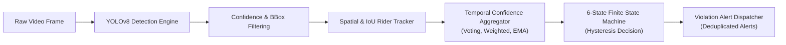
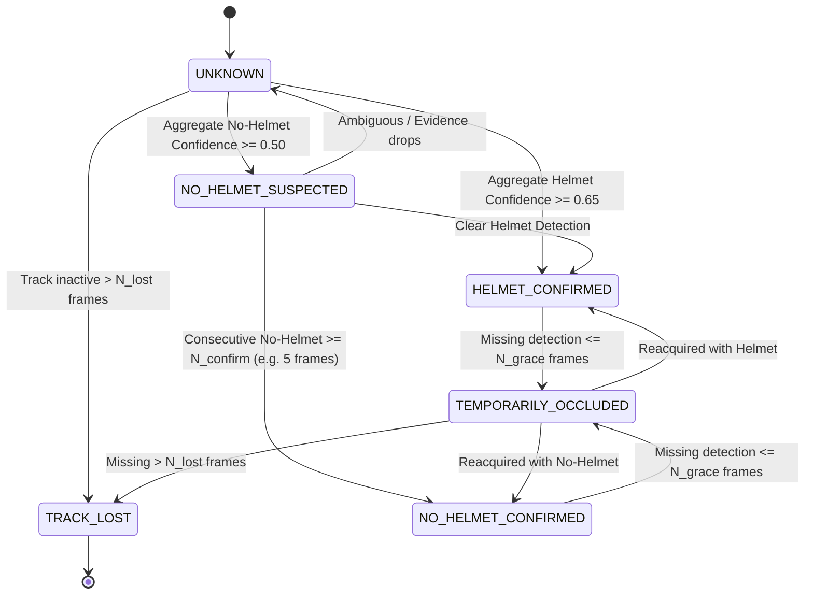

# Phase 10: Confidence-Aware Temporal Verification Framework — System Design

**Project:** An Integrated Dual-Camera Framework for Context-Aware Motorcycle Helmet Violation Detection with Confidence-Aware Temporal Verification  
**Author:** Senior Computer Vision Research Engineer & Kaggle Execution Agent  
**Date:** November 2026  
**Status:** Architecture Specification & Reference Implementation  

---

## 1. Executive Summary & Research Motivation

Single-frame object detection models, such as YOLOv8, evaluate each video frame independently. In real-world roadside traffic surveillance, single-frame decisions suffer from several systemic failure modes:
1. **Transient Classification Jitter:** A helmeted rider may momentarily yield a low-confidence false positive `no_helmet` detection due to motion blur, partial visor reflection, or lighting changes.
2. **False Alert Cascades:** Directly dispatching roadside citation alerts from single-frame detections causes unacceptable false violation rates, eroding public trust and overwhelming enforcement agencies.
3. **Severe Head Occlusions:** As motorcycles pass behind signposts, street trees, or other vehicles, temporary occlusion causes bounding box drops, which naïve systems treat as separate new tracks upon reappearance.
4. **Asymmetric Risk Profile:** Falsely penalizing a compliant citizen (False Violation Alert) carries significantly greater legal and social consequences than delaying a violation notice by 300–600 milliseconds to confirm persistence.

To resolve these challenges, **Phase 10** develops a **Confidence-Aware Temporal Verification Framework**. This engine sits downstream of the object detector, aggregating per-frame detections across tracked rider trajectories using principled temporal filtering, track state machines, and hysteresis logic.



---

## 2. System Architecture & Component Breakdown

The framework is partitioned into modular, highly decoupled sub-packages:

```text
src/
├── temporal/
│   ├── __init__.py
│   ├── state_machine.py         # 6-state temporal FSM with hysteresis
│   ├── confidence_aggregator.py  # Voting, Confidence-Weighted, & EMA smoothers
│   ├── rider_tracker.py         # IoU association & trajectory lifecycle manager
│   ├── violation_decision.py     # Hysteresis gating & alert deduplication logic
│   └── temporal_engine.py       # Central orchestrator integrating all components
├── video/
│   ├── __init__.py
│   ├── frame_processor.py       # Frame extraction, pre-processing, rendering
│   └── video_pipeline.py        # Stream and file playback inference manager
└── evaluation/
    ├── __init__.py
    ├── temporal_metrics.py      # Stability, alert latency, abstention metrics
    └── event_evaluator.py       # Synthetic and sequence-level test evaluators
```

### 2.1 Video Stream & Detection Pre-Filtering
- **Detection Confidence Threshold ($\tau_{det}$):** Initial bounding boxes below $\tau_{det} = 0.25$ are discarded prior to tracking to suppress background noise.
- **Bounding Box Format:** Standard `[x1, y1, x2, y2]` in pixel coordinates, accompanied by class label ($0 = \text{no\_helmet}, 1 = \text{helmet}$) and scalar confidence score $c \in [0.0, 1.0]$.

### 2.2 Rider Tracking & Association (`RiderTracker`)
- **Association Metric:** Intersection over Union ($\text{IoU}$) matching between predicted track locations and incoming detections.
- **Match Threshold:** $\tau_{iou} = 0.30$. Unmatched detections initiate candidate tracks; unmatched existing tracks transition into temporary occlusion buffering.
- **Track Lifecycle:**
  - `TENTATIVE`: Initial 1–2 frames; evidence accumulating before formal activation.
  - `ACTIVE`: Actively updated with new detections.
  - `OCCLUDED`: Missing detections for $\le N_{grace}$ frames (default: 5 frames at 30 fps $\approx 167\text{ ms}$).
  - `LOST`: Inactive for $> N_{lost}$ frames (default: 15 frames $\approx 500\text{ ms}$). Permanently purged.

---

## 3. Six-State Temporal Finite State Machine (FSM)

Each active track maintains an internal state $S(t) \in \mathcal{S}$:

$$\mathcal{S} = \{\text{UNKNOWN}, \text{HELMET\_CONFIRMED}, \text{NO\_HELMET\_SUSPECTED}, \text{NO\_HELMET\_CONFIRMED}, \text{TEMPORARILY\_OCCLUDED}, \text{TRACK\_LOST}\}$$



### 3.1 State Semantics & Invariants
1. **`UNKNOWN` (Default Initial State):**
   - Invariant: Accumulated observation count $N_{obs} < N_{min\_frames}$ or neither class satisfies confidence criteria.
   - Action: The system abstains from issuing citations.
2. **`HELMET_CONFIRMED`:**
   - Invariant: Rider exhibits continuous or dominant helmet presence ($C_{helmet} \ge \tau_{helmet}$).
   - Action: Compliant track; alert generation suppressed.
3. **`NO_HELMET_SUSPECTED`:**
   - Invariant: Potential violation detected ($C_{no\_helmet} \ge \tau_{suspect}$), but observation length has not yet satisfied the mandatory verification window $N_{confirm}$.
   - Action: Buffer frames; prepare evidence log. No citation emitted.
4. **`NO_HELMET_CONFIRMED`:**
   - Invariant: Unbroken or strongly weighted violation evidence sustained across $N_{confirm}$ frames, with temporal confidence exceeding $\tau_{violation}$.
   - Action: Emits authoritative Violation Alert Event. Sets alert latch to prevent duplicate spamming.
5. **`TEMPORARILY_OCCLUDED`:**
   - Invariant: Track was previously active, but detector produced no bounding box for $1 \le k \le N_{grace}$ consecutive frames.
   - Action: Preserves prior state and velocity projection; prevents premature track fragmentation.
6. **`TRACK_LOST`:**
   - Invariant: Target disappeared for $> N_{lost}$ frames or moved outside frame boundaries.
   - Action: Terminal state. Archival of trajectory statistics.

---

## 4. Confidence Aggregation Formulations

We formulate and evaluate three distinct mathematical aggregation operators over a sliding temporal window of size $W$:

$$\mathcal{W}_t = \{(y_i, c_i)\}_{i=t-W+1}^t$$

where $y_i \in \{0, 1\}$ ($0 = \text{no\_helmet}, 1 = \text{helmet}$) and $c_i \in [0, 1]$.

### 4.1 Approach 1: Simple Temporal Voting
Unweighted majority rule across non-empty detections in window $\mathcal{W}_t$:

$$V_{no\_helmet} = \frac{1}{|\mathcal{W}_t|} \sum_{i \in \mathcal{W}_t} \mathbb{I}(y_i = 0)$$

$$V_{helmet} = \frac{1}{|\mathcal{W}_t|} \sum_{i \in \mathcal{W}_t} \mathbb{I}(y_i = 1)$$

- **Limitation:** Fails to distinguish between a marginal detection ($c = 0.26$) and an authoritative detection ($c = 0.98$).

### 4.2 Approach 2: Confidence-Weighted Temporal Aggregation
Normalizes raw observation confidence so high-confidence detections carry greater evidentiary weight:

$$\bar{C}_{no\_helmet} = \frac{\sum_{i \in \mathcal{W}_t} c_i \cdot \mathbb{I}(y_i = 0)}{\sum_{i \in \mathcal{W}_t} c_i + \epsilon}$$

$$\bar{C}_{helmet} = \frac{\sum_{i \in \mathcal{W}_t} c_i \cdot \mathbb{I}(y_i = 1)}{\sum_{i \in \mathcal{W}_t} c_i + \epsilon}$$

- **Advantage:** Low-confidence false detections cannot overturn consistent high-confidence correct classifications.

### 4.3 Approach 3: Exponential Moving Average (EMA) Smoothing
Provides infinite-impulse response smoothing with recency weighting:

$$S_t = \alpha \cdot \tilde{y}_t \cdot c_t + (1 - \alpha) \cdot S_{t-1}$$

where $\tilde{y}_t \in \{-1, +1\}$ ($-1$ for no helmet, $+1$ for helmet) and $\alpha \in (0, 1)$ (default: $\alpha = 0.35$).
- **Advantage:** Highly reactive to genuine transitions while suppressing single-frame high-frequency noise spikes.

---

## 5. Violation Decision & Hysteresis

To eliminate alert flicker, the decision engine incorporates dual-threshold hysteresis:
- **Confirmation Threshold ($\tau_{confirm} = 0.70$):** A transition to `NO_HELMET_CONFIRMED` requires aggregated violation confidence $\ge 0.70$ sustained over at least $N_{confirm} = 5$ frames ($\approx 167\text{ ms}$).
- **De-escalation Threshold ($\tau_{clear} = 0.40$):** Once confirmed, a track only reverts from `NO_HELMET_CONFIRMED` if aggregated violation confidence falls strictly below $0.40$ or strong helmet evidence ($\ge 0.75$) appears for at least 3 frames.
- **Alert Deduplication Latch:** Each track ID generates at most **one** primary citation event per trajectory traversal across the camera field-of-view.

---

## 6. Controlled Synthetic Evaluation Suite

Because real synchronized dual-camera video with frame-level and track-level ground truth annotations is not provided in the raw repository datasets, scientific integrity demands that we:
1. Clearly state the lack of real multi-camera video annotations.
2. Construct a rigorous synthetic test framework covering every edge case:
   - **Scenario 1 (Stable Helmet):** Rider with constant helmet detections ($c \in [0.85, 0.98]$) for 30 frames. Must remain in `HELMET_CONFIRMED` with 0 false alerts.
   - **Scenario 2 (Stable Violation):** Rider without helmet ($c \in [0.80, 0.95]$) for 30 frames. Must confirm violation at frame $\sim 5$ and trigger exactly 1 alert.
   - **Scenario 3 (Single-Frame False Positive Burst):** Helmeted rider with 1–2 spurious `no_helmet` frames interspersed. System must filter out burst and suppress false alerts.
   - **Scenario 4 (Short Occlusion):** Violation rider occluded for 4 frames ($< N_{grace}$). Track must transition to `TEMPORARILY_OCCLUDED` and resume without losing track identity.
   - **Scenario 5 (Extended Occlusion & Track Expiration):** Track occluded for 20 frames ($> N_{lost}$). Must transition to `TRACK_LOST` and clean up memory.
   - **Scenario 6 (Marginal Confidence Jitter):** Low-confidence alternating predictions ($c \in [0.25, 0.35]$). System must abstain and remain in `UNKNOWN`.
   - **Scenario 7 (Multi-Rider Scene):** Two simultaneous riders (one helmeted, one non-helmeted). Verification must track and classify both independently without identity crosstalk.

---

## 7. Limitations & Scope Constraints
- **Single-Camera Scope:** This Phase 10 implementation evaluates single-stream temporal verification. It does not perform cross-camera homography or inter-camera re-identification (which belongs to downstream multi-camera integration).
- **Tracker Occlusion Re-identification:** Long-term re-identification across minutes or camera blind spots is outside this module's scope; re-identification relies on local spatial continuity.
