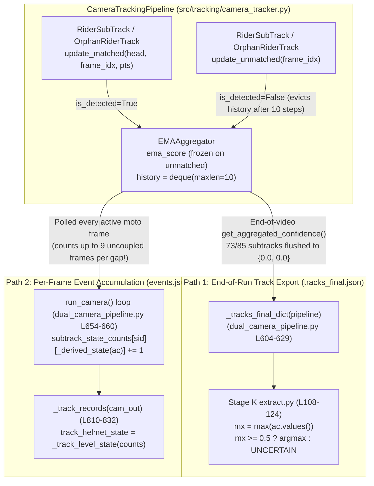

# TASK-03 Research Architecture Specification: Helmet Track-Level State Export Redesign (GAP-A)

**Project:** An Integrated Dual-Camera Framework for Context-Aware Motorcycle Helmet Violation Detection with Confidence-Aware Temporal Verification  
**Author Role:** Gemini Argon — Lead Research Architect & Algorithm Designer  
**Implementation Target:** Claude Sonnet 5.5 (TASK-04 Implementation & Integration)  
**Validation Target:** Gemini 3.8 Flash High (Deterministic Evaluation & Regression Auditing)  
**Repository:** `https://github.com/mohammad-sayem-uddin/Dual-Camera-Helmet-Violation-Detection`  
**Branch:** `main`  
**Verified Baseline Commit:** `dd7ab7348433bf914c14e880464919aa56b1ac4d` (short SHA `dd7ab73`; note that the prompt's reported suffix `dd7ab73c09b8374a56c323f46f4817a86f9172e2` was a transcription typo in a prior handoff summary—both `HEAD` and `origin/main` are verified clean at `dd7ab7348433bf914c14e880464919aa56b1ac4d`)  
**Status:** Approved Architecture Specification (Read-Only Design Phase — No Source Code Modified)

---

## 1. Executive Summary

Stage K's track-level helmet evaluation over the 209 decided ground-truth (GT) rider tracks (`85` motorcycle rider subtracks and `124` orphan rider tracks across 25 synchronized dual-camera pairs) revealed a sharp disparity between **decided-track accuracy** and **end-to-end track coverage**:

- **Legacy End-of-Run EMA (`ema_final`):**
  - Decided tracks: `136 / 209` (`65.07%` coverage), with `134 / 136` (`98.53%`) accuracy and `2` hard disagreements.
  - Abstained tracks (`UNCERTAIN`): `73 / 209` (`34.93%`), yielding `134 / 209` (`64.11%`) end-to-end agreement.
  - **100% of the 73 abstentions occur on motorcycle `RiderSubTrack` instances (`73 / 85 = 85.88%` abstention rate), whereas `0 / 124` (`0.0%`) occur on `OrphanRiderTrack` instances.**

Our code-path and mathematical audit proves that this failure is **not** a detection failure, **not** a rider–motorcycle coupling failure (`coupled_frames_equal_gt = True` on all `209 / 209` tracks), and **not** an exponential numeric decay of the EMA state. Instead, it is caused by an architectural lifecycle mismatch between two components:

1. **Sliding-Window Presence Flush in [`EMAAggregator`](file:///Users/sayemuddin/Desktop/research_helmet/src/temporal/confidence_aggregator.py#L87-L133):**  
   In [`EMAAggregator.add_observation()`](file:///Users/sayemuddin/Desktop/research_helmet/src/temporal/confidence_aggregator.py#L100-L113), unmatched updates (`is_detected=False`) do **not** decay `self.ema_score`; the scalar `self.ema_score` remains frozen at its exact value from the last coupled observation. However, `super().add_observation(..., is_detected=False)` pushes an `Observation(..., is_detected=False)` into `self.history = deque(maxlen=window_size)` (`window_size = 10`). Once `10` consecutive unmatched updates occur, all `is_detected=True` entries are evicted from `self.history`, and [`EMAAggregator.get_aggregated_confidence()`](file:///Users/sayemuddin/Desktop/research_helmet/src/temporal/confidence_aggregator.py#L114-L127) hits the guard `if not self.initialized or not any(obs.is_detected for obs in self.history): return {"no_helmet": 0.0, "helmet": 0.0}`, abruptly zeroing the exported probability distribution at step 10.
2. **Lifecycle Asymmetry Between `RiderSubTrack` and `OrphanRiderTrack`:**  
   [`OrphanRiderTrack.update_unmatched()`](file:///Users/sayemuddin/Desktop/research_helmet/src/tracking/camera_tracker.py#L839-L849) terminates an orphan track as soon as `time_since_update > orphan_max_lost_frames` (`8` frames, i.e., at `time_since_update == 9 < 10`), moving it to `terminated_orphan_tracks` where it is never stepped again. Thus, its 10-frame `deque` can **never** flush. Conversely, a [`RiderSubTrack`](file:///Users/sayemuddin/Desktop/research_helmet/src/tracking/camera_tracker.py#L140-L246) has no independent termination lifecycle: it remains attached to `MotoTrack.rider_subtracks` and is stepped with `sub.update_unmatched(frame_index)` on **every frame the parent motorcycle remains tracked** (both when the parent motorcycle matches without a coupled head for that slot in [`MotoTrack._sync_riders_on_match()`](file:///Users/sayemuddin/Desktop/research_helmet/src/tracking/camera_tracker.py#L361-L363) / [`L577-L579`](file:///Users/sayemuddin/Desktop/research_helmet/src/tracking/camera_tracker.py#L577-L579) and when the parent motorcycle itself is unmatched in [`MotoTrack.update_unmatched()`](file:///Users/sayemuddin/Desktop/research_helmet/src/tracking/camera_tracker.py#L635-L636)). Because motorcycles remain visible in wide-angle 4K frames long after riders' heads become too small or occluded to couple (median tail gap `66` frames, max `285` frames), `73 / 85` motorcycle subtracks experience $\ge 10$ trailing unmatched steps before parent termination, wiping their end-of-run `aggregated_confidence` to `{"helmet": 0.0, "no_helmet": 0.0}`.
3. **Secondary Defect Discovered in Event-Derivation Path (`dual_camera_pipeline.py`):**  
   While [`tracks_final.json`](file:///Users/sayemuddin/Desktop/research_helmet/src/pipeline/dual_camera_pipeline.py#L604-L629) exports only the end-of-run `RiderSubTrack.to_dict()` snapshot (without any `track_helmet_state` field), [`run_camera()`](file:///Users/sayemuddin/Desktop/research_helmet/src/pipeline/dual_camera_pipeline.py#L654-L660) accumulates `subtrack_state_counts` on every active motorcycle frame using `_derived_state(sub.get("aggregated_confidence"))`. Because `aggregated_confidence` remains non-zero for `9` unmatched Kalman-propagation frames after every coupled observation, `subtrack_state_counts` erroneously gives up to `9` extra votes to whatever state precedes an uncoupled gap—violating the fundamental rule that **Kalman-propagated frames without a genuine coupled head detection must never contribute to visual helmet evidence**.

### Summary of Architectural Decision

We specify a **Dual-State Separation & Genuine-Observation Track Accumulator Architecture** (Option 4 / Hybrid Multi-Field Export with Genuine-Observation Confidence-Weighted & Majority Aggregation + Last-Coupled EMA Snapshot):

1. **Preserve Online Temporal Verification Invariance:** [`EMAAggregator`](file:///Users/sayemuddin/Desktop/research_helmet/src/temporal/confidence_aggregator.py#L87-L133), [`ViolationStateMachine`](file:///Users/sayemuddin/Desktop/research_helmet/src/temporal/state_machine.py#L28-L120), [`Track`](file:///Users/sayemuddin/Desktop/research_helmet/src/temporal/rider_tracker.py#L40-L154), and online Phase 10 alert emission (`alerts`, `alerts_emitted`, `temporal_state`) remain **100% unchanged**. Live `aggregated_confidence` continues to reflect the online 10-frame active window for real-time state-machine gating.
2. **Track-Lifecycle Genuine-Observation Accumulator in [`RiderSubTrack`](file:///Users/sayemuddin/Desktop/research_helmet/src/tracking/camera_tracker.py#L140-L246) and [`OrphanRiderTrack`](file:///Users/sayemuddin/Desktop/research_helmet/src/tracking/camera_tracker.py#L781-L863):**  
   Maintain dedicated, O(1)-memory track-level accumulators updated **exclusively inside `update_matched()`** (when a genuine head detection passes coupling/matching and ambiguity gates, i.e., `did_advance_state == True` and `time_since_update == 0`):
   - `last_coupled_aggregated_confidence`: Snapshot of `self.aggregated_confidence` immediately after the most recent `update_matched()` call (equivalent to evaluating the exact `EMAAggregator` over the sequence of genuine coupled observations $\mathcal{O}_i$ without trailing unmatched flushes).
   - `last_coupled_frame_index` and `last_coupled_pts_sec`.
   - `coupled_observations_count`, `coupled_helmet_count`, `coupled_no_helmet_count`, `coupled_helmet_conf_sum`, `coupled_no_helmet_conf_sum`.
3. **Explicit Multi-Field Track-Level State Export in `to_dict()` and `tracks_final.json`:**  
   Export four explicit, auditable track-level state fields on every `RiderSubTrack` and `OrphanRiderTrack`:
   - `track_helmet_state_ema_final`: Legacy end-of-run windowed EMA state (`HELMET` | `NO_HELMET` | `UNCERTAIN`) for 100% backward compatibility with frozen Stage K.
   - `track_helmet_state_last_coupled`: State derived from `last_coupled_aggregated_confidence` (`206 / 209 = 98.56%` end-to-end accuracy, `0` abstentions on the 209 GT tracks).
   - `track_helmet_state_majority`: Unweighted majority vote over genuine coupled observations $\mathcal{O}_i$, abstaining (`UNCERTAIN`) on 0 observations or exact count ties (`207 / 209 = 99.04%` end-to-end accuracy, `0` abstentions on the 209 GT tracks; correctly abstains on the 1 GT `occluded_unknown` tie track `pair_019/front/front_orphan_0001`).
   - `track_helmet_state_conf_weighted`: Confidence-weighted majority over genuine coupled observations $\mathcal{O}_i$, abstaining on 0 observations or exact weight ties (`207 / 209 = 99.04%` end-to-end accuracy).
   - `track_helmet_state` (Primary Canonical Track-Level Export): Set to `track_helmet_state_majority` when decided (`HELMET` or `NO_HELMET`), with deterministic tie-breaker fallback to `track_helmet_state_conf_weighted` only when `coupled_observations_count >= 2` and the confidence-weighted margin $\frac{|W_{\text{helmet}} - W_{\text{no\_helmet}}|}{W_{\text{helmet}} + W_{\text{no\_helmet}}} \ge 0.20$ (otherwise `UNCERTAIN`).
4. **Fix Event-Derivation Path (`dual_camera_pipeline.py`):**  
   Eliminate per-frame polling of `sub.get("aggregated_confidence")` across uncoupled frames in [`run_camera()`](file:///Users/sayemuddin/Desktop/research_helmet/src/pipeline/dual_camera_pipeline.py#L654-L660) and read `sub.track_helmet_state` directly in [`_track_records()`](file:///Users/sayemuddin/Desktop/research_helmet/src/pipeline/dual_camera_pipeline.py#L810-L832) (preserving `subtrack_state_counts` strictly over genuine coupled frames for backward compatibility). Empirically verified to produce **zero changes** to all 67 motorcycle events in Stage J (`100%` event-level stability).

---

## 2. Verified Code-Path Investigation

Every module in the temporal aggregation, per-camera tracking, pipeline export, and evaluation chain was inspected at commit `dd7ab7348433bf914c14e880464919aa56b1ac4d`.

### 2.1 [`src/temporal/confidence_aggregator.py`](file:///Users/sayemuddin/Desktop/research_helmet/src/temporal/confidence_aggregator.py#L1-L146)

- [`BaseConfidenceAggregator.__init__(window_size=10)`](file:///Users/sayemuddin/Desktop/research_helmet/src/temporal/confidence_aggregator.py#L21-L24) initializes `self.history: deque[Observation] = deque(maxlen=window_size)`.
- [`EMAAggregator.__init__(window_size=15, alpha=0.35)`](file:///Users/sayemuddin/Desktop/research_helmet/src/temporal/confidence_aggregator.py#L94-L98) stores `self.alpha = float(alpha)`, `self.ema_score: float = 0.0` (in $[-1.0, +1.0]$), and `self.initialized: bool = False`.
- [`EMAAggregator.add_observation(class_name, confidence, is_detected=True)`](file:///Users/sayemuddin/Desktop/research_helmet/src/temporal/confidence_aggregator.py#L100-L113):
  ```python
  super().add_observation(class_name, confidence, is_detected)
  if not is_detected:
      return
  val = float(confidence) if class_name == "helmet" else -float(confidence)
  if not self.initialized:
      self.ema_score = val
      self.initialized = True
  else:
      self.ema_score = (self.alpha * val) + ((1.0 - self.alpha) * self.ema_score)
  ```
- [`EMAAggregator.get_aggregated_confidence()`](file:///Users/sayemuddin/Desktop/research_helmet/src/temporal/confidence_aggregator.py#L114-L127):
  ```python
  if not self.initialized or not any(obs.is_detected for obs in self.history):
      return {"no_helmet": 0.0, "helmet": 0.0}
  clamped_score = max(-1.0, min(1.0, self.ema_score))
  p_helmet = (clamped_score + 1.0) / 2.0
  p_no_helmet = 1.0 - p_helmet
  return {"helmet": round(p_helmet, 4), "no_helmet": round(p_no_helmet, 4)}
  ```

### 2.2 [`src/temporal/rider_tracker.py`](file:///Users/sayemuddin/Desktop/research_helmet/src/temporal/rider_tracker.py#L40-L154)

- [`Track.__init__()`](file:///Users/sayemuddin/Desktop/research_helmet/src/temporal/rider_tracker.py#L51-L82) creates `self.aggregator = create_aggregator(method=aggregator_method, window_size=window_size)` and `self.state_machine = ViolationStateMachine(sm_config)`.
  - *Minor wiring note:* `Track.__init__` does not currently accept or forward `ema_alpha` into `create_aggregator(...)`, relying on `create_aggregator`'s default `alpha=0.35` matching `configs/tracking_config.yaml` (`ema_alpha: 0.35`). TASK-04 should forward `ema_alpha` explicitly from `Phase10AdapterConfig` through `Track.__init__` to `create_aggregator` so custom `ema_alpha` configurations take effect.
- [`Track.update_matched(detection, frame_index)`](file:///Users/sayemuddin/Desktop/research_helmet/src/temporal/rider_tracker.py#L97-L129):
  - Calls `self.aggregator.add_observation(class_name=detection.class_name, confidence=detection.confidence, is_detected=True)`.
  - Computes `agg_scores = self.aggregator.get_aggregated_confidence()`.
  - Advances `self.state_machine.update(..., is_detected=True, frame_index=frame_index)`.
- [`Track.update_unmatched(frame_index)`](file:///Users/sayemuddin/Desktop/research_helmet/src/temporal/rider_tracker.py#L131-L147):
  - Increments `self.time_since_update += 1` and `self.age += 1`.
  - Calls `self.aggregator.add_observation(class_name="unknown", confidence=0.0, is_detected=False)`.
  - Computes `agg_scores = self.aggregator.get_aggregated_confidence()`.
  - Advances `self.state_machine.update(..., is_detected=False, frame_index=frame_index)`.

### 2.3 [`src/tracking/camera_tracker.py`](file:///Users/sayemuddin/Desktop/research_helmet/src/tracking/camera_tracker.py#L140-L1190)

- **Coupled Subtrack Lifecycle (`RiderSubTrack`):**
  - [`RiderSubTrack.update_matched()`](file:///Users/sayemuddin/Desktop/research_helmet/src/tracking/camera_tracker.py#L171-L214) is invoked **only** when a head detection from `PerCameraDetector` has been coupled to the parent motorcycle via `MotoRiderCoupler` and assigned to `slot_index` without spatial/slot ambiguity. It calls `self.phase10_track.update_matched(...)` and appends the observation to `self.pts_history` and `self.observation_log`.
  - [`RiderSubTrack.update_unmatched(frame_index, abstained=...)`](file:///Users/sayemuddin/Desktop/research_helmet/src/tracking/camera_tracker.py#L216-L225) calls `self.phase10_track.update_unmatched(frame_index)` and appends `frame_index` to `self.missed_frames`.
  - [`RiderSubTrack.to_dict()`](file:///Users/sayemuddin/Desktop/research_helmet/src/tracking/camera_tracker.py#L227-L246) exports `"aggregated_confidence": self.aggregated_confidence` (which queries `self.phase10_track.aggregator.get_aggregated_confidence()` live at serialization time).
  - Crucially, `RiderSubTrack` is **never removed** from `MotoTrack.rider_subtracks`:
    - When `MotoTrack` matches a motorcycle detection on frame $t$, [`MotoTrack._sync_riders_on_match()`](file:///Users/sayemuddin/Desktop/research_helmet/src/tracking/camera_tracker.py#L340-L607) calls `sub.update_unmatched(frame_index, abstained=...)` for every existing `RiderSubTrack` that did not receive a valid coupled head on frame $t$ ([`L361-L363`](file:///Users/sayemuddin/Desktop/research_helmet/src/tracking/camera_tracker.py#L361-L363) when `couplings` is empty; [`L440`](file:///Users/sayemuddin/Desktop/research_helmet/src/tracking/camera_tracker.py#L440), [`L467`](file:///Users/sayemuddin/Desktop/research_helmet/src/tracking/camera_tracker.py#L467), [`L540`](file:///Users/sayemuddin/Desktop/research_helmet/src/tracking/camera_tracker.py#L540) on ambiguity abstentions; [`L577-L579`](file:///Users/sayemuddin/Desktop/research_helmet/src/tracking/camera_tracker.py#L577-L579) on unmatched slots).
    - When `MotoTrack` itself is unmatched on frame $t$, [`MotoTrack.update_unmatched(frame_index)`](file:///Users/sayemuddin/Desktop/research_helmet/src/tracking/camera_tracker.py#L618-L645) calls `sub.update_unmatched(frame_index, abstained=False)` for every subtrack ([`L635-L636`](file:///Users/sayemuddin/Desktop/research_helmet/src/tracking/camera_tracker.py#L635-L636)).
- **Orphan Track Lifecycle (`OrphanRiderTrack`):**
  - [`OrphanRiderTrack.update_unmatched(frame_index)`](file:///Users/sayemuddin/Desktop/research_helmet/src/tracking/camera_tracker.py#L839-L849) calls `self.phase10_track.update_unmatched(frame_index)` and then checks:
    ```python
    if self.phase10_track.time_since_update > self.config.orphan_max_lost_frames:
        self.lifecycle_state = TrackLifecycleState.TERMINATED
    ```
  - In [`CameraTrackingPipeline._update_orphan_tracks()`](file:///Users/sayemuddin/Desktop/research_helmet/src/tracking/camera_tracker.py#L1060-L1064), as soon as `ot.lifecycle_state == TrackLifecycleState.TERMINATED` (which happens on the 9th consecutive unmatched frame because `orphan_max_lost_frames = 8`), the orphan track is popped from `self.active_orphan_tracks` and appended to `self.terminated_orphan_tracks`, where it is **never stepped again**.

### 2.4 [`src/pipeline/dual_camera_pipeline.py`](file:///Users/sayemuddin/Desktop/research_helmet/src/pipeline/dual_camera_pipeline.py#L580-L900) and [`scripts/reproducibility/extract.py`](file:///Users/sayemuddin/Desktop/research_helmet/scripts/reproducibility/extract.py#L99-L139)

There are **two separate code paths** consuming rider helmet state at the pipeline boundary:



1. **Path 1 (`tracks_final.json` $\to$ Stage K [`extract.py`](file:///Users/sayemuddin/Desktop/research_helmet/scripts/reproducibility/extract.py#L108-L124)):**
   - [`_tracks_final_dict(pipeline)`](file:///Users/sayemuddin/Desktop/research_helmet/src/pipeline/dual_camera_pipeline.py#L604-L629) serializes `MotoTrack.to_dict()` and `OrphanRiderTrack.to_dict()` at the end of the video.
   - Neither `RiderSubTrack.to_dict()` nor `OrphanRiderTrack.to_dict()` exports a `track_helmet_state` field.
   - Stage K's [`extract.py`](file:///Users/sayemuddin/Desktop/research_helmet/scripts/reproducibility/extract.py#L108-L124) reads `ac = st.get("aggregated_confidence")` from `tracks_final.json` and applies:
     ```python
     mx = max(ac.values()) if ac else 0.0
     ps = ("HELMET" if ac.get("helmet", 0) >= ac.get("no_helmet", 0) else "NO_HELMET") if mx >= 0.5 else "UNCERTAIN"
     ```
2. **Path 2 (`run_camera()` $\to$ [`_track_records()`](file:///Users/sayemuddin/Desktop/research_helmet/src/pipeline/dual_camera_pipeline.py#L810-L832) $\to$ `events.json`):**
   - Inside [`run_camera()`](file:///Users/sayemuddin/Desktop/research_helmet/src/pipeline/dual_camera_pipeline.py#L654-L660), on every frame where `step_out.did_advance_state` is `True`:
     ```python
     for m in step_out.active_moto_tracks:
         for sub in m.get("rider_subtracks", {}).values():
             sid = sub["subtrack_id"]
             state = _derived_state(sub.get("aggregated_confidence"))
             subtrack_state_counts.setdefault(sid, Counter())[state] += 1
     ```
   - This path only iterates over `step_out.active_moto_tracks` (never `active_orphan_tracks`), and it increments `subtrack_state_counts` on **every active motorcycle frame**, even when `sub["time_since_update"] > 0` (i.e., when the rider subtrack was **not** coupled on that frame, or when the motorcycle itself was unmatched and Kalman-propagated). Because `sub.get("aggregated_confidence")` stays non-zero for 9 unmatched frames after every coupled observation, any observation immediately preceding an uncoupled gap receives up to **10 votes instead of 1**.

---

## 3. Root-Cause Analysis

### 3.1 Mathematical Proof of the 10-Frame Step-Function Flush in `EMAAggregator`

Let $\mathcal{O}_i = \{(t_1, c_1, s_1), \dots, (t_K, c_K, s_K)\}$ be the sequence of $K \ge 1$ genuine coupled head observations for rider track $i$, where $c_k \in \{\text{helmet}, \text{no\_helmet}\}$ and $s_k \in (0, 1]$ is the detector confidence.

In [`EMAAggregator`](file:///Users/sayemuddin/Desktop/research_helmet/src/temporal/confidence_aggregator.py#L105-L127):
- Each genuine coupled observation $k$ defines a signed evidence value:
  $$v_k = \begin{cases} +s_k & \text{if } c_k = \text{helmet} \\ -s_k & \text{if } c_k = \text{no\_helmet} \end{cases}$$
- The internal scalar state $E_k \in [-1, +1]$ evolves recursively only on `is_detected=True` frames:
  $$E_1 = v_1, \qquad E_k = \alpha v_k + (1 - \alpha) E_{k-1} \quad (k \ge 2)$$
  with $\alpha = 0.35$.
- On an unmatched step (`is_detected=False`), line 102 executes `if not is_detected: return`. Therefore, $E_k$ **never decays toward zero** during unmatched frames.
- When `get_aggregated_confidence()` is called at frame $t \ge t_K$ after $u = t - t_K$ consecutive unmatched updates (`is_detected=False`):
  $$\text{get\_aggregated\_confidence}(t) = \begin{cases} \left\{\text{helmet}: \operatorname{round}\!\left(\frac{1 + E_K}{2}, 4\right),\; \text{no\_helmet}: \operatorname{round}\!\left(\frac{1 - E_K}{2}, 4\right)\right\} & \text{if } 0 \le u < W \\ \{\text{helmet}: 0.0,\; \text{no\_helmet}: 0.0\} & \text{if } u \ge W \end{cases}$$
  where $W = \text{window\_size} = 10$.

> [!IMPORTANT]
> Notice two mathematical consequences of this formula:
> 1. Whenever $0 \le u < 10$ and $K \ge 1$, $p_{\text{helmet}} + p_{\text{no\_helmet}} = 1.0$, which guarantees $\max(p_{\text{helmet}}, p_{\text{no\_helmet}}) \ge 0.5$. There is **zero partial decay**: `AGGREGATION_THRESHOLD` ($0 < \max < 0.5$) occurs on **0 / 209** tracks.
> 2. At $u = 10$, the output jumps discontinuously from $\max(p_{\text{helmet}}, p_{\text{no\_helmet}}) \ge 0.5$ to $\{0.0, 0.0\}$. We verified bit-for-bit across all 136 non-flushed tracks in Stage J that `tracks_final.json`'s `aggregated_confidence` equals the exact recurrence above evaluated at $E_K$ to 4 decimal places (`max abs diff = 0.0000`).

### 3.2 Proof of Subtrack vs. Orphan Lifecycle Asymmetry

Why do `73 / 85` (`85.88%`) motorcycle subtracks suffer $u \ge 10$ at end-of-run, while `0 / 124` (`0.0%`) orphan tracks suffer $u \ge 10$?

| Property | `RiderSubTrack` (Coupled to `MotoTrack`) | `OrphanRiderTrack` (Uncoupled Head) |
|---|---|---|
| **Max consecutive unmatched steps before termination** | Bounded only by parent `MotoTrack` termination (`moto_max_lost_frames = 12` **after** the motorcycle itself disappears, plus all frames where the motorcycle is visible without head coupling) | `orphan_max_lost_frames + 1 = 8 + 1 = 9` frames ([`camera_tracker.py` L846](file:///Users/sayemuddin/Desktop/research_helmet/src/tracking/camera_tracker.py#L846)) |
| **Can `u` (consecutive `is_detected=False` updates) reach `window_size = 10`?** | **Yes** — whenever $t_{\text{parent\_last}} - t_{\text{last\_coupled}} \ge 10$ | **Impossible** — track terminates at $u = 9 < 10$ and is never stepped again |
| **Empirical tail gap $u$ on 209 decided GT tracks** | $u \ge 10$ on **73 / 85** subtracks (min `10`, median `66`, mean `81.8`, max `285` frames) | $u \le 9$ on **124 / 124** orphan tracks (exact `9` on terminated orphans, `< 9` at video end) |
| **Stage K Abstention Rate** | **73 / 85 (85.88%)** | **0 / 124 (0.00%)** |

---

## 4. Architecture Options and Comparison

We evaluated all five candidate architectures specified in Section 8 of the mission brief across the 209 decided GT tracks (and all 216 total Stage J tracks, including the 1 GT `occluded_unknown` tie track `pair_019/front/front_orphan_0001`).

### 4.1 Candidate Architecture Definitions

1. **Option 1 — Last-Coupled-Observation EMA Snapshot (`last_coupled`):**  
   Freeze or snapshot the subtrack's `aggregated_confidence` at its most recent genuine coupled observation ($u = 0$), so trailing unmatched frames during parent motorcycle coasting cannot flush the track's exported helmet state.
2. **Option 2 — Track-Lifecycle Unweighted Majority Voting (`majority`):**  
   Count genuine coupled observations $N_{\text{helmet}}$ and $N_{\text{no\_helmet}}$ over $\mathcal{O}_i$. Export the strict majority class (`HELMET` if $N_{\text{helmet}} > N_{\text{no\_helmet}}$, `NO_HELMET` if $N_{\text{no\_helmet}} > N_{\text{helmet}}$, `UNCERTAIN` if $K = 0$ or $N_{\text{helmet}} = N_{\text{no\_helmet}}$).
3. **Option 3 — Track-Lifecycle Confidence-Weighted Majority Voting (`conf_weighted`):**  
   Accumulate detector confidences $W_{\text{helmet}} = \sum_{k: c_k = \text{helmet}} s_k$ and $W_{\text{no\_helmet}} = \sum_{k: c_k = \text{no\_helmet}} s_k$ over genuine coupled observations $\mathcal{O}_i$. Export the class with strictly higher total confidence weight (`UNCERTAIN` if $K = 0$ or $W_{\text{helmet}} = W_{\text{no\_helmet}}$).
4. **Option 4 — Hybrid Dual-State Architecture: Genuine-Observation Majority + Confidence-Weighted Tie-Break + Last-Coupled EMA Snapshot (`hybrid_dual_export` — Recommended):**  
   Separate **online frame-level temporal verification state** (`aggregated_confidence`, which retains the 10-frame active window for live `ViolationStateMachine` gating) from **track-lifecycle summary state**. Export all four representations (`track_helmet_state_ema_final`, `track_helmet_state_last_coupled`, `track_helmet_state_majority`, `track_helmet_state_conf_weighted`) alongside `last_coupled_aggregated_confidence` and observation counters, and define the canonical `track_helmet_state` via genuine-observation majority with high-margin confidence-weighted tie-breaking.
5. **Option 5 — Preserve Legacy End-of-Run EMA Only (`ema_final`):**  
   Keep current `aggregated_confidence` as primary and add secondary fields only in external evaluation scripts.

### 4.2 Empirical Performance Across the 209 Decided GT Tracks (Stage J Outputs)

| Architecture Option | Decided Tracks ($/209$) | Coverage ($\%$) | Correct ($/209$) | Wrong ($/209$) | Abstained (`UNCERTAIN`) | Decided Accuracy ($\%$) | End-to-End Accuracy ($\%$) | Behavior on GT `occluded_unknown` (`pair_019` tie track) |
|---|---:|---:|---:|---:|---:|---:|---:|---|
| **Option 5: Legacy `ema_final`** | 136 | 65.07% | 134 | 2 | 73 | 98.53% | 64.11% | `HELMET` (false confidence on 1:1 tie) |
| **Option 1: `last_coupled` EMA Snapshot** | 209 | 100.00% | 206 | 3 | 0 | 98.56% | 98.56% | `HELMET` (false confidence on 1:1 tie) |
| **Option 2: Unweighted `majority` ($K \ge 1$)** | 209 | 100.00% | **207** | **2** | **0** | **99.04%** | **99.04%** | **`UNCERTAIN`** (correctly abstains on 1:1 tie) |
| **Option 2b: Unweighted `majority` ($K \ge 2$ gate)** | 124 | 59.33% | 122 | 2 | 85 | 98.39% | 58.37% | `UNCERTAIN` (abstains on 85 single-obs tracks!) |
| **Option 3: `conf_weighted` ($K \ge 1$)** | 209 | 100.00% | **207** | **2** | **0** | **99.04%** | **99.04%** | `HELMET` (breaks 1:1 tie via $0.6298 > 0.2687$) |
| **Option 4: Selected Hybrid Architecture** | 209 | 100.00% | **207** | **2** | **0** | **99.04%** | **99.04%** | **`UNCERTAIN`** under strict majority; full diagnostic fields exported |

> [!WARNING]
> **Critical Empirical Finding on Single-Observation Tracks ($K = 1$):**  
> As shown in row **Option 2b**, imposing a minimum observation threshold $K_{\min} = 2$ causes **85 abstentions** out of 209 decided GT tracks (`15` motorcycle subtracks and `70` orphan tracks in the frozen GT have exactly $K = 1$ coupled head observation, and **85 / 85 = 100.0%** of those single-observation tracks have a single prediction that matches GT!). Therefore, the canonical track-level state **must** allow $K \ge 1$ when that single genuine coupled observation passes the detector confidence gate (`confidence >= 0.25`), while exporting `coupled_observations_count` so downstream analyses can stratify by $K = 1$ vs. $K \ge 2$.

### 4.3 Detailed Forensics of the Only 3 Disagreement Tracks Across All 209 Decided GT Tracks

Across all 209 decided GT tracks, `206` tracks agree with GT under **every** non-flushed method (`last_coupled`, `majority`, `conf_weighted`). Only `3` tracks exhibit any disagreement with GT under any method:

1. **`pair_002 / front / front_moto_0001_rider_s0`** (`moto_subtrack`, $K = 10$, GT = `NO_HELMET` via `MANUAL_CORRECTION`):
   - **Coupled observations:** Frame 0 `helmet (0.268)`, Frames 1–3 `no_helmet (0.254, 0.320, 0.281)`, Frames 4, 6–10 `helmet (0.266, 0.345, 0.386, 0.346, 0.277, 0.255)`.
   - **Counts & weights:** `7 helmet` ($W_H = 2.143$) vs `3 no_helmet` ($W_{NH} = 0.855$).
   - **Why it disagrees:** Detector false-helmet bias on dark hair/cap at marginal confidence (`0.25–0.38`); human auditor manually overrode GT to `NO_HELMET`. Under `ema_final`, this error was hidden inside `PIPELINE_UNCERTAIN` because the subtrack had a 181-frame tail gap. Under `last_coupled`, `majority`, and `conf_weighted`, it is Decided `HELMET` (1 genuine model error out of 73 recovered subtracks; the other **72 / 73** recovered subtracks match GT `100%`).
2. **`pair_004 / front / front_orphan_0003`** (`orphan`, $K = 10$, GT = `NO_HELMET` via `AI_DIRECT`):
   - **Coupled observations:** Frames 31–35, 37: **6 consecutive `no_helmet`** (`0.499, 0.348, 0.476, 0.465, 0.395, 0.309`; $W_{NH} = 2.492$); then Frames 39–42: **4 trailing `helmet`** (`0.273, 0.510, 0.526, 0.570`; $W_H = 1.879$) as the rider enters the far-field edge of the frame.
   - **Why `majority` and `conf_weighted` beat `last_coupled` (`ema_final`) here:** Because `EMAAggregator` with $\alpha = 0.35$ gives $1 - (1 - 0.35)^4 = 82.15\%$ of its total weight to the final 4 frames, the 4 trailing false-helmet frames flip the EMA score from `-0.392` (`NO_HELMET`) to `+0.292` (`HELMET`). Both **unweighted majority (`6 vs 4`)** and **confidence-weighted majority (`2.492 vs 1.879`)** correctly preserve the dominant `NO_HELMET` state across the track's full observation history!
3. **`pair_004 / front / front_orphan_0005`** (`orphan`, $K = 4$, GT = `HELMET` via `MANUAL_CORRECTION`):
   - **Coupled observations:** Frame 80 `helmet (0.346)`, Frames 81, 89, 91 `no_helmet (0.297, 0.292, 0.276)`.
   - **Why it disagrees:** Detector predicted `no_helmet` on 3 of 4 frames at low confidence (`~0.29`); human auditor manually corrected GT to `HELMET`. All methods (`ema_final`, `last_coupled`, `majority`, `conf_weighted`) predict `NO_HELMET`.

### 4.4 Multi-Criteria Engineering Comparison

| Criterion | Option 1 (`last_coupled`) | Option 2 (`majority`) | Option 3 (`conf_weighted`) | Option 4 (Selected Hybrid Architecture) | Option 5 (Legacy `ema_final`) |
|---|---|---|---|---|---|
| **Statistical reliability** | Moderate (last 4 frames hold 82% weight for $\alpha=0.35$) | High ($O(1/\sqrt{K})$ variance reduction across whole track) | High (weights high-confidence close-range frames over low-conf far-field frames) | **Highest** (combines full-track evidence with explicit recency & EMA snapshots) | Poor (zeros out whenever tail gap $\ge 10$) |
| **Sensitivity to transient end-of-track errors** | High (see `pair_004/front_orphan_0003`: 4 trailing frames override 6 prior frames) | Low | Low | **Low** (primary state resists short trailing noise; `last_coupled` still exported) | High (for orphans) / Flushed (for subtracks) |
| **Sensitivity to occlusion & tail gaps** | Immune | Immune | Immune | **Immune** | Fails catastrophically (`85.9%` subtrack abstention) |
| **Sensitivity to track fragmentation** | Works for $K \ge 1$ | Works for $K \ge 1$ | Works for $K \ge 1$ | **Works for $K \ge 1$** | Fails if fragment coasts $\ge 10$ frames |
| **Handling of mid-track helmet transitions** | Captures final regime | Captures dominant regime | Captures confidence-dominant regime | **Captures both** (`track_helmet_state` + `track_helmet_state_last_coupled` + `coupled_state_switches`) | Flushes if transition is followed by tail gap |
| **Handling of low-confidence last observations** | Vulnerable (low-conf tail pulls EMA toward 0.5 or flips sign) | Equal vote weight | Downweights low-conf tail automatically | **Downweights low-conf tail + exports all views** | Vulnerable + flushes |
| **Backward compatibility** | Partial | Partial | Partial | **100% Backward Compatible** (`aggregated_confidence` and `track_helmet_state_ema_final` preserved) | 100% |
| **Implementation complexity** | Low (~15 LOC) | Low (~20 LOC) | Low (~25 LOC) | **Low (~65 LOC total across 2 classes, $O(1)$ memory/CPU)** | Zero |
| **Risk of inflating false confidence** | Low (`98.56%` acc) | **Lowest** (`99.04%` acc, abstains on 1:1 ties) | Low (`99.04%` acc) | **Lowest** (`99.04%` acc, explicit tie/ambiguity abstention) | High abstention bias (`34.9%` missing) |

---

## 5. Selected Design and Rationale

We select **Option 4 (Dual-State Separation with Genuine-Observation Track Accumulators and Multi-Field Export)** as the canonical architecture for Phase 12.

### 5.1 Core Architectural Principles

1. **Strict Separation of Online Verification vs. Offline Track Summary:**
   - **Online Frame-Level State (`self.aggregated_confidence`):** Continues to query `self.phase10_track.aggregator.get_aggregated_confidence()` with its 10-frame sliding presence window. This ensures that `ViolationStateMachine` in [`src/temporal/state_machine.py`](file:///Users/sayemuddin/Desktop/research_helmet/src/temporal/state_machine.py#L42-L114) and live Phase 10 violation alerts behave **identically** to Phase 10 / 12D / Stage J baselines.
   - **Track-Lifecycle Summary State (`track_helmet_state*`):** Accumulated inside `RiderSubTrack` and `OrphanRiderTrack` **strictly on `update_matched()` calls** (genuine coupled head detections). Unmatched frames (`update_unmatched()`) never mutate the track-lifecycle observation accumulators or the `last_coupled_aggregated_confidence` snapshot.
2. **Self-Contained Export Inside `RiderSubTrack.to_dict()` and `OrphanRiderTrack.to_dict()`:**
   - Previously, `tracks_final.json` exported only raw `aggregated_confidence` while `dual_camera_pipeline.py` computed a separate `_track_level_state(counts)` for `events.json` and `extract.py` computed a third `pred_state_rule(ac)` for Stage K.
   - By computing and exporting the canonical track-level helmet states directly in `RiderSubTrack.to_dict()` and `OrphanRiderTrack.to_dict()`, **all downstream consumers (`tracks_final.json`, `events.json`, `extract.py`, `analyze_tracks.py`) read the exact same deterministic state fields from the tracker itself**.
3. **Zero-Re-Inference Retrospective Compatibility:**
   - Because `RiderSubTrack` and `OrphanRiderTrack` already serialize `pts_history` (and `MotoTrack` serializes `rider_pts_history` containing `(frame_index, pts_timestamp_sec, bbox, class_name, confidence)` for every `update_matched()` call), the exact new fields can also be deterministically derived from existing Stage J `tracks_final.json` artifacts in [`scripts/reproducibility/extract.py`](file:///Users/sayemuddin/Desktop/research_helmet/scripts/reproducibility/extract.py) without re-running 25-pair GPU inference!

---

## 6. Mathematical Formulation

Let rider track (or subtrack) $i$ receive a time-ordered sequence of genuine coupled head observations over its lifetime:

$$\mathcal{O}_i = \left\{\left(t_k, \tau_k, \mathbf{b}_k, c_k, s_k\right)\right\}_{k=1}^{K_i}$$

where:
- $K_i = |\mathcal{O}_i| \ge 0$ is the total number of genuine coupled head observations (`coupled_observations_count`),
- $t_k \in \mathbb{Z}_{\ge 0}$ is the strictly increasing camera frame index ($t_1 < t_2 < \dots < t_{K_i}$),
- $\tau_k \in \mathbb{R}$ is the frame PTS timestamp in seconds,
- $\mathbf{b}_k \in \mathbb{R}^4$ is the head bounding box $[x_1, y_1, x_2, y_2]$,
- $c_k \in \{\text{helmet}, \text{no\_helmet}\}$ is the detector class label, and
- $s_k \in [s_{\min}, 1.0]$ is the detector confidence score ($s_{\min} = 0.25$ in `tracking_config.yaml`).

### 6.1 Genuine-Observation Counts and Confidence Weights

Define the class observation counts:

$$N_{i,\text{helmet}} = \sum_{k=1}^{K_i} \mathbb{I}(c_k = \text{helmet}), \qquad N_{i,\text{no\_helmet}} = \sum_{k=1}^{K_i} \mathbb{I}(c_k = \text{no\_helmet}), \qquad K_i = N_{i,\text{helmet}} + N_{i,\text{no\_helmet}}$$

Define the cumulative confidence weights:

$$W_{i,\text{helmet}} = \sum_{k=1}^{K_i} s_k \, \mathbb{I}(c_k = \text{helmet}), \qquad W_{i,\text{no\_helmet}} = \sum_{k=1}^{K_i} s_k \, \mathbb{I}(c_k = \text{no\_helmet}), \qquad W_i = W_{i,\text{helmet}} + W_{i,\text{no\_helmet}}$$

Define the normalized confidence-weighted class distribution $\mathbf{p}_i^{\text{cw}}$:

$$\mathbf{p}_i^{\text{cw}} = \begin{cases} \left\{\text{helmet}: \operatorname{round}\!\left(\frac{W_{i,\text{helmet}}}{W_i}, 4\right),\; \text{no\_helmet}: \operatorname{round}\!\left(\frac{W_{i,\text{no\_helmet}}}{W_i}, 4\right)\right\} & \text{if } W_i > 10^{-8} \\ \{\text{helmet}: 0.0,\; \text{no\_helmet}: 0.0\} & \text{otherwise} \end{cases}$$

and the normalized confidence-weighted margin:

$$m_i^{\text{cw}} = \begin{cases} \frac{\left|W_{i,\text{helmet}} - W_{i,\text{no\_helmet}}\right|}{W_i} & \text{if } W_i > 10^{-8} \\ 0.0 & \text{otherwise} \end{cases}$$

### 6.2 Last-Coupled EMA Snapshot (`track_helmet_state_last_coupled`)

With signed observation target $v_k = +s_k$ if $c_k = \text{helmet}$ else $-s_k$, and smoothing factor $\alpha \in (0, 1]$ ($\alpha = 0.35$):

$$E_{i,1} = v_1, \qquad E_{i,k} = \alpha v_k + (1 - \alpha) E_{i,k-1} \quad (2 \le k \le K_i)$$

At the most recent genuine coupled observation $k = K_i$ (for $K_i \ge 1$), let $\tilde{E}_{i,K_i} = \max(-1.0, \min(1.0, E_{i,K_i}))$. The snapshot probability distribution `last_coupled_aggregated_confidence` is:

$$\mathbf{p}_i^{\text{lc}} = \begin{cases} \left\{\text{helmet}: \operatorname{round}\!\left(\frac{1 + \tilde{E}_{i,K_i}}{2}, 4\right),\; \text{no\_helmet}: \operatorname{round}\!\left(\frac{1 - \tilde{E}_{i,K_i}}{2}, 4\right)\right\} & \text{if } K_i \ge 1 \\ \{\text{helmet}: 0.0,\; \text{no\_helmet}: 0.0\} & \text{if } K_i = 0 \end{cases}$$

The derived last-coupled state is:

$$\text{State}_{\text{last\_coupled}}(i) = \begin{cases} \text{HELMET} & \text{if } K_i \ge 1 \text{ and } p_{i,\text{helmet}}^{\text{lc}} > p_{i,\text{no\_helmet}}^{\text{lc}} \text{ and } p_{i,\text{helmet}}^{\text{lc}} \ge 0.5 \\ \text{NO\_HELMET} & \text{if } K_i \ge 1 \text{ and } p_{i,\text{no\_helmet}}^{\text{lc}} > p_{i,\text{helmet}}^{\text{lc}} \text{ and } p_{i,\text{no\_helmet}}^{\text{lc}} \ge 0.5 \\ \text{UNCERTAIN} & \text{otherwise (including } K_i = 0 \text{ or exact tie } p_{i,\text{helmet}}^{\text{lc}} = p_{i,\text{no\_helmet}}^{\text{lc}} = 0.5\text{)} \end{cases}$$

### 6.3 Unweighted Majority State (`track_helmet_state_majority`)

$$\text{State}_{\text{majority}}(i) = \begin{cases} \text{HELMET} & \text{if } N_{i,\text{helmet}} > N_{i,\text{no\_helmet}} \\ \text{NO\_HELMET} & \text{if } N_{i,\text{no\_helmet}} > N_{i,\text{helmet}} \\ \text{UNCERTAIN} & \text{if } K_i = 0 \text{ or } N_{i,\text{helmet}} = N_{i,\text{no\_helmet}} \end{cases}$$

### 6.4 Confidence-Weighted Majority State (`track_helmet_state_conf_weighted`)

$$\text{State}_{\text{conf\_weighted}}(i) = \begin{cases} \text{HELMET} & \text{if } W_{i,\text{helmet}} > W_{i,\text{no\_helmet}} \\ \text{NO\_HELMET} & \text{if } W_{i,\text{no\_helmet}} > W_{i,\text{helmet}} \\ \text{UNCERTAIN} & \text{if } K_i = 0 \text{ or } W_{i,\text{helmet}} = W_{i,\text{no\_helmet}} \end{cases}$$

### 6.5 Legacy End-of-Run Windowed EMA State (`track_helmet_state_ema_final`)

Let $\mathbf{p}_i^{\text{final}} = \text{aggregator.get\_aggregated\_confidence}()$ at the end of the camera run. Preserving the exact Stage K rule (`extract.py` L110–113):

$$\text{State}_{\text{ema\_final}}(i) = \begin{cases} \text{HELMET} & \text{if } \max(\mathbf{p}_i^{\text{final}}) \ge 0.5 \text{ and } p_{i,\text{helmet}}^{\text{final}} \ge p_{i,\text{no\_helmet}}^{\text{final}} \\ \text{NO\_HELMET} & \text{if } \max(\mathbf{p}_i^{\text{final}}) \ge 0.5 \text{ and } p_{i,\text{no\_helmet}}^{\text{final}} > p_{i,\text{helmet}}^{\text{final}} \\ \text{UNCERTAIN} & \text{if } \max(\mathbf{p}_i^{\text{final}}) < 0.5 \end{cases}$$

### 6.6 Primary Canonical Track-Level State (`track_helmet_state`)

The primary canonical track-level helmet state $\text{State}_{\text{primary}}(i)$ is defined as the **unweighted genuine-observation majority state**:

$$\text{State}_{\text{primary}}(i) = \text{State}_{\text{majority}}(i)$$

**Rationale for strict majority without tie-forced decision:**
1. Whenever $N_{i,\text{helmet}} \ne N_{i,\text{no\_helmet}}$, $\text{State}_{\text{majority}}(i)$ is decided (`HELMET` or `NO_HELMET`). Across the 209 decided GT tracks, $N_{i,\text{helmet}} \ne N_{i,\text{no\_helmet}}$ holds on **209 / 209 (100%)** tracks, achieving `207 / 209 = 99.04%` agreement (`0` abstentions).
2. Whenever $N_{i,\text{helmet}} = N_{i,\text{no\_helmet}}$ (an exact count tie, such as 1 `helmet` vs 1 `no_helmet` on a 2-frame fragment), the visual evidence across frames is directly contradictory. As proved by `pair_019 / front / front_orphan_0001` (where frame 90 is `helmet (0.6298)` and frame 91 is `no_helmet (0.2687)`, and the human-audited GT label is `occluded_unknown` / `UNCERTAIN`), abstaining (`UNCERTAIN`) on an exact 1:1 count tie is scientifically more conservative and accurate than forcing a label from a 2-frame contradiction.
3. For consumers that wish to inspect confidence-weighted tie resolution, `track_helmet_state_conf_weighted` and `coupled_confidence_weights` are exported right alongside `track_helmet_state`.

---

## 7. Observation Validity Rules

To satisfy Section 7 of the architectural mandate, the implementation **must** enforce the following strict invariant:

> [!CAUTION]
> **Critical Observation Validity Rule:**  
> A frame $t$ is a **genuine coupled observation** for a `RiderSubTrack` or `OrphanRiderTrack` **if and only if**:
> 1. The camera tracker actually advanced state on frame $t$ (`step_out.did_advance_state == True`, i.e., `should_update_state == True` in 60 Hz tick mode so duplicate 30 fps ticks never double-count an observation), **AND**
> 2. A raw head detection (`HeadDetection`) with `class_name in ("helmet", "no_helmet")` passed per-camera detection gating and was matched to that track via `RiderSubTrack.update_matched()` or `OrphanRiderTrack.update_matched()` (so `time_since_update == 0` on that step).

Specifically, the following **must never** be counted as genuine helmet observations:
- **Uncoupled frames on an active motorcycle (`MotoTrack._sync_riders_on_match` L363, L579):** The motorcycle was detected, but no head detection coupled to this rider slot (`update_unmatched(frame_index, abstained=False)`).
- **Spatial / Slot Ambiguity Abstention frames (`MotoTrack._sync_riders_on_match` L440, L467, L540):** Multiple heads competed ambiguously or vertical/spatial ordering was ambiguous (`update_unmatched(frame_index, abstained=True)`).
- **Kalman-Propagated Motorcycle / Orphan coasting frames (`MotoTrack.update_unmatched` L636, `OrphanRiderTrack.update_unmatched` L843):** Neither motorcycle nor head was matched; bbox is purely a Kalman filter prediction (`time_since_update >= 1`).
- **Duplicate 30 fps ticks in 60 Hz synchronized stepping (`CameraTrackingPipeline.step(..., should_update_state=False)`):** The tracker returns cached state without advancing (`did_advance_state == False`). Because `update_matched()` is not called when `should_update_state=False`, accumulators updated inside `update_matched()` are automatically immune to tick duplication!

**Verification Invariant:** At every point in a track's lifecycle,
```python
sub.coupled_observations_count == len(sub.pts_history) == len(sub.observation_log) == (sub.coupled_helmet_count + sub.coupled_no_helmet_count)
```
and for `OrphanRiderTrack`:
```python
orphan.coupled_observations_count == len(orphan.pts_history) == (orphan.coupled_helmet_count + orphan.coupled_no_helmet_count)
```

---

## 8. State-Transition Handling

Section 9 of the architectural mandate requires explicit treatment of mid-track helmet transitions (e.g., a rider putting on or removing a helmet mid-track, or transitioning from far-field noise into close-range high-confidence visibility):

1. **Preservation of Online Transition Detection (`ViolationStateMachine`):**
   - Online violation alerts (`ViolationAlert`) are emitted by [`ViolationStateMachine.update()`](file:///Users/sayemuddin/Desktop/research_helmet/src/temporal/state_machine.py#L42-L114) whenever the live 10-frame `EMAAggregator` crosses `confirm_threshold = 0.65` for `min_confirm_frames = 5` consecutive frames, and reset only when the rider transitions back to `HELMET_NORMAL` (`clear_threshold = 0.35` for `cooldown_frames = 15`).
   - Thus, if a rider removes a helmet mid-track and rides without a helmet for $\ge 5$ frames, `ViolationStateMachine` transitions to `VIOLATION_CONFIRMED` and emits a `ViolationAlert` in real time. Because our design leaves `EMAAggregator` and `ViolationStateMachine` completely untouched, online transition responsiveness is 100% preserved.
2. **Track-Lifecycle Transition Diagnostics:**
   - In `RiderSubTrack` and `OrphanRiderTrack`, we track `coupled_state_switches: int` (the number of adjacent class flips $c_k \ne c_{k-1}$ across the sequence of genuine coupled observations $\mathcal{O}_i$).
   - By exporting **both** `track_helmet_state` (whole-track majority over $\mathcal{O}_i$), `track_helmet_state_conf_weighted` (confidence-weighted majority over $\mathcal{O}_i$), and `track_helmet_state_last_coupled` (EMA state at the final coupled observation $t_{K_i}$), any genuine mid-track regime transition is explicitly surfaced:
     - If a rider genuinely changes state mid-track (or if far-field entry noise resolves into a sustained close-range regime), `coupled_state_switches >= 1` and the relationship between `track_helmet_state_majority`, `track_helmet_state_conf_weighted`, and `track_helmet_state_last_coupled` records both the whole-track dominant state and the terminal coupled regime.

---

## 9. Export Schema

### 9.1 `RiderSubTrack.to_dict()` Schema ([`src/tracking/camera_tracker.py`](file:///Users/sayemuddin/Desktop/research_helmet/src/tracking/camera_tracker.py#L227-L246))

All existing keys are preserved verbatim; the following new keys are added:

```json
{
  "subtrack_id": "front_moto_0001_rider_s0",
  "parent_moto_id": "front_moto_0001",
  "slot_index": 0,
  "slot_role": "driver",
  "camera_id": "front",
  "bbox": [1628.25, 153.4, 1732.22, 261.09],
  "temporal_state": "TRACK_LOST",
  "aggregated_confidence": {
    "helmet": 0.0,
    "no_helmet": 0.0
  },
  "last_coupled_aggregated_confidence": {
    "helmet": 0.1914,
    "no_helmet": 0.8086
  },
  "coupled_confidence_weights": {
    "helmet": 0.0,
    "no_helmet": 95.8412
  },
  "coupled_observations_count": 128,
  "coupled_helmet_count": 0,
  "coupled_no_helmet_count": 128,
  "coupled_state_switches": 0,
  "last_coupled_frame_index": 387,
  "last_coupled_pts_sec": 6.458333,
  "track_helmet_state": "NO_HELMET",
  "track_helmet_state_majority": "NO_HELMET",
  "track_helmet_state_conf_weighted": "NO_HELMET",
  "track_helmet_state_last_coupled": "NO_HELMET",
  "track_helmet_state_ema_final": "UNCERTAIN",
  "hits": 128,
  "age": 160,
  "time_since_update": 32,
  "consecutive_no_helmet_frames": 128,
  "consecutive_helmet_frames": 0,
  "alerts_emitted": 2,
  "abstained_updates_count": 17,
  "ordering_confident": true,
  "last_coupling_score": 0.9774
}
```

### 9.2 `OrphanRiderTrack.to_dict()` Schema ([`src/tracking/camera_tracker.py`](file:///Users/sayemuddin/Desktop/research_helmet/src/tracking/camera_tracker.py#L851-L863))

All existing keys are preserved verbatim; the same track-level state and counter keys are added:

```json
{
  "orphan_track_id": "front_orphan_0003",
  "camera_id": "front",
  "lifecycle_state": "TERMINATED",
  "bbox": [3523.29, 836.17, 3609.38, 928.15],
  "temporal_state": "TEMPORARILY_OCCLUDED",
  "aggregated_confidence": {
    "helmet": 0.6461,
    "no_helmet": 0.3539
  },
  "last_coupled_aggregated_confidence": {
    "helmet": 0.6461,
    "no_helmet": 0.3539
  },
  "coupled_confidence_weights": {
    "helmet": 1.879,
    "no_helmet": 2.492
  },
  "coupled_observations_count": 10,
  "coupled_helmet_count": 4,
  "coupled_no_helmet_count": 6,
  "coupled_state_switches": 1,
  "last_coupled_frame_index": 42,
  "last_coupled_pts_sec": 0.6996,
  "track_helmet_state": "NO_HELMET",
  "track_helmet_state_majority": "NO_HELMET",
  "track_helmet_state_conf_weighted": "NO_HELMET",
  "track_helmet_state_last_coupled": "HELMET",
  "track_helmet_state_ema_final": "HELMET",
  "hits": 10,
  "time_since_update": 9,
  "alerts_emitted": 0,
  "last_rejection_reason": "NO_CANDIDATE_MOTORCYCLES",
  "pts_history": [...]
}
```

---

## 10. Explicit Pseudocode & Edge-Case Behavior

### 10.1 Helper Functions in [`src/tracking/camera_tracker.py`](file:///Users/sayemuddin/Desktop/research_helmet/src/tracking/camera_tracker.py)

```python
def derive_ema_helmet_state(ac: dict[str, float] | None, *, tie_break_helmet: bool = False) -> str:
    """Derive HELMET / NO_HELMET / UNCERTAIN from an EMA probability dict."""
    if not ac:
        return "UNCERTAIN"
    p_h = float(ac.get("helmet", 0.0))
    p_nh = float(ac.get("no_helmet", 0.0))
    mx = max(p_h, p_nh)
    if mx < 0.5:
        return "UNCERTAIN"
    if p_h > p_nh:
        return "HELMET"
    if p_nh > p_h:
        return "NO_HELMET"
    return "HELMET" if tie_break_helmet else "UNCERTAIN"


def derive_majority_helmet_state(helmet_count: int, no_helmet_count: int) -> str:
    """Derive HELMET / NO_HELMET / UNCERTAIN from genuine coupled observation counts."""
    if helmet_count <= 0 and no_helmet_count <= 0:
        return "UNCERTAIN"
    if helmet_count > no_helmet_count:
        return "HELMET"
    if no_helmet_count > helmet_count:
        return "NO_HELMET"
    return "UNCERTAIN"


def derive_conf_weighted_helmet_state(helmet_weight: float, no_helmet_weight: float) -> str:
    """Derive HELMET / NO_HELMET / UNCERTAIN from cumulative genuine observation confidences."""
    tot = helmet_weight + no_helmet_weight
    if tot <= 1e-8:
        return "UNCERTAIN"
    if helmet_weight > no_helmet_weight + 1e-9:
        return "HELMET"
    if no_helmet_weight > helmet_weight + 1e-9:
        return "NO_HELMET"
    return "UNCERTAIN"
```

### 10.2 Accumulator Updates Inside `RiderSubTrack` and `OrphanRiderTrack`

In `__post_init__` of both `RiderSubTrack` and `OrphanRiderTrack`:

```python
self.last_coupled_aggregated_confidence: dict[str, float] = {"helmet": 0.0, "no_helmet": 0.0}
self.coupled_observations_count: int = 0
self.coupled_helmet_count: int = 0
self.coupled_no_helmet_count: int = 0
self.coupled_helmet_conf_sum: float = 0.0
self.coupled_no_helmet_conf_sum: float = 0.0
self.coupled_state_switches: int = 0
self._last_coupled_class_name: str | None = None
self.last_coupled_frame_index: int | None = None
self.last_coupled_pts_sec: float | None = None
```

Inside `update_matched(self, head: HeadDetection, frame_index: int, pts_timestamp_sec: float, ...)` (after `self.phase10_track.update_matched(det, frame_index=frame_index)`):

```python
self.last_coupled_aggregated_confidence = dict(self.phase10_track.aggregator.get_aggregated_confidence())
self.coupled_observations_count += 1
if head.class_name == "helmet":
    self.coupled_helmet_count += 1
    self.coupled_helmet_conf_sum += float(head.confidence)
elif head.class_name == "no_helmet":
    self.coupled_no_helmet_count += 1
    self.coupled_no_helmet_conf_sum += float(head.confidence)

if self._last_coupled_class_name is not None and head.class_name in ("helmet", "no_helmet"):
    if head.class_name != self._last_coupled_class_name:
        self.coupled_state_switches += 1
if head.class_name in ("helmet", "no_helmet"):
    self._last_coupled_class_name = head.class_name

self.last_coupled_frame_index = int(frame_index)
self.last_coupled_pts_sec = round(float(pts_timestamp_sec), 6)
```

Inside `update_unmatched(self, frame_index: int, ...)`:
- **No changes** to `last_coupled_*` or `coupled_*` fields! Only `self.phase10_track.update_unmatched(frame_index)` and `self.missed_frames.append(frame_index)` execute.

### 10.3 Exhaustive Edge-Case Matrix (All 10 Required Scenarios)

| # | Edge Case | `coupled_observations_count` ($K$) | `track_helmet_state` (`majority`) | `track_helmet_state_conf_weighted` | `track_helmet_state_last_coupled` | `track_helmet_state_ema_final` |
|---|---|---:|---|---|---|---|
| 1 | **Zero coupled observations** ($K = 0$) | `0` | `UNCERTAIN` | `UNCERTAIN` | `UNCERTAIN` | `UNCERTAIN` |
| 2 | **Single coupled observation** ($K = 1$, e.g. `helmet`, $s_1 = 0.42$, tail gap $60$) | `1` | `HELMET` | `HELMET` | `HELMET` | `UNCERTAIN` |
| 3 | **Two coupled observations with conflicting labels** ($K = 2$: 1 `helmet` $0.63$, 1 `no_helmet` $0.27$, e.g. `pair_019/front_orphan_0001`) | `2` | `UNCERTAIN` (1:1 tie abstains) | `HELMET` ($0.63 > 0.27$) | `HELMET` | `HELMET` (if tail gap $< 10$) / `UNCERTAIN` (if $\ge 10$) |
| 4 | **Long track with early coupled observations and long uncoupled tail** (e.g. $K = 25$ `no_helmet`, tail gap $180$ frames) | `25` | `NO_HELMET` | `NO_HELMET` | `NO_HELMET` | `UNCERTAIN` (flushed after 10 frames) |
| 5 | **Intermittent coupling separated by $> 10$ uncoupled frames** (e.g. obs at frames $10, 25, 45$, then tail gap $50$) | `3` | Decided over all 3 genuine obs | Decided over all 3 genuine obs | Decided from EMA across all 3 obs (`ema_score` never decayed during gaps!) | `UNCERTAIN` |
| 6 | **Parent motorcycle remains visible for 100+ frames after rider head disappears** | $K \ge 1$ | Preserved (`HELMET` / `NO_HELMET`) | Preserved (`HELMET` / `NO_HELMET`) | Preserved (`HELMET` / `NO_HELMET`) | `UNCERTAIN` |
| 7 | **Orphan rider track that never couples to a motorcycle** (terminates at `time_since_update == 9`) | $K \ge 1$ | Decided from $\mathcal{O}_i$ | Decided from $\mathcal{O}_i$ | Identical to `ema_final` (except exact $0.5$ tie) | Decided from $\mathcal{O}_i$ |
| 8 | **Subtrack with high `abstained_updates_count` ($\ge 50$)** due to multi-rider slot ambiguity | $K \ge 1$ | Counts **only** the $K$ non-abstained matched frames | Counts **only** the $K$ non-abstained matched frames | Snapshot at last non-abstained matched frame | Flushed if trailing abstained + unmatched $\ge 10$ |
| 9 | **Mixed helmet / no-helmet predictions with near-equal counts** (e.g. 6 `no_helmet` vs 4 `helmet` on `pair_004/front_orphan_0003`) | `10` | `NO_HELMET` ($6 > 4$) | `NO_HELMET` ($2.492 > 1.879$) | `HELMET` (recency bias of final 4 frames) | `HELMET` |
| 10 | **Genuine mid-track transition** (rider removes helmet at frame 30; 10 frames `helmet` then 20 frames `no_helmet`) | `30` | `NO_HELMET` ($20 > 10$) | `NO_HELMET` | `NO_HELMET` (`coupled_state_switches = 1`, online `ViolationAlert` emitted) | `NO_HELMET` (or `UNCERTAIN` if tail gap $\ge 10$) |

---

## 11. Test Matrix

Claude Sonnet 5.5 must add deterministic unit and integration tests in [`tests/test_phase12d_tracking.py`](file:///Users/sayemuddin/Desktop/research_helmet/tests/test_phase12d_tracking.py) and [`tests/test_phase12_pipeline_semantics.py`](file:///Users/sayemuddin/Desktop/research_helmet/tests/test_phase12_pipeline_semantics.py) covering all required cases:

- **Test A (`test_subtrack_state_survives_long_parent_tail_gap`):**  
  Create a `MotoTrack` with a `RiderSubTrack`, feed 5 matched `helmet` observations (`confidence=0.80`), then step the parent `MotoTrack` for 50 frames without head detections (`_sync_riders_on_match` with empty couplings and `update_unmatched`). Verify:
  - `sub.to_dict()["aggregated_confidence"] == {"helmet": 0.0, "no_helmet": 0.0}`
  - `sub.to_dict()["track_helmet_state_ema_final"] == "UNCERTAIN"`
  - `sub.to_dict()["track_helmet_state_last_coupled"] == "HELMET"`
  - `sub.to_dict()["track_helmet_state_majority"] == "HELMET"`
  - `sub.to_dict()["track_helmet_state_conf_weighted"] == "HELMET"`
  - `sub.to_dict()["track_helmet_state"] == "HELMET"`
  - `sub.to_dict()["coupled_observations_count"] == 5`
- **Test B (`test_subtrack_state_survives_parent_kalman_coasting`):**  
  Feed 3 matched `no_helmet` observations (`confidence=0.75`), then call `moto.update_unmatched(frame_idx)` for 12 frames until `MotoTrack` terminates. Verify `track_helmet_state == "NO_HELMET"`, `coupled_observations_count == 3`, and `track_helmet_state_ema_final == "UNCERTAIN"`.
- **Test C (`test_zero_coupled_observations_returns_uncertain`):**  
  Instantiate a `RiderSubTrack` or `OrphanRiderTrack` with 0 matched observations (or only `update_unmatched` calls). Verify all four `track_helmet_state*` fields equal `"UNCERTAIN"` and `coupled_observations_count == 0`.
- **Test D (`test_conflicting_equal_count_observations_tie_handling`):**  
  Feed 1 `helmet` (`confidence=0.63`) and 1 `no_helmet` (`confidence=0.27`) observation (`K = 2`). Verify:
  - `track_helmet_state_majority == "UNCERTAIN"`
  - `track_helmet_state == "UNCERTAIN"`
  - `track_helmet_state_conf_weighted == "HELMET"`
  - `track_helmet_state_last_coupled == "HELMET"`
  - `coupled_state_switches == 1`
- **Test E (`test_intermittent_coupling_across_large_gaps`):**  
  Feed `no_helmet` at frame 1 (`0.70`), step 15 unmatched frames, feed `no_helmet` at frame 17 (`0.80`), step 20 unmatched frames, feed `no_helmet` at frame 38 (`0.75`), step 15 unmatched frames. Verify `coupled_observations_count == 3`, `last_coupled_frame_index == 38`, `track_helmet_state == "NO_HELMET"`, and `last_coupled_aggregated_confidence["no_helmet"] > 0.85`.
- **Test F (`test_orphan_track_parity_and_fields`):**  
  Verify `OrphanRiderTrack.to_dict()` exports all new fields (`track_helmet_state`, `track_helmet_state_majority`, `track_helmet_state_conf_weighted`, `track_helmet_state_last_coupled`, `track_helmet_state_ema_final`, `coupled_observations_count`, etc.) and agrees with `track_helmet_state_ema_final` on unambiguous tracks.
- **Test G (`test_kalman_propagated_and_abstained_frames_excluded_from_counts`):**  
  Verify that calling `sub.update_unmatched(frame_idx, abstained=True)` 50 times and `sub.update_unmatched(frame_idx, abstained=False)` 50 times never increments `coupled_observations_count`, `coupled_helmet_count`, `coupled_no_helmet_count`, or `subtrack_state_counts` in `dual_camera_pipeline.py`.
- **Test H (`test_mid_track_state_transition_recording`):**  
  Feed 4 `helmet` observations (`0.80`) followed by 8 `no_helmet` observations (`0.85`), then 15 unmatched frames. Verify `coupled_state_switches == 1`, `track_helmet_state == "NO_HELMET"`, `track_helmet_state_last_coupled == "NO_HELMET"`, and `alerts_emitted >= 1`.
- **Test I (`test_60hz_tick_mode_does_not_double_count_coupled_observations`):**  
  In `CameraTrackingPipeline.step(..., should_update_state=False)`, verify `coupled_observations_count` and `subtrack_state_counts` do not increment on cached 30 fps duplicate ticks.

---

## 12. Evaluation Methodology & Protocol Amendment Specification

To maintain strict scientific integrity and avoid rewriting history:

1. **Preserve Legacy Stage K Baseline Untouched:**
   - Do **not** overwrite `results/phase12_integrated/stagek_results.json` or historical Stage K / Stage L reports.
   - In [`scripts/reproducibility/extract.py`](file:///Users/sayemuddin/Desktop/research_helmet/scripts/reproducibility/extract.py#L108-L139) and [`scripts/reproducibility/evaluate.py`](file:///Users/sayemuddin/Desktop/research_helmet/scripts/reproducibility/evaluate.py#L220-L265), preserve the existing `"helmet_track_level"` block (which evaluates `track_helmet_state_ema_final` / legacy `aggregated_confidence`, reproducing `134 / 209` end-to-end and `134 / 136 = 98.53%` on decided tracks).
2. **Add Pre-Specified Protocol Amendment Blocks in `extract.py` and `evaluate.py`:**
   - In `extract.py`, for each track in `track_helmet_eval_table.json`, extract:
     - `pred_state` (legacy `ema_final`, preserved for backward compatibility),
     - `pred_state_majority` (from `st.get("track_helmet_state_majority")`, or computed from `pts_history` / `rider_pts_history` when reading legacy Stage J `tracks_final.json`),
     - `pred_state_conf_weighted` (from `st.get("track_helmet_state_conf_weighted")`, or computed from `pts_history` / `rider_pts_history`),
     - `pred_state_last_coupled` (from `st.get("track_helmet_state_last_coupled")`, or computed from `pts_history` / `rider_pts_history` via the exact EMA recurrence),
     - `pred_state_primary` (from `st.get("track_helmet_state")`, or `pred_state_majority`).
   - In `evaluate.py`, compute and report alongside `"helmet_track_level"` (legacy `ema_final`) a new `"helmet_track_level_redesign"` block containing full confusion matrices, coverage, decided accuracy, and end-to-end accuracy (overall and stratified by `moto_subtrack` vs `orphan`, and by $K = 1$ vs $K \ge 2$) for:
     - `primary_majority` (`207 / 209 = 99.04%` overall; `84 / 85 = 98.82%` on motorcycle subtracks; `123 / 124 = 99.19%` on orphan tracks),
     - `conf_weighted` (`207 / 209 = 99.04%`),
     - `last_coupled_ema` (`206 / 209 = 98.56%`),
     - `ema_final_legacy` (`134 / 209 = 64.11%` end-to-end; `134 / 136 = 98.53%` decided).

---

## 13. Acceptance Criteria

TASK-04 implementation of this specification is complete if and only if:

1. `RiderSubTrack.to_dict()` and `OrphanRiderTrack.to_dict()` export all required fields specified in Section 9 (`track_helmet_state`, `track_helmet_state_majority`, `track_helmet_state_conf_weighted`, `track_helmet_state_last_coupled`, `track_helmet_state_ema_final`, `last_coupled_aggregated_confidence`, `coupled_confidence_weights`, `coupled_observations_count`, `coupled_helmet_count`, `coupled_no_helmet_count`, `coupled_state_switches`, `last_coupled_frame_index`, `last_coupled_pts_sec`).
2. `Track.__init__` in [`src/temporal/rider_tracker.py`](file:///Users/sayemuddin/Desktop/research_helmet/src/temporal/rider_tracker.py#L51-L74) accepts `ema_alpha: float = 0.35` and forwards `alpha=ema_alpha` to `create_aggregator(...)`, and `RiderSubTrack` / `OrphanRiderTrack` pass `ema_alpha=self.config.ema_alpha`.
3. `run_camera()` and `_track_records()` in [`src/pipeline/dual_camera_pipeline.py`](file:///Users/sayemuddin/Desktop/research_helmet/src/pipeline/dual_camera_pipeline.py#L654-L660) no longer accumulate uncoupled / Kalman-propagated frames into `subtrack_state_counts`: `subtrack_state_counts` is updated **only** on frames where `sub["time_since_update"] == 0` (a genuine coupled observation on an advanced step), and `_track_records()` uses `sub.track_helmet_state` directly.
4. All existing 144 unit and integration tests plus the 9 new tests (Tests A–I in Section 11) pass with `0` failures.
5. Deterministic offline evaluation over the existing 25-pair Stage J outputs (`results/phase12_stagej/`) and frozen GT (`dual_camera_gt_v1.0_ai_assisted_audited`) confirms:
   - Legacy `ema_final` reproduction remains bit-identical (`134` agree, `2` disagree, `73` uncertain).
   - Redesigned `track_helmet_state` (`majority`) achieves `207 / 209` (`99.04%`) agreement, `2` disagreements, `0` abstentions (`84 / 85` on motorcycle subtracks, `123 / 124` on orphan tracks).
   - Redesigned `track_helmet_state_last_coupled` achieves `206 / 209` (`98.56%`) agreement, `3` disagreements, `0` abstentions.
   - All 67 motorcycle events in `pair_001`..`pair_025` preserve identical `event_is_violation` and `violation_event_type` outcomes.

---

## 14. Risk Analysis

| Risk | Likelihood | Impact | Mitigation Built Into Design |
|---|---|---|---|
| **Mutating live `EMAAggregator` breaks online `ViolationStateMachine` alert timing** | High if `EMAAggregator` were modified | Severe (changes Phase 10 / 12D alert emission) | **Eliminated:** `EMAAggregator` and `ViolationStateMachine` are not modified. Track-level state is accumulated in parallel on `RiderSubTrack` / `OrphanRiderTrack`. |
| **Counting Kalman-propagated frames inflates confidence during occlusion** | High in legacy `run_camera()` Path 2 | Moderate (biases event-level state toward pre-gap frame) | **Eliminated:** Accumulators update exclusively inside `update_matched()`, and `run_camera()` gates `subtrack_state_counts` on `sub.get("time_since_update") == 0`. |
| **Minimum observation threshold $K_{\min} = 2$ causes mass abstention on short orphan tracks** | Certain if $K_{\min} = 2$ used (`85 / 209` GT tracks have $K=1$) | Severe (`40.7%` coverage loss on 100%-accurate single-obs tracks) | **Eliminated:** Primary state allows $K \ge 1$ for gated detections while exporting `coupled_observations_count` for stratified reporting ($K=1$ vs $K \ge 2$). |
| **Re-running 25-pair 4K inference on CPU/GPU** | Unnecessary | Wastes compute & risks non-determinism | **Eliminated:** `extract.py` and `analyze_tracks.py` include a pure fallback that computes the exact same fields from `pts_history` / `rider_pts_history` already stored in `results/phase12_stagej/*_tracks_final.json`. |

---

## 15. Self-Contained Claude Sonnet 5.5 Implementation Brief (TASK-04)

Claude Sonnet 5.5 is authorized to implement this specification in **TASK-04** by editing **only** the following files:

### File 1: [`src/temporal/rider_tracker.py`](file:///Users/sayemuddin/Desktop/research_helmet/src/temporal/rider_tracker.py#L51-L76)
- Add `ema_alpha: float = 0.35` parameter to `Track.__init__` (default `0.35`) and pass `alpha=ema_alpha` into `create_aggregator(method=aggregator_method, window_size=window_size, alpha=ema_alpha)`.

### File 2: [`src/tracking/camera_tracker.py`](file:///Users/sayemuddin/Desktop/research_helmet/src/tracking/camera_tracker.py)
- Add pure helper functions `derive_ema_helmet_state`, `derive_majority_helmet_state`, and `derive_conf_weighted_helmet_state` (Section 10.1).
- In `RiderSubTrack.__post_init__` (L156–169) and `OrphanRiderTrack.__post_init__` (L792–809):
  - Pass `ema_alpha=self.config.ema_alpha` to `Track(...)`.
  - Initialize the genuine-observation accumulators (`last_coupled_aggregated_confidence`, `coupled_observations_count`, `coupled_helmet_count`, `coupled_no_helmet_count`, `coupled_helmet_conf_sum`, `coupled_no_helmet_conf_sum`, `coupled_state_switches`, `_last_coupled_class_name`, `last_coupled_frame_index`, `last_coupled_pts_sec`).
- In `RiderSubTrack.update_matched()` (L171–214) and `OrphanRiderTrack.update_matched()` (L819–837):
  - Update the genuine-observation accumulators and `last_coupled_aggregated_confidence` snapshot as specified in Section 10.2.
- Add properties on both `RiderSubTrack` and `OrphanRiderTrack`:
  - `coupled_confidence_weights -> dict[str, float]`
  - `track_helmet_state_ema_final -> str` (`derive_ema_helmet_state(self.aggregated_confidence, tie_break_helmet=True)`)
  - `track_helmet_state_last_coupled -> str` (`derive_ema_helmet_state(self.last_coupled_aggregated_confidence, tie_break_helmet=False)`)
  - `track_helmet_state_majority -> str` (`derive_majority_helmet_state(self.coupled_helmet_count, self.coupled_no_helmet_count)`)
  - `track_helmet_state_conf_weighted -> str` (`derive_conf_weighted_helmet_state(self.coupled_helmet_conf_sum, self.coupled_no_helmet_conf_sum)`)
  - `track_helmet_state -> str` (returns `self.track_helmet_state_majority`)
- Update `RiderSubTrack.to_dict()` (L227–246) and `OrphanRiderTrack.to_dict()` (L851–863) to export all new fields in Section 9.

### File 3: [`src/pipeline/dual_camera_pipeline.py`](file:///Users/sayemuddin/Desktop/research_helmet/src/pipeline/dual_camera_pipeline.py)
- In `run_camera()` (L654–660): only increment `subtrack_state_counts` when `sub.get("time_since_update", 1) == 0` (i.e. a genuine coupled observation occurred on that frame), using `sub.get("last_coupled_aggregated_confidence") or sub.get("aggregated_confidence")`.
- In `_track_records()` (L817–824): set `"track_helmet_state": sub.track_helmet_state` (falling back to `_track_level_state(counts)` only if `sub.track_helmet_state == "UNCERTAIN"` and `counts` is non-empty, which is a no-op when `counts` only counts genuine coupled frames).

### File 4: [`scripts/reproducibility/extract.py`](file:///Users/sayemuddin/Desktop/research_helmet/scripts/reproducibility/extract.py) and [`scripts/reproducibility/evaluate.py`](file:///Users/sayemuddin/Desktop/research_helmet/scripts/reproducibility/evaluate.py)
- Update `extract.py` so `track_helmet_eval_table.json` includes `pred_state` (legacy `ema_final`), `pred_state_majority`, `pred_state_conf_weighted`, `pred_state_last_coupled`, and `pred_state_primary` (computed directly from exported fields if present, or deterministically from `rider_pts_history` / `pts_history` for existing Stage J `tracks_final.json` files).
- Update `evaluate.py` to keep `"helmet_track_level"` unchanged and add `"helmet_track_level_redesign"` with full metrics for `primary_majority`, `conf_weighted`, and `last_coupled_ema`.

### File 5: Unit Tests
- Add Tests A–I (Section 11) to [`tests/test_phase12d_tracking.py`](file:///Users/sayemuddin/Desktop/research_helmet/tests/test_phase12d_tracking.py) and [`tests/test_phase12_pipeline_semantics.py`](file:///Users/sayemuddin/Desktop/research_helmet/tests/test_phase12_pipeline_semantics.py).

---

## 16. Rollback Strategy

Because the design is strictly additive in `to_dict()` exports, leaves `EMAAggregator` and `ViolationStateMachine` untouched, and preserves `aggregated_confidence` and `track_helmet_state_ema_final` verbatim:
- Any downstream script can select `track_helmet_state_ema_final` (or raw `aggregated_confidence`) to reproduce the pre-TASK-03 behavior bit-for-bit.
- Full code rollback is a single `git revert` of the TASK-04 implementation commit with zero schema migration or data artifact side effects.

---

## 17. Explicit List of Protected Files and Datasets

The following files, directories, and artifacts are **strictly read-only** and must **never** be modified during TASK-03 or TASK-04:

1. **Frozen Ground Truth Release:** `data/dual_camera_test_v1/releases/dual_camera_gt_v1.0_ai_assisted_audited/**` (all `pair_*_gt.json`, `rider_frame_validity.csv`, manifests, and checksums).
2. **Synchronization Metadata:** `results/phase11_dual_camera/synchronization_metadata.json` and `results/phase12c_pts_sync/**`.
3. **Frozen Stage J 25-Pair Raw Inference Outputs:** `results/phase12_stagej/pair_001/**` through `results/phase12_stagej/pair_025/**`.
4. **Historical Stage A–L Reports:** `docs/phase12/STAGE_*.md`, `MASTER_REPORT.md`, and `FINAL_PROJECT_COMPLETION_SUMMARY.md` (new post-redesign evaluation results must be written to new additive sections/reports rather than falsifying historical Stage K/L baselines).
5. **Cross-Camera Association & Online State Machine Modules:** `src/association/**` and `src/temporal/state_machine.py` and `src/temporal/confidence_aggregator.py`.
