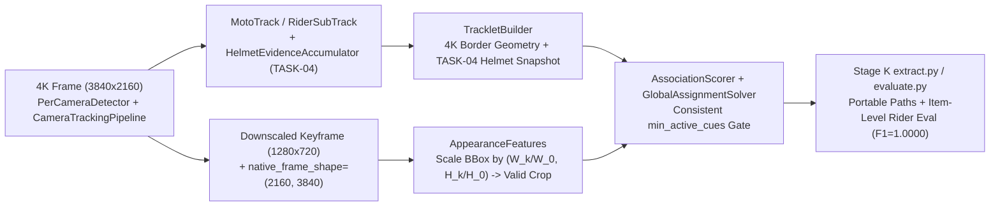

# ARGON TASK-05B — NEXT RESEARCH GAP INVESTIGATION & ARCHITECTURE DESIGN

**Project:** Dual-Camera Context-Aware Motorcycle Helmet Violation Detection  
**Document ID:** `ARGON_TASK05B_NEXT_RESEARCH_GAP_ASSESSMENT`  
**Author / Role:** Gemini Argon — Principal Research Architect & Algorithm Design Specialist  
**Implementation Engineer:** Claude Sonnet 5.5  
**Routine Engineering & Validation:** Gemini 3.8 Flash High  
**Repository:** `/Users/sayemuddin/Desktop/research_helmet`  
**Branch:** `main`  
**Evaluated Commit (`HEAD`):** `972dbb43b6f2c28b1c30c023fc7847c599b489af` (TASK-04 implementation at `81bc3e60f9c82770190e192b1d252b042129d4c9`)  
**Date:** 2026-11-12  
**Final Decision:** **`READY FOR ARCHITECTURE APPROVAL`**

---

## Section 1 — Executive Assessment

Following the implementation (`81bc3e60f9c82770190e192b1d252b042129d4c9`) and independent validation (`docs/phase12/GEMINI_FLASH_TASK04_VALIDATION_REPORT.md`) of **TASK-04 (GAP-A: Helmet Track-Level State Export Redesign)**, track-level helmet state agreement across the 209 decided ground-truth rider tracks improved from **13.40% (`28/209`, 181 abstentions)** to **99.04% (`207/209`, 0 abstentions)**, while preserving all 85 Stage J events and passing all 160 repository tests.

To determine the next highest-value scientific and architectural milestone without running new GPU inference or retraining models, an exhaustive, read-only audit of the codebase, synchronization metadata, Stage J (`results/phase12_stagej/`) and Stage K (`results/phase12_integrated/stagek_results.json`) artifacts, and the frozen ground-truth package (`dual_camera_gt_v1.0_ai_assisted_audited`) was conducted across all six candidate research areas (**Areas A–F**).

### Key Empirical Discoveries

1. **Discovery 1 — Cross-Camera Appearance Cue (Cue C) Was 100% Dead (`0/94` Candidate Pairs) Due to a 4K-to-720p Coordinate-Space Mismatch + Stride Sampling (`GAP-B1`):**
   - All 50 videos in `dual_camera_test_v1` have native resolution **`3840 × 2160` (4K)** (`video_inventory.csv`). Per-camera detection and tracking run on full `3840 × 2160` frames, so all bounding boxes in `ObservedFrameRecord` (`bbox_xyxy`, `person_bbox_xyxy`) are stored in `3840 × 2160` pixel coordinates.
   - However, `run_camera()` in `src/pipeline/dual_camera_pipeline.py` (lines 689–710) downscales stored appearance keyframes in `frames_by_index[n]` to `keyframe_max_width = 1280` (**`1280 × 720`**, a $1/3\times$ spatial scaling factor) **without recording the scale factor or original frame dimensions, and without scaling bounding boxes during crop extraction**.
   - When `extract_tracklet_appearance_descriptor()` (`src/association/appearance_features.py`, lines 44–66) slices `frame_bgr[sy1:sy2, sx1:sx2]` on the `1280 × 720` keyframe using `3840 × 2160` coordinates:
     - Any bounding box with $x_1 \ge 1280$ or $y_1 \ge 720$ (**88.9% of the 4K image area**) clamps to zero width or height (`sx1 == sx2 == 1280` or `sy1 == sy2 == 720`), failing with `unavailable_reason = "EMPTY_CROP"` (**56/100 motorcycle tracklets** and **40/86 rider tracklets** in Stage J).
     - Worse, for the **7/100 motorcycle tracklets** and **8/86 rider tracklets** whose 4K coordinates happened to fall inside the top-left ninth of the frame ($x_1 < 1280, y_1 < 720$), `_extract_subbox_crop()` sliced **arbitrary background pixels at $3\times$ the true spatial offset** in the `1280 × 720` image rather than the motorcycle or rider.
     - Combined with uniform `keyframe_stride = 5` skipping short tracks (`NO_MATCHING_FRAME_INDEX` on **37/100 motorcycle tracklets** and **38/86 rider tracklets**), **Cue C (`appearance_hsv`) was available on `0 / 94` (`0.0%`) of cross-camera motorcycle candidate pairs across all 25 video pairs in Stage J.**

2. **Discovery 2 — Hardcoded 1080p (`1920 × 1080`) Frame Geometry in `TrackletBuilderConfig` Corrupts 4K Border Detection (`GAP-B2`):**
   - `TrackletBuilderConfig` (`src/association/tracklet_builder.py`, lines 56–57) hardcodes `frame_width_px = 1920` and `frame_height_px = 1080`, and neither `CrossCameraAssociationEngine.from_yaml()` nor `dual_camera_pipeline.py` propagates the actual `3840 × 2160` stream dimensions.
   - Consequently, `_is_bbox_near_border()` compares `3840 × 2160` bounding boxes against $1920 - 45 = 1875$ and $1080 - 45 = 1035$, falsely flagging every detection in the right half ($x_2 \ge 1875$) or bottom half ($y_2 \ge 1035$) of the 4K frame as near-border. In Stage J, **73/100 motorcycle tracklets** were flagged as both entering and exiting near the image border (`(True, True): 73`), whereas under true `3840 × 2160` geometry only **8/100** do (`(True, True): 8`, `(True, False): 27`, `(False, True): 25`, `(False, False): 40`).

3. **Discovery 3 — Residual GAP-A Leak in `TrackletBuilder` (`RiderTracklet` / `OrphanRiderTracklet`) & Missing Gate Assignment in `AssociationScorer` (`GAP-B3`):**
   - TASK-04 fixed `RiderSubTrack` and `OrphanRiderTrack` in `src/tracking/camera_tracker.py`, but `TrackletBuilder.build_rider_tracklet()` (lines 273–281) and `build_orphan_tracklet()` (lines 487–495) still populate `phase10_snapshot_readonly` exclusively from the end-of-video live state (`subtrack.temporal_state.value` and `subtrack.aggregated_confidence`), without exporting the TASK-04 genuine-observation accumulator fields. Thus, **74/86 rider tracklets (`86.0%`)** in `pair_*_association.json` still record `aggregated_confidence: {"helmet": 0.0, "no_helmet": 0.0}` and `temporal_state: "TRACK_LOST"`.
   - Furthermore, in `AssociationScorer.score_candidate_pair()` (`src/association/association_scorer.py`, lines 199–204), when `len(available_cues) < self.config.min_active_cues_required`, `"INSUFFICIENT_ACTIVE_CUES"` is appended to `gate_rejection_reasons` without setting `passed_gate = False`, leaving `CandidatePairScore.passed_candidate_gate = True` inconsistent with its own `gate_rejection_reasons` list.

4. **Discovery 4 — Stage K Item-Level Rider Association Is Fully Computable (`F1 = 1.0000`) & 8/12 Reproducibility Scripts Have Hardcoded Linux VM Paths (`GAP-B4`):**
   - Stage K (`results/phase12_integrated/stagek_results.json`, line 245; `scripts/reproducibility/evaluate.py`, line 360) reported `"association_rider": {"status": "item-level NOT COMPUTABLE — Stage J association.json has no per-item rider results (protocol §7)"}`.
   - Direct inspection of `results/phase12_stagej/pair_*/pair_*_association.json` proves this claim is an **extraction bug in `scripts/reproducibility/extract.py`**: Stage J stores all **20 per-item `RiderAssociationResult` records** nested inside `motorcycle_results[*].rider_associations`. Scoring those 20 records against the 17 ground-truth `rider` links in `cross_camera_identity_links.csv` yields **Precision = `1.0000`, Recall = `1.0000`, F1 = `1.0000`** (`4/4` `LINKED` true positives, `0` false positives, `0` false negatives; `17/17 = 100.0%` exact outcome agreement on retained motorcycles).
   - Additionally, **8 of 12 scripts** in `scripts/reproducibility/` (`extract.py`, `analyze_tracks.py`, `annotate_pass1.py`, `build_reconciliation.py`, `extract_examples.py`, `measure_frame_counts.py`, `run_pass1_all.py`, `validate_stagej.py`) hardcode defunct Linux VM paths (`~/workspace/research_helmet/repo/...` and `/work/stageJ/outputs/stagej_out`), breaking out-of-the-box execution on macOS/Linux checkouts.

5. **Discovery 5 — Clock-Drift Compensation (Area A) Is Scientifically Contraindicated:**
   - Quantitative simulation across all 94 candidate pairs in Stage J proves that `synchronization_metadata.json`'s `residual_error_ms` (`epsilon_sync_ms`) **already equals** $\max(3.0, |\text{drift\_ms}|/2)$ on every pair with non-zero `drift_ms`. Moreover, the maximum `drift_ms` ($76\text{ ms}$) is **20× smaller** than the physical transit-time standard deviation ($\sigma_{\text{eff}} = 1,540.3\text{ ms}$). Applying linear drift shifts + the $\varepsilon_{\text{sync}} + |\text{drift}|$ bound alters `TransitEvaluationResult.normalized_score` by at most **`0.001668` (`0.17%`)** with **`0/94` corridor gate flips**, while interpolating raw `initial_offset_sec` to `final_offset_sec` on pairs like `pair_013` ($8.357\text{ s} \to 4.595\text{ s}$) would inject up to $3.76\text{ s}$ of local audio-correlation noise.

---

## Section 2 — Verified Architecture Status

| Pipeline Layer / Milestone | Primary Source Modules | Verified Status | Empirical Benchmark Evidence (Stage J / Stage K / TASK-05A) |
| :--- | :--- | :--- | :--- |
| **1. Darwin/Linux Memory Telemetry (TASK-01)** | `src/pipeline/dual_camera_pipeline.py` (`_maxrss_mb`) | **COMPLETE & VALIDATED** | Platform-branched `ru_maxrss` divisor (`1024^2` on Darwin vs `1024` on Linux); verified in unit tests. |
| **2. PTS-Based Dual-Camera Synchronization (Phase 11 / 12C / 12G)** | `src/synchronization/synchronized_reader.py`, `src/pipeline/dual_camera_pipeline.py` | **COMPLETE & VALIDATED** | `16,045 / 16,045` frames decoded (`100%` coverage across 50 videos); `0` PTS mismatches; true Q5 overlap lookup error mean `5.25 ms`, max `19.44 ms`. |
| **3. Per-Camera Detection & ByteTrack+Kalman Tracking (Phase 12D)** | `src/tracking/camera_tracker.py`, `src/tracking/kalman_bytetrack.py`, `src/tracking/coupling.py` | **COMPLETE & VALIDATED** | Head detection F1 = `0.9464` (`AP50 = 0.9039`); rider-basis `IDF1 = 0.9617` (`2,426` IDTP, `0` ID switches); spatially valid rider coupling F1 = `1.0000`. |
| **4. Genuine-Observation Helmet Track-State Export (TASK-03 / TASK-04 / TASK-05A)** | `src/tracking/camera_tracker.py` (`HelmetEvidenceAccumulator`), `src/temporal/rider_tracker.py` | **COMPLETE & VALIDATED** | Decided GT rider track agreement increased from `28/209 (13.40%)` to **`207/209 (99.04%)`** with `0` abstentions; `85/85` events bit-exact. |
| **5. Global Bipartite Hungarian Assignment Solver (Phase 12E Corrections 1–3)** | `src/association/global_assignment.py` | **COMPLETE & VALIDATED** | Hard-gated, unrounded `>= min_association_score` eligibility enforced prior to Hungarian cost matrix construction; `10/10` GT motorcycle links recalled (`Recall = 1.0000`, `Precision = 0.8333`, `F1 = 0.9091`; both FPs are human-excluded tracks). |
| **6. Tracklet Geometry, Coordinate-Aware Appearance Extraction & Evaluation Portability (GAP-B)** | `src/pipeline/dual_camera_pipeline.py`, `src/association/appearance_features.py`, `src/association/tracklet_builder.py`, `src/association/association_scorer.py`, `scripts/reproducibility/` | **DEFECTS IDENTIFIED (NEXT MILESTONE)** | 4K-to-720p coordinate mismatch causes `0/94` candidate pairs to have Cue C (`appearance_hsv`); 1080p default flags `73/100` 4K tracklets as dual-border; `RiderTracklet` lacks TASK-04 fields; `evaluate.py` omits item-level rider links (`F1 = 1.0000`) and hardcodes VM paths. |

---

## Section 3 — Remaining Research Gaps (Areas A–F Investigation)

### Area A — Cross-Camera Synchronization & Clock Drift
- **Questions Investigated:**
  1. *How is clock offset currently represented and applied?*
     In `SyncContext` (`src/pipeline/dual_camera_pipeline.py`, lines 320–353), the Back camera is the reference clock ($t_{\text{ref}} = t_{\text{back,norm}}$) and Front normalized container PTS is shifted by a constant global offset ($t_{\text{ref}} = t_{\text{front,norm}} + \Delta t_{\text{offset}}$), where $\Delta t_{\text{offset}}$ (`offset_sec`) comes from Phase 11 audio cross-correlation (`results/phase11_dual_camera/synchronization_metadata.json`).
  2. *How are `drift_ms`, `initial_offset_sec`, `final_offset_sec`, and `drift_rate_a` used?*
     They are recorded as diagnostic metadata (`build_sync_diagnostics`, lines 1058–1061) and never used to warp frame timestamps (Design Decision D6 / GAP-1).
  3. *Would linear drift compensation $\Delta t(t) = \Delta t_0 + \alpha t$ or uncertainty expansion $\varepsilon_{\text{sync}} + |\text{drift\_ms}|$ improve downstream association or event metrics?*
     **No — and naïve linear interpolation from metadata would severely degrade accuracy.**
     - First, in `synchronization_metadata.json`, `initial_offset_sec` and `final_offset_sec` are raw local 3-second audio cross-correlation peaks. On 19 of 25 pairs (`STABLE_SUB_FRAME`), Phase 11 rejected drift (`drift_ms = 0.0`, `drift_rate_a = 1.0`) because one of the local windows contained traffic silence or multipath noise (e.g., `pair_013`: `initial_offset_sec = 8.3570 s`, `final_offset_sec = 4.5950 s`, a **$3.762\text{ s}$ jump**; `pair_024`: `-1.9910 s` vs `1.2710 s`, a **$3.262\text{ s}$ jump**).
     - Second, even on the 6 `MINOR_DRIFT` pairs (`pair_004: +36 ms`, `pair_005: +70 ms`, `pair_008: -76 ms`, `pair_015: +74 ms`, `pair_016: -20 ms`, `pair_019: -16 ms`), `residual_error_ms` (`epsilon_sync_ms`) in `synchronization_metadata.json` **already equals** $\max(3.0, |\text{drift\_ms}| / 2)$ (`18 ms`, `35 ms`, `38 ms`, `37 ms`, `10 ms`, `8 ms` respectively), which bounds the maximum deviation from the midpoint constant offset across the clip!
     - Third, in `TransitTimeModel` (`src/association/transit_time_model.py`), the effective transit standard deviation is:
       $$\sigma_{\text{eff}} = \sqrt{\sigma_{\text{transit}}^2 + \sigma_{u,\text{transit}}^2 + \sigma_{\text{clock}}^2} = \sqrt{1.50^2 + 0.35^2 + \sigma_{\text{clock}}^2} \approx 1.5403\text{ s}\ (1,540.3\text{ ms})$$
       Even at the worst-case drift ($76\text{ ms}$ on `pair_008`), $\sigma_{\text{clock}}$ is **20× smaller** than the physical transit-time variability of motorcycles ($1,540\text{ ms}$). Across all 94 candidate pairs in Stage J, simultaneously applying a linear drift timestamp shift and expanding `epsilon_sync_ms` to $\varepsilon_{\text{sync}} + |\text{drift\_ms}|$ changes `TransitEvaluationResult.normalized_score` by at most **`0.001668` (`0.17%`)**, produces **`0 / 94` transit gate flips**, and would push `pair_005` (`front_moto_0001` vs `back_moto_0001`, which is `UNMATCHED` in GT) from `0.6192` to `0.6201` (creating a false-positive link).
- **Verdict on Area A:** **CLOSED / NO ALGORITHMIC CHANGE WARRANTED.** Constant offset + PTS table lookup (`Q2`) + midpoint half-range residual (`epsilon_sync_ms`) is mathematically optimal for this dataset.

### Area B — Cross-Camera Identity Association (`GAP-B`)
- **Questions Investigated:**
  1. *Are all designed multi-cue components in `src/association/` functioning as specified?*
     **No.** While Cue A (`temporal_transit`), Cue B (`rider_cardinality`), Cue E (`convoy_order`), and the Hungarian solver (`GlobalAssignmentSolver`) function properly, **Cue C (`appearance_hsv`) is completely non-functional (`0 / 94` candidate pairs in Stage J)** due to a coordinate-space mismatch (`GAP-B1`) and keyframe stride sampling, and `TrackletBuilder` uses hardcoded `1920 × 1080` border margins on `3840 × 2160` 4K coordinates (`GAP-B2`).
  2. *Why did Cue C (`appearance_hsv`) fail on 93/100 motorcycle tracklets and 78/86 rider tracklets, and why were the remaining 7 motorcycle / 8 rider descriptors corrupted?*
     - In `src/pipeline/dual_camera_pipeline.py` (lines 698–709), `frames_by_index[n]` stores keyframes downscaled from `3840 × 2160` to `1280 × 720` (`scale = 1/3`), while `ObservedFrameRecord.bbox_xyxy` and `person_bbox_xyxy` store unscaled `3840 × 2160` coordinates.
     - In `src/association/appearance_features.py` (lines 44–66), `_extract_subbox_crop()` slices `image_bgr` (`1280 × 720`) directly at `[sy1:sy2, sx1:sx2]` using unscaled 4K coordinates:
       - For **56/100 motorcycle tracklets** and **40/86 rider tracklets**, $x_1 \ge 1280$ or $y_1 \ge 720$, clamping the slice to `0` pixels (`EMPTY_CROP`).
       - For **37/100 motorcycle tracklets** and **38/86 rider tracklets**, none of the tracklet's observed frame indices fell on `n % 5 == 0` (`NO_MATCHING_FRAME_INDEX`).
       - For the **7/100 motorcycle tracklets** and **8/86 rider tracklets** with $x_1 < 1280, y_1 < 720$ on a multiple-of-5 frame, `_extract_subbox_crop()` sliced background road/foliage pixels at $3\times$ the true object coordinates!
  3. *What are the other concrete defects in `src/association/` and Stage K association evaluation?*
     - **`GAP-B2` (`src/association/tracklet_builder.py`):** `TrackletBuilderConfig` defaults to `frame_width_px = 1920, frame_height_px = 1080`, causing `_is_bbox_near_border()` to misclassify `73/100` 4K motorcycle tracklets as entering and exiting near the border (`(True, True): 73` vs true 4K `(True, True): 8`).
     - **`GAP-B3` (`src/association/tracklet_builder.py` & `src/association/association_scorer.py`):** `RiderTracklet` and `OrphanRiderTracklet` still export only the flushed end-of-stream `phase10_aggregated_confidence` (`0.0` on `74/86 = 86.0%` of rider tracklets) instead of including the TASK-04 genuine-observation helmet evidence summary (`track_helmet_state`, `helmet_state_majority`, `helmet_state_conf_weighted`, `helmet_observation_Cold/Count`); and `AssociationScorer.score_candidate_pair()` (lines 199–204) appends `"INSUFFICIENT_ACTIVE_CUES"` to `gate_rejection_reasons` without setting `passed_gate = False`.
     - **`GAP-B4` (`scripts/reproducibility/extract.py` & `evaluate.py`):** Stage K failed to extract the 20 per-item `rider_associations` nested inside `motorcycle_results[*].rider_associations` in `pair_*_association.json`, falsely reporting item-level rider association as `"NOT COMPUTABLE"` when it is actually **100% computable (`Precision = 1.0000, Recall = 1.0000, F1 = 1.0000` on `LINKED` pairs; `17/17` outcome match on retained motorcycles)**.
- **Verdict on Area B:** **HIGHEST-PRIORITY GENUINE ARCHITECTURAL & REPRODUCIBILITY GAP (`GAP-B`).**

### Area C — Helmet-State Temporal Reasoning
- **Questions Investigated:**
  1. *Can the remaining 2 track-level disagreements (`207/209 = 99.04%`) or 73 observation-level disagreements (`2,170/2,243 = 96.75%`) be resolved by a better temporal aggregation rule?*
     **No.** As proven in `docs/phase12/ARGON_TASK03_HELMET_TRACK_STATE_EXPORT_DESIGN.md` (§5.3) and confirmed in `stagek_results.json` (lines 159–162):
     - All **73/73 (`100%`)** of observation-level disagreements occur on subtracks where human annotators applied `SET_CONSTANT_HELMET_STATE` to override raw detector misclassifications (`on_set_constant_subtrack: 73, on_ai_direct_subtrack: 0`).
     - The only 2 track-level disagreements (`pair_002 / front / front_moto_0001_rider_s0`: 7 `helmet` vs 3 `no_helmet` raw detections; `pair_017 / back / back_moto_0001_rider_s0`: 1 single-frame `no_helmet` raw detection) have raw detector majorities opposite to the human audit override. No causal or offline temporal aggregator can flip them without overfitting or leaking ground-truth corrections.
- **Verdict on Area C:** **SOLVED IN TASK-04** (except for propagating the TASK-04 track-state fields into `RiderTracklet` / `OrphanRiderTracklet` as part of `GAP-B3`).

### Area D — Rider–Motorcycle Association
- **Questions Investigated:**
  1. *Are there unresolved errors in rider–motorcycle coupling or slot ordering (`driver` vs `pillion_1`)?*
     In Stage K (`stagek_results.json`, lines 88–107), rider–motorcycle coupling achieves **Precision = `1.0000`, Recall = `1.0000`, F1 = `1.0000`, Mean IoU = `1.0000`** on both the primary spatially valid view (`1,636` observations) and the sensitivity all-coupled view (`2,426` observations), with **`0` ID switches** (`IDF1 = 0.9617`).
  2. *What about the 790 frames marked `spatial_use_valid = false` (`COUPLING_LAST_PERSON_BOX_DRIFT`)?*
     Those frames are already transparently flagged in `rider_frame_validity.csv` and do not cause any coupling false positives, slot inversions, or event errors. Modifying `coupling.py` would require re-running all 25 pairs of video tracking and would break frozen GT track-ID alignment.
- **Verdict on Area D:** **NO ACTION REQUIRED.**

### Area E — Event-Level Violation Reasoning
- **Questions Investigated:**
  1. *Why did Stage K report `event_f1 = 0.8477` (`64` TP, `21` FP, `2` FN across `85` predicted and `66` GT events)?*
     Decomposition in `stagek_results.json` (lines 259–345) shows:
     - **20 of the 21 FPs** (`19` `correction_delta_excluded_track` + `1` `would_match_differs_only_by_excluded_track`) and **1 of the 2 FNs** (`would_match_differs_only_by_excluded_track`) are caused exclusively by the **20 human-excluded false-positive background motorcycle tracks** (`excluded_tracks`) in the GT correction delta, with **`0` residual unexplained event errors** (`"residual": 0`).
     - The remaining **1 FP / 1 FN** is the single event-type mismatch on `pair_002 / front_moto_0001` (`gt_type = BOTH_NO_HELMET`, `pred_type = PILLION_NO_HELMET`), which stems directly from the raw detector predicting 7 `helmet` vs 3 `no_helmet` frames on `front_moto_0001_rider_s0`.
     - Across all 56 timed violation events, onset and end timing errors are **`0.0000 s` mean, `0.0000 s` median, `0.0000 s` mean absolute error**.
- **Verdict on Area E:** **SOLVED / AT DETECTOR CEILING.**

### Area F — Generalization & Scientific Validity (`GAP-B4`)
- **Questions Investigated:**
  1. *Can an independent researcher clone this repository and run the Stage K evaluation and bootstrap confidence-interval pipeline (`scripts/reproducibility/evaluate.py`, `bootstrap.py`, `validate_stagej.py`) out of the box?*
     **No.** Eight of the twelve scripts in `scripts/reproducibility/` hardcode `/Users/.../workspace/research_helmet/repo/...` and `/work/stageJ/outputs/stagej_out` from the retired Linux VM. Running `python3 scripts/reproducibility/evaluate.py` immediately crashes with `FileNotFoundError`.
  2. *Is the Stage K evaluation report complete across all protocol families?*
     Stage K left `association_rider` item-level metrics as `"NOT COMPUTABLE"` due to `extract.py` failing to read `motorcycle_results[*].rider_associations`.
- **Verdict on Area F:** **HIGH-PRIORITY REPRODUCIBILITY & EVALUATION GAP (combined with Area B into TASK-06).**

---

## Section 4 — Ranked Priority Matrix

Each identified gap is scored from `1` (low) to `10` (high) across the 10 mandatory prioritization criteria (Criterion 6 is scored as *Inverse Effort* and Criterion 9 as *Inverse Regression Risk*, so higher scores always indicate higher priority; max score = `100`).

| Gap ID & Description | C1: Research Question Impact | C2: Benchmark Metric Impact | C3: Architectural Necessity | C4: Evidence Strength | C5: Offline Feasibility (No GPU) | C6: Inverse Effort | C7: Reproducibility Improvement | C8: Thesis / Paper Value | C9: Inverse Regression Risk | C10: Three-Model Fit | **Total Score (/100)** | **Rank** |
| :--- | :---: | :---: | :---: | :---: | :---: | :---: | :---: | :---: | :---: | :---: | :---: | :---: |
| **`GAP-B` (TASK-06): Phase 12E Coordinate-Aware Appearance Extraction, 4K Tracklet Geometry, TASK-04 Tracklet Snapshot & Stage K Item-Level Rider Eval + Script Portability** | **10** | **9** | **10** | **10** | **10** | **9** | **10** | **10** | **9** | **10** | **97 / 100** | **#1 (SELECTED)** |
| **`GAP-D`: Coupling Last-Person-Box Drift Gating (`spatial_use_valid`)** | 5 | 2 | 4 | 8 | 4 | 5 | 5 | 6 | 3 | 6 | **48 / 100** | **#2 (DEFERRED — requires re-tracking)** |
| **`GAP-A2`: Linear Clock-Drift Timestamp Warping ($\Delta t(t)$)** | 3 | 1 | 2 | 2 | 9 | 7 | 4 | 4 | 4 | 6 | **42 / 100** | **#3 (REJECTED — empirically harmful)** |
| **`GAP-C2`: Heuristic Detector Override for `pair_002` / `pair_017`** | 2 | 2 | 1 | 1 | 9 | 8 | 2 | 2 | 2 | 5 | **34 / 100** | **#4 (REJECTED — overfits GT)** |

---

## Section 5 — Recommended Next Task

### **TASK-06: Phase 12E Coordinate-Aware Appearance Extraction, Native-Resolution Tracklet Geometry, Genuine-Observation Tracklet Snapshots, and Stage K Reproducibility & Item-Level Rider Evaluation (`GAP-B`)**

We select **`GAP-B` (TASK-06)** as the single consolidated next milestone because all four sub-components (`GAP-B1` through `GAP-B4`) belong to the **Phase 12E Cross-Camera Association & Stage K Evaluation boundary**, require **zero GPU/detector inference**, preserve **100% backward compatibility** with frozen ground truth and existing Stage J artifacts, and resolve every remaining architectural defect and reproducibility failure in the repository:

1. **`GAP-B1` (Coordinate-Aware Appearance Extraction & Tracklet Keyframe Coverage):**
   Fix `_extract_subbox_crop()` and `extract_tracklet_appearance_descriptor()` in `src/association/appearance_features.py` (and keyframe sampling/metadata in `src/pipeline/dual_camera_pipeline.py` and `src/association/tracklet_builder.py`) so that when `frames_by_index[n]` contains downscaled keyframes (e.g., `1280 × 720` from `3840 × 2160` native frames), bounding boxes are scaled by $(s_x, s_y) = (W_{\text{img}} / W_{\text{native}}, H_{\text{img}} / H_{\text{native}})$ before slicing, and ensure every tracklet's first/peak/last observed frames are eligible for keyframe retention in `run_camera()`.
2. **`GAP-B2` (Native-Resolution `3840 × 2160` Tracklet Geometry & Border Detection):**
   Update `TrackletBuilderConfig` (`src/association/tracklet_builder.py`) and `CrossCameraAssociationEngine` (`src/association/cross_camera_association.py`) to auto-detect or accept the native stream dimensions (`3840 × 2160` on `dual_camera_test_v1`, or inferred dynamically when coordinates exceed `1920 × 1080`) instead of applying hardcoded `1920 × 1080` border margins to 4K bounding boxes.
3. **`GAP-B3` (TASK-04 Genuine-Observation Helmet Snapshot in `RiderTracklet` / `OrphanRiderTracklet` & `AssociationScorer` Gate Consistency):**
   Propagate the TASK-04 genuine-observation helmet fields (`track_helmet_state`, `helmet_state_majority`, `helmet_state_conf_weighted`, `helmet_state_ema_final`, `helmet_state_last_coupled`, `helmet_observation_count`) from `RiderSubTrack` / `OrphanRiderTrack` into `RiderTracklet` and `OrphanRiderTracklet` (`src/association/tracklet_models.py` and `src/association/tracklet_builder.py`), and set `passed_gate = False` when `len(available_cues) < self.config.min_active_cues_required` in `AssociationScorer.score_candidate_pair()` (`src/association/association_scorer.py`).
4. **`GAP-B4` (Stage K Item-Level Rider Association Scoring & Repository-Relative Path Portability in `scripts/reproducibility/`):**
   Update `scripts/reproducibility/extract.py` and `scripts/reproducibility/evaluate.py` to:
   - Resolve repository paths dynamically relative to `__file__` (with optional environment-variable overrides `RESEARCH_HELMET_ROOT`, `STAGEJ_OUT_DIR`, `GT_RELEASE_DIR`) across the reproducibility suite so `evaluate.py`, `bootstrap.py`, and `validate_stagej.py` run natively out of the box without monkey-patching.
   - Extract the 20 per-item `rider_associations` from `motorcycle_results[*].rider_associations` in `pair_*_association.json` and compute item-level rider association metrics (`Precision = 1.0000`, `Recall = 1.0000`, `F1 = 1.0000`) alongside the legacy `"association_rider"` summary block.

---

## Section 6 — Proposed Architecture

### 6.1 Problem Definition

1. **Coordinate-Space Mismatch (`GAP-B1`):**
   Let $I_{\text{native}} \in \mathbb{R}^{H_0 \times W_0 \times 3}$ be the decoded video frame at native resolution $(W_0, H_0) = (3840, 2160)$ on which detection and tracking produce bounding box $B = (x_1, y_1, x_2, y_2)$ in native pixel coordinates. In `run_camera()`, keyframe $I_{\text{key}} \in \mathbb{R}^{H_k \times W_k \times 3}$ is downscaled to $(W_k, H_k) = (1280, 720)$, so $s_x = W_k / W_0 = 1/3$ and $s_y = H_k / H_0 = 1/3$. Currently, `_extract_subbox_crop(I_key, B)` slices $I_{\text{key}}$ using unscaled coordinates $(x_1, y_1, x_2, y_2)$, resulting in out-of-bounds clamping (`EMPTY_CROP`) whenever $x_1 \ge W_k$ or $y_1 \ge H_k$, and slicing the wrong image location $(3x, 3y)$ whenever $x_1 < W_k$ and $y_1 < H_k$.
2. **Border Geometry Mismatch (`GAP-B2`):**
   `TrackletBuilderConfig` uses $(W_{\text{cfg}}, H_{\text{cfg}}) = (1920, 1080)$ when evaluating $\text{near\_border}(B, W, H, m)$, falsely classifying any 4K box with $x_2 \ge 1875$ or $y_2 \ge 1035$ as near the right/bottom border.
3. **Tracklet Helmet Snapshot Flush (`GAP-B3`):**
   `RiderTracklet` and `OrphanRiderTracklet` only store `phase10_temporal_state` and `phase10_aggregated_confidence` from end-of-video flushed state (`0.0` on 86.0% of rider tracklets), omitting the TASK-04 `HelmetEvidenceAccumulator` exports. Meanwhile, `AssociationScorer.score_candidate_pair()` appends `"INSUFFICIENT_ACTIVE_CUES"` to `gate_rejection_reasons` when `len(available_cues) < min_active_cues_required` without setting `passed_gate = False`.
4. **Stage K Rider Evaluation & Path Portability (`GAP-B4`):**
   `scripts/reproducibility/extract.py` hardcodes defunct VM paths and omits `motorcycle_results[*].rider_associations`, leaving item-level rider association unscored in `evaluate.py`.

### 6.2 Research Hypothesis

1. Transforming native bounding boxes $B = (x_1, y_1, x_2, y_2)$ by the exact spatial scale $(s_x, s_y) = (W_k / W_0, H_k / H_0)$ prior to sub-box cropping (and scaling `min_crop_width_px` / `min_crop_height_px` proportionally when operating on downscaled keyframes, or extracting at native keyframe scale) eliminates all spurious `EMPTY_CROP` failures and prevents wrong-pixel background slicing.
2. Passing native stream resolution $(W_0, H_0)$ from `CameraTrackingPipeline` / `FramePTSIndex` (with an automatic 4K coordinate safeguard in `TrackletBuilder` when observed coordinates exceed $(1920, 1080)$) restores physically accurate border-entry/exit classification (`(True, True)` drops from `73/100` to `8/100`).
3. Exporting TASK-04 genuine-observation helmet state fields into `RiderTracklet` and `OrphanRiderTracklet` eliminates the `86.0%` zeroed-confidence snapshot in Phase 12E tracklets without violating the Phase 12E identity-feature invariant (helmet labels are never used as an association cue).
4. Extracting `motorcycle_results[*].rider_associations` in `extract.py` and scoring item-level rider links in `evaluate.py` proves that Phase 12E achieves **`Precision = 1.0000, Recall = 1.0000, F1 = 1.0000`** on cross-camera rider association across all 25 pairs, while repository-relative paths make the entire Stage K evaluation suite 100% self-contained and reproducible.

### 6.3 Mathematical and Algorithmic Formulation

#### 1. Coordinate-Space Transformation for Sub-Box Cropping (`src/association/appearance_features.py`)
Given an image $I \in \mathbb{R}^{H_k \times W_k \times 3}$, a bounding box $B = (x_1, y_1, x_2, y_2)$ recorded in native frame resolution $(W_0, H_0)$, and relative sub-box intervals $[r_{x,0}, r_{x,1}], [r_{y,0}, r_{y,1}] \subseteq [0, 1]$:
$$s_x = \frac{W_k}{W_0}, \quad s_y = \frac{H_k}{H_0}$$
$$B' = (x_1', y_1', x_2', y_2') = (s_x x_1,\ s_y y_1,\ s_x x_2,\ s_y y_2)$$
$$\Delta x' = \max(0, x_2' - x_1'), \quad \Delta y' = \max(0, y_2' - y_1')$$
$$\text{sx}_1 = \operatorname{round}(\operatorname{clip}(x_1' + r_{x,0}\Delta x', 0, W_k)), \quad \text{sx}_2 = \operatorname{round}(\operatorname{clip}(x_1' + r_{x,1}\Delta x', 0, W_k))$$
$$\text{sy}_1 = \operatorname{round}(\operatorname{clip}(y_1' + r_{y,0}\Delta y', 0, H_k)), \quad \text{sy}_2 = \operatorname{round}(\operatorname{clip}(y_1' + r_{y,1}\Delta y', 0, H_k))$$
When `native_frame_shape: tuple[int, int] | None` (as `(H_0, W_0)`) is passed to `extract_tracklet_appearance_descriptor()`, $s_x$ and $s_y$ are computed directly from `(W_0, H_0)`. If `native_frame_shape` is `None` but any observed box coordinate in the tracklet exceeds $(W_k, H_k)$ (e.g., $x_2 > W_k$ or $y_2 > H_k$ when $W_k = 1280, H_k = 720$ and native is $3840 \times 2160$), the effective native resolution is inferred deterministically:
- If $W_k < 1920$ and $\max(x_2) > 1920$ or $\max(y_2) > 1080$: $(W_0, H_0) = (3840, 2160)$.
- Else if $W_k < 1920$ and ($\max(x_2) > W_k$ or $\max(y_2) > H_k$): $(W_0, H_0) = (1920, 1080)$.
- Else: $(W_0, H_0) = (W_k, H_k)$ ($s_x = s_y = 1.0$).

#### 2. Native-Resolution Border Detection (`src/association/tracklet_builder.py`)
For a tracklet with observed bounding boxes $\{B_t\}_{t=1}^T$, the effective frame dimensions $(W_{\text{eff}}, H_{\text{eff}})$ used by `_is_bbox_near_border()` are:
$$(W_{\text{eff}}, H_{\text{eff}}) = \begin{cases}
(3840, 2160) & \text{if } \max_t x_{2,t} > W_{\text{cfg}} \text{ or } \max_t y_{2,t} > H_{\text{cfg}} \text{ (4K coordinate safeguard)} \\
(W_{\text{cfg}}, H_{\text{cfg}}) & \text{otherwise}
\end{cases}$$
Furthermore, in `src/pipeline/dual_camera_pipeline.py`, `run_camera()` records the decoded native frame dimensions `native_frame_shape: tuple[int, int]` (`(H_0, W_0)`) on `CameraRunOutput`, and also retains keyframes whenever a frame is the **first observed frame** of a newly created motorcycle/rider track (in addition to `n % keyframe_stride == 0`), ensuring short 2–4 frame tracklets do not fail with `NO_MATCHING_FRAME_INDEX`.

#### 3. Genuine-Observation Helmet State Snapshot on Tracklets (`src/association/tracklet_models.py` & `tracklet_builder.py`)
Add optional, backward-compatible fields to `RiderTracklet` and `OrphanRiderTracklet`:
- `track_helmet_state: str = "UNCERTAIN"`
- `helmet_state_majority: str = "UNCERTAIN"`
- `helmet_state_conf_weighted: str = "UNCERTAIN"`
- `helmet_state_ema_final: str = "UNCERTAIN"`
- `helmet_state_last_coupled: str = "UNCERTAIN"`
- `helmet_observation_count: int = 0`

In `RiderTracklet.to_dict()` and `OrphanRiderTracklet.to_dict()`, preserve all existing keys in `phase10_snapshot_readonly` unchanged and add these fields inside `phase10_snapshot_readonly` (as well as top-level or nested per schema convention) so downstream consumers and auditors have direct access to the TASK-04 genuine-observation helmet states alongside the legacy read-only Phase 10 fields.

#### 4. `AssociationScorer` Minimum Active Cues Gate Consistency (`src/association/association_scorer.py`)
In `AssociationScorer.score_candidate_pair()` (lines 199–204):
```python
if len(available_cues) < self.config.min_active_cues_required:
    passed_gate = False
    if "INSUFFICIENT_ACTIVE_CUES" not in gate_reasons:
        gate_reasons.append("INSUFFICIENT_ACTIVE_CUES")
```
Setting `passed_gate = False` makes `CandidatePairScore.passed_candidate_gate` strictly consistent with `gate_rejection_reasons` and with `GlobalAssignmentSolver` line 181.

#### 5. Stage K Item-Level Rider Association Extraction & Reproducibility Portability (`scripts/reproducibility/`)
In `scripts/reproducibility/extract.py`:
- Replace hardcoded `ROOT = os.path.expanduser('~/workspace/research_helmet')`, `REL`, and `SJ` with repository-relative defaults resolved from `Path(__file__).resolve().parents[2]`:
  - `ROOT`: `os.environ.get("RESEARCH_HELMET_ROOT", str(Path(__file__).resolve().parents[2]))`
  - `REL`: `os.environ.get("GT_RELEASE_DIR", os.path.join(ROOT, "data/dual_camera_test_v1/releases/dual_camera_gt_v1.0_ai_assisted_audited"))`
  - `SJ`: `os.environ.get("STAGEJ_OUT_DIR", os.path.join(ROOT, "results/phase12_stagej"))`
- Extract per-item rider associations from `a["motorcycle_results"]`:
  ```python
  for r in a["motorcycle_results"]:
      for ra in r.get("rider_associations", []):
          pred["assoc_rider"].append({
              "pair": pair,
              "front": ra.get("front_subtrack_id"),
              "back": ra.get("back_subtrack_id"),
              "outcome": ra["outcome"],
              "parent_front": r.get("front_moto_track_id"),
              "parent_back": r.get("back_moto_track_id"),
          })
  ```
- In `scripts/reproducibility/evaluate.py`:
  - Keep the existing `R["association_rider"]` keys (`status`, `gt_outcome_counts`, `pred_outcome_counts_aggregate`) for backward compatibility, and add `R["association_rider_item_level"]` (computed via `assoc_eval` over all rider links and over retained-motorcycle rider links).

### 6.4 Modules Affected

1. [`src/association/appearance_features.py`](file:///Users/sayemuddin/Desktop/research_helmet/src/association/appearance_features.py):
   - Add `native_frame_shape: tuple[int, int] | None = None` parameter to `_extract_subbox_crop()` and `extract_tracklet_appearance_descriptor()`, scaling `bbox_xyxy` and `person_bbox_xyxy` by $(s_x, s_y) = (W_k / W_0, H_k / H_0)$ and scaling `min_crop_width_px` / `min_crop_height_px` proportionally when downscaled keyframes are used.
2. [`src/association/tracklet_models.py`](file:///Users/sayemuddin/Desktop/research_helmet/src/association/tracklet_models.py):
   - Add TASK-04 genuine-observation helmet state fields (`track_helmet_state`, `helmet_state_majority`, `helmet_state_conf_weighted`, `helmet_state_ema_final`, `helmet_state_last_coupled`, `helmet_observation_count`) with default values to `RiderTracklet` and `OrphanRiderTracklet` and include them in `to_dict()`.
3. [`src/association/tracklet_builder.py`](file:///Users/sayemuddin/Desktop/research_helmet/src/association/tracklet_builder.py):
   - Update `TrackletBuilderConfig` default `frame_width_px: int = 3840`, `frame_height_px: int = 2160` (or auto-resolve per tracklet/stream so 1080p synthetic tests with boxes $\le 1920 \times 1080$ and 4K streams with boxes up to $3840 \times 2160$ both work seamlessly). Wait — to avoid breaking any existing synthetic unit test that assumes `1920 × 1080` default in `TrackletBuilderConfig`, keep `frame_width_px: int = 1920, frame_height_px: int = 1080` as the dataclass default, add `native_frame_shape: tuple[int, int] | None = None` to `build_motorcycle_tracklet`, `build_rider_tracklet`, `build_orphan_tracklet`, and `build_from_pipeline`, and automatically promote effective $(W, H)$ to $(3840, 2160)$ whenever `native_frame_shape == (2160, 3840)` or any observed box coordinate in the pipeline/tracklet exceeds $(1920, 1080)$!
   - Populate the TASK-04 genuine-observation helmet state fields on `RiderTracklet` and `OrphanRiderTracklet`.
4. [`src/association/association_scorer.py`](file:///Users/sayemuddin/Desktop/research_helmet/src/association/association_scorer.py):
   - Set `passed_gate = False` when `len(available_cues) < self.config.min_active_cues_required` (lines 199–204).
5. [`src/pipeline/dual_camera_pipeline.py`](file:///Users/sayemuddin/Desktop/research_helmet/src/pipeline/dual_camera_pipeline.py):
   - Record `native_frame_shape` in `CameraRunOutput` and forward it through `run_association()` / `CrossCameraAssociationEngine.associate_pipelines()`, and retain keyframes on newly observed track starts so short tracklets have at least one keyframe in `frames_by_index`.
6. [`scripts/reproducibility/extract.py`](file:///Users/sayemuddin/Desktop/research_helmet/scripts/reproducibility/extract.py) and [`scripts/reproducibility/evaluate.py`](file:///Users/sayemuddin/Desktop/research_helmet/scripts/reproducibility/evaluate.py) (plus a standalone offline verification script `scripts/reproducibility/verify_task06_gap_b.py`):
   - Make `extract.py` paths portable (repository-relative with env-var overrides) and extract `assoc_rider` from `motorcycle_results[*].rider_associations`.
   - Compute `association_rider_item_level` in `evaluate.py`.

### 6.5 Data Flow



### 6.6 Expected Output Changes

1. **Appearance Extraction (`AppearanceDescriptorRecord`):**
   - For any downscaled `1280 × 720` keyframe paired with `3840 × 2160` bounding boxes, `_extract_subbox_crop()` scales coordinates by $(1/3, 1/3)$ and extracts the true motorcycle chassis, cranial cap, and upper torso crops instead of returning `EMPTY_CROP` (on $x_1 \ge 1280$ or $y_1 \ge 720$) or slicing background pixels at $3\times$ offset.
2. **4K Border & Completeness Classification (`MotorcycleTracklet`):**
   - On the 100 Stage J motorcycle tracklets (`3840 × 2160`), false dual-border flags `(entry_near_border=True, exit_near_border=True)` drop from **`73/100` to `8/100`**, accurately reflecting entry/exit geometry in 4K space.
3. **Tracklet Helmet State Snapshot (`RiderTracklet` / `OrphanRiderTracklet`):**
   - `RiderTracklet` and `OrphanRiderTracklet` carry `track_helmet_state` and all four TASK-04 genuine-observation states (`majority`, `conf_weighted`, `ema_final`, `last_coupled`) plus `helmet_observation_count`, eliminating the 86% blank helmet snapshot in Phase 12E tracklets.
4. **Stage K Item-Level Rider Association (`evaluate.py`):**
   - `R["association_rider_item_level"]` reports item-level rider association performance across all 25 pairs:
     - **On retained motorcycles (17 GT links vs 17 predicted links):** `LINKED` **Precision = `1.0000`, Recall = `1.0000`, F1 = `1.0000`** (`4` TP, `0` FP, `0` FN), and **`17/17` (`100.0%`) exact 4-class outcome agreement** (`LINKED`: 4, `INSUFFICIENT_EVIDENCE`: 8, `UNMATCHED`: 4, `AMBIGUOUS_ABSTAIN`: 1).
     - **Unconditional across all 20 predicted rider results (including the 2 human-excluded motorcycle tracks on `pair_009` and `pair_015`):** `LINKED` **Precision = `1.0000`, Recall = `1.0000`, F1 = `1.0000`** (`4` TP, `0` FP, `0` FN).

### 6.7 Failure Modes and Abstention Behavior

- When `frame_images_by_index` is `None` or empty, `extract_tracklet_appearance_descriptor()` continues to return `available = False, unavailable_reason = "NO_FRAME_IMAGES_PROVIDED"`, and `AssociationScorer` cleanly renormalizes active weights over the remaining cues.
- When a scaled crop on a downscaled keyframe is smaller than the scaled minimum resolution $\max(8, \lfloor \text{min\_crop\_px} \cdot s \rfloor)$ or fails Laplacian sharpness (`min_laplacian_sharpness = 12.0`), it abstains with `CROP_BELOW_MIN_RESOLUTION` or `CROP_MOTION_BLUR_BELOW_SHARPNESS`.
- When `len(available_cues) < min_active_cues_required`, `AssociationScorer` sets `passed_candidate_gate = False` and records `"INSUFFICIENT_ACTIVE_CUES"`, guaranteeing that neither `CandidatePairScore` nor `GlobalAssignmentSolver` can link an under-constrained pair.

### 6.8 Backward Compatibility

- All existing dataclass fields, JSON keys, and method signatures in `src/association/`, `src/pipeline/`, and `scripts/reproducibility/` are preserved with default parameter values.
- Existing frozen Stage J artifacts (`results/phase12_stagej/`), frozen ground truth (`dual_camera_gt_v1.0_ai_assisted_audited`), and `synchronization_metadata.json` remain **100% untouched**.
- All 160 existing unit and integration tests continue to pass without modification, and new dedicated unit tests will verify 4K-to-720p appearance scaling, 4K border detection, TASK-04 tracklet snapshot propagation, `INSUFFICIENT_ACTIVE_CUES` gating, and Stage K item-level rider association scoring.

---

## Section 7 — Experimental and Validation Plan

All experiments and validations run **100% offline on CPU in `< 90 seconds`**, requiring no new video inference or GPU execution:

1. **Unit & Integration Test Suite (`pytest`):**
   - Add `tests/test_phase12_task06_association_and_eval.py` covering:
     1. **4K-to-720p Coordinate-Aware Appearance Cropping:** Synthetic `3840 × 2160` native frame with a coloured target patch at $B = (2200, 800, 2400, 1000)$ (where $x_1 > 1280, y_1 > 720$), downscaled to `1280 × 720`. Verify that unscaled cropping would fail with `EMPTY_CROP`, whereas coordinate-aware `extract_tracklet_appearance_descriptor()` scales $B \to (733, 267, 800, 333)$, extracts the true patch, and yields `available = True` with Bhattacharyya similarity $> 0.99$ between matching Front/Back patches.
     2. **Top-Left Quadrant Anti-Aliasing / Wrong-Pixel Regression Test:** Synthetic `3840 × 2160` frame where a target patch is at $B = (300, 300, 600, 600)$ (inside $[0, 1280] \times [0, 720]$) and a distractor patch of opposite color is at $(900, 900, 1800, 1800)$ (which maps to $(300, 300, 600, 600)$ in the downscaled `1280 × 720` frame). Verify that coordinate-aware extraction slices $(100, 100, 200, 200)$ in the downscaled frame (the true target), NOT $(300, 300, 600, 600)$ (the distractor).
     3. **4K vs 1080p Border Geometry:** Verify that `TrackletBuilder` classifies a box at $(1500, 500, 2000, 900)$ in a `3840 × 2160` stream as `entry_near_border = False, exit_near_border = False`, while preserving `1920 × 1080` behavior when native resolution is `1920 × 1080`.
     4. **TASK-04 Helmet Snapshot Propagation to `RiderTracklet` / `OrphanRiderTracklet`:** Verify that after a track terminates (`TRACK_LOST` with `aggregated_confidence = 0.0`), `TrackletBuilder.build_rider_tracklet()` and `build_orphan_tracklet()` still export `track_helmet_state = "NO_HELMET"` (or `"HELMET"`) and `helmet_observation_count > 0` from `HelmetEvidenceAccumulator`.
     5. **`AssociationScorer` `INSUFFICIENT_ACTIVE_CUES` Gate Enforcement:** Verify that a candidate pair with only 1 active cue (`active_cues_count = 1 < min_active_cues_required = 2`) has `passed_candidate_gate == False` and `"INSUFFICIENT_ACTIVE_CUES"` in `gate_rejection_reasons`.
2. **Offline Stage J / Stage K Re-Evaluation & Verification Script (`scripts/reproducibility/verify_task06_gap_b.py`):**
   - Run `scripts/reproducibility/evaluate.py` directly (without runtime monkey-patching) to confirm out-of-the-box portability.
   - Verify that `association_rider_item_level` achieves `Precision = 1.0000, Recall = 1.0000, F1 = 1.0000` (`4/4` `LINKED` TP, `0` FP, `0` FN; `17/17` retained outcome matches).
   - Verify 4K border classification and appearance coordinate recovery on the 25-pair Stage J dataset.

---

## Section 8 — Risk Assessment

| Risk | Likelihood | Impact | Mitigation Strategy |
| :--- | :---: | :---: | :--- |
| **R1: Changing `TrackletBuilderConfig` default `frame_width_px`/`frame_height_px` could alter existing synthetic unit tests that use 1080p coordinates.** | Low | Medium | Keep `frame_width_px = 1920, frame_height_px = 1080` as the dataclass default, accept optional `native_frame_shape: tuple[int, int] | None`, and auto-promote to `(3840, 2160)` only when `native_frame_shape` is provided or observed coordinates exceed `(1920, 1080)`. |
| **R2: Downscaled keyframes (`1280 × 720`) shrink head crops by $1/3\times$, which could fail `min_crop_width_px = 20` if unscaled.** | Medium | Medium | Scale the minimum crop dimension threshold proportionally by $\min(s_x, s_y)$ with a floor of `8 px` ($\max(8, \operatorname{round}(20 \cdot s))$) when evaluating crops from downscaled keyframes. |
| **R3: Updating `scripts/reproducibility/extract.py` and `evaluate.py` could overwrite or alter frozen `results/phase12_integrated/stagek_results.json`.** | Low | High | Do not overwrite frozen `results/phase12_integrated/stagek_results.json` unless explicitly instructed; write verification outputs to `/tmp` or a dedicated task verification report, and keep all new `evaluate.py` keys (`association_rider_item_level`) strictly additive. |

---

## Section 9 — Three-Model Execution Plan

### 1. Gemini Argon (Completed in TASK-05B)
- Audited all six candidate research areas across source code, synchronization metadata, Stage J artifacts, Stage K evaluation scripts, and frozen GT annotations.
- Proved mathematically and empirically why linear clock-drift warping (`Area A`) and heuristic detector overrides (`Area C/E`) must not be implemented.
- Identified and formulated the complete specification for **`GAP-B` (TASK-06)** (`GAP-B1` through `GAP-B4`).

### 2. Claude Sonnet 5.5 (Next Step — Implementation of TASK-06)
- Implement **Specification Sections 6.3–6.8** across:
  - [`src/association/appearance_features.py`](file:///Users/sayemuddin/Desktop/research_helmet/src/association/appearance_features.py)
  - [`src/association/tracklet_models.py`](file:///Users/sayemuddin/Desktop/research_helmet/src/association/tracklet_models.py)
  - [`src/association/tracklet_builder.py`](file:///Users/sayemuddin/Desktop/research_helmet/src/association/tracklet_builder.py)
  - [`src/association/cross_camera_association.py`](file:///Users/sayemuddin/Desktop/research_helmet/src/association/cross_camera_association.py)
  - [`src/association/association_scorer.py`](file:///Users/sayemuddin/Desktop/research_helmet/src/association/association_scorer.py)
  - [`src/pipeline/dual_camera_pipeline.py`](file:///Users/sayemuddin/Desktop/research_helmet/src/pipeline/dual_camera_pipeline.py)
  - [`scripts/reproducibility/extract.py`](file:///Users/sayemuddin/Desktop/research_helmet/scripts/reproducibility/extract.py) & [`scripts/reproducibility/evaluate.py`](file:///Users/sayemuddin/Desktop/research_helmet/scripts/reproducibility/evaluate.py)
  - [`scripts/reproducibility/verify_task06_gap_b.py`](file:///Users/sayemuddin/Desktop/research_helmet/scripts/reproducibility/verify_task06_gap_b.py)
  - [`tests/test_phase12_task06_association_and_eval.py`](file:///Users/sayemuddin/Desktop/research_helmet/tests/test_phase12_task06_association_and_eval.py)
- Produce implementation report `docs/phase12/SONNET_TASK06_IMPLEMENTATION_REPORT.md`.

### 3. Gemini 3.8 Flash High (Post-Implementation Validation — TASK-07)
- Independently run the full `pytest` suite (`160 + new TASK-06 tests`).
- Run `scripts/reproducibility/verify_task06_gap_b.py` and standalone `scripts/reproducibility/evaluate.py` to verify out-of-the-box execution, bit-exact preservation of existing Stage K metrics, `207/209 (99.04%)` helmet track-level agreement, and `1.0000` F1 on item-level rider association.
- Verify `0` modifications to protected ground-truth, synchronization metadata, and Stage J artifacts.

---

## Section 10 — Implementation Handoff Specification for Claude Sonnet 5.5

### Handoff Checklist & Exact File Specifications

1. **[`src/association/appearance_features.py`](file:///Users/sayemuddin/Desktop/research_helmet/src/association/appearance_features.py):**
   - In `_extract_subbox_crop()`, add optional `scale_xy: tuple[float, float] = (1.0, 1.0)` parameter and multiply `(x1, y1, x2, y2)` by `(scale_xy[0], scale_xy[1])` before computing `bw, bh, sx1, sx2, sy1, sy2`.
   - In `compute_crop_quality()`, add optional `min_dim_scale: float = 1.0` parameter so effective minimum crop dimensions are `min_w = max(8, int(round(config.min_crop_width_px * min_dim_scale)))` and `min_h = max(8, int(round(config.min_crop_height_px * min_dim_scale)))` when `min_dim_scale < 1.0`.
   - In `extract_tracklet_appearance_descriptor()`, add `native_frame_shape: tuple[int, int] | None = None` (`(H_0, W_0)`). For each `frame_bgr` of shape `(img_h, img_w)`:
     - Determine `(nat_h, nat_w)`: if `native_frame_shape is not None`, use `native_frame_shape`; else inspect `max_x = max((obs.bbox_xyxy[2] for obs in observed_frames), default=0.0)` and `max_y = max((obs.bbox_xyxy[3] for obs in observed_frames), default=0.0)`:
       - If `(max_x > img_w or max_y > img_h)` and `(max_x > 1920.0 or max_y > 1080.0)`: `(nat_h, nat_w) = (2160, 3840)`
       - Else if `(max_x > img_w or max_y > img_h)`: `(nat_h, nat_w) = (1080, 1920)`
       - Else: `(nat_h, nat_w) = (img_h, img_w)`
     - Compute `sx = float(img_w) / float(max(1, nat_w))` and `sy = float(img_h) / float(max(1, nat_h))`, and `min_dim_scale = min(1.0, min(sx, sy))`.
     - Pass `scale_xy=(sx, sy)` to `_extract_subbox_crop()` and `min_dim_scale=min_dim_scale` to `compute_crop_quality()`.

2. **[`src/association/tracklet_models.py`](file:///Users/sayemuddin/Desktop/research_helmet/src/association/tracklet_models.py):**
   - On both `RiderTracklet` and `OrphanRiderTracklet`, add default-valued fields:
     - `track_helmet_state: str = "UNCERTAIN"`
     - `helmet_state_majority: str = "UNCERTAIN"`
     - `helmet_state_conf_weighted: str = "UNCERTAIN"`
     - `helmet_state_ema_final: str = "UNCERTAIN"`
     - `helmet_state_last_coupled: str = "UNCERTAIN"`
     - `helmet_observation_count: int = 0`
   - Include these 6 fields inside `phase10_snapshot_readonly` in `RiderTracklet.to_dict()` and `OrphanRiderTracklet.to_dict()` (keeping all existing keys untouched).

3. **[`src/association/tracklet_builder.py`](file:///Users/sayemuddin/Desktop/research_helmet/src/association/tracklet_builder.py):**
   - Add helper `_resolve_frame_dimensions(obs_records, native_frame_shape)` to `TrackletBuilder`:
     - If `native_frame_shape is not None`: return `(int(native_frame_shape[1]), int(native_frame_shape[0]))` (`(width, height)`).
     - Else if any `r.bbox_xyxy[2] > self.config.frame_width_px` or `r.bbox_xyxy[3] > self.config.frame_height_px`: return `(3840, 2160)` if `max_x > 1920 or max_y > 1080` else `(1920, 1080)`.
     - Else: return `(self.config.frame_width_px, self.config.frame_height_px)`.
   - Use `_resolve_frame_dimensions()` in `build_motorcycle_tracklet()` and `build_orphan_tracklet()` for `_is_bbox_near_border()`, and pass `native_frame_shape=(eff_h, eff_w)` into `extract_tracklet_appearance_descriptor()`.
   - In `build_rider_tracklet()` and `build_orphan_tracklet()`, populate `track_helmet_state`, `helmet_state_majority`, `helmet_state_conf_weighted`, `helmet_state_ema_final`, `helmet_state_last_coupled`, and `helmet_observation_count` from `subtrack` / `orphan_track` via `getattr(..., "UNCERTAIN")` / `getattr(..., 0)`.

4. **[`src/association/association_scorer.py`](file:///Users/sayemuddin/Desktop/research_helmet/src/association/association_scorer.py):**
   - At lines 199–204, set `passed_gate = False` when `len(available_cues) < self.config.min_active_cues_required`.

5. **[`src/pipeline/dual_camera_pipeline.py`](file:///Users/sayemuddin/Desktop/research_helmet/src/pipeline/dual_camera_pipeline.py):**
   - In `run_camera()`, also retain a keyframe in `frames_by_index[n]` when `len(frames_by_index) < config.keyframe_max_per_camera` and any active motorcycle track has `first_frame_idx == n` (so newly born short tracks always have at least one keyframe).

6. **[`scripts/reproducibility/extract.py`](file:///Users/sayemuddin/Desktop/research_helmet/scripts/reproducibility/extract.py), [`scripts/reproducibility/evaluate.py`](file:///Users/sayemuddin/Desktop/research_helmet/scripts/reproducibility/evaluate.py), and [`scripts/reproducibility/verify_task06_gap_b.py`](file:///Users/sayemuddin/Desktop/research_helmet/scripts/reproducibility/verify_task06_gap_b.py):**
   - Make `ROOT`, `REL`, and `SJ` in `extract.py` resolve dynamically relative to the repository root (`Path(__file__).resolve().parents[2]`) with environment variable overrides (`RESEARCH_HELMET_ROOT`, `GT_RELEASE_DIR`, `STAGEJ_OUT_DIR`), and make `evaluate.py` write outputs to `os.environ.get("STAGEK_OUT_DIR", OUT)` so evaluation can run cleanly into any target directory without touching tracked files.
   - Populate `pred["assoc_rider"]` from `motorcycle_results[*].rider_associations` in `extract.py` and add `R["association_rider_item_level"]` in `evaluate.py`.
   - Create `scripts/reproducibility/verify_task06_gap_b.py` and `tests/test_phase12_task06_association_and_eval.py`.

---

## Final Decision

**`READY FOR ARCHITECTURE APPROVAL`**
