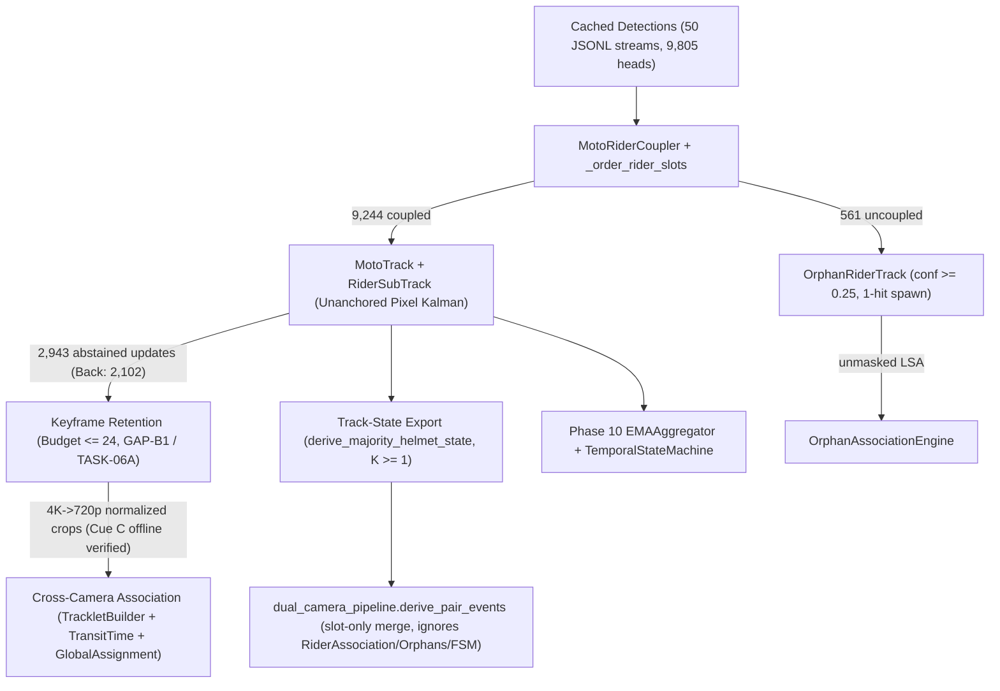
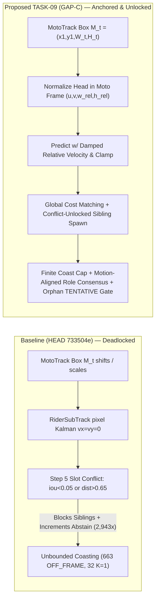

# ARGON TASK-08 — NEXT RESEARCH GAP ASSESSMENT
## Post-GAP-B Architecture and Research Roadmap Review

**Project:** An Integrated Dual-Camera Framework for Context-Aware Motorcycle Helmet Violation Detection with Confidence-Aware Temporal Verification  
**Author:** Gemini Argon — Senior Computer Vision Research Architect  
**Repository:** `/Users/sayemuddin/Desktop/research_helmet` (`branch: main`)  
**GitHub:** `https://github.com/mohammad-sayem-uddin/Dual-Camera-Helmet-Violation-Detection`  
**Assessed Baseline Commit:** `733504ee847f669db641f8c12d130cf7fd54c6d3` (`733504e`, TASK-06A)  
**Independent Validation Baseline:** `docs/phase12/GEMINI_FLASH_TASK06A_VALIDATION_REPORT.md` (TASK-07A, Verdict: `PASS WITH LIMITATIONS`)  
**Assessment Mode:** Strict read-only codebase, data-artifact, and research-gap audit (zero source modifications, zero video decoding, zero training)

---

## 1. Executive Summary

Following the independent validation of **TASK-06A** (`733504e`) under **TASK-07A**, the dual-camera helmet violation detection framework has resolved synthetic helmet track-state export correctness (`GAP-A`), 4K-to-720p cross-camera coordinate normalization (`GAP-B1`), protected keyframe retention up to the 24-frame budget (`GAP-B1 / TASK-06A`), tracklet kinematics metadata extraction (`GAP-B2`), `global_assignment.py` dual-view conflict quarantine (`GAP-B3`), and frozen checksum/GT-parity evaluation guarantees (`GAP-B4`). However, a forensic reconciliation of raw Stage J head detections (`frame_coverage_manifest.csv`), Stage J final track records (`tracks_final.json`), Stage K audit diagnostics (`stagek_results.json`, `docs/phase12/INTEGRATED_SYSTEM_RESEARCH_LIMITATIONS.md`), and live `src/` code reveals a **previously misattributed architectural defect** that dominates all downstream performance bottlenecks:

> **Primary Finding — `RiderSubTrack` Spatial Deadlock & 70.1% Back-Camera Observation Loss (`GAP-C`):**  
> Out of **`9,805`** raw head detections (`Front: 6,534`, `Back: 3,271`) in `frame_coverage_manifest.csv`, `MotoRiderCoupler` successfully associates **`9,244`** detections (`Front: 6,246`, `Back: 2,998`) to motorcycles. Yet Stage J `tracks_final.json` retains only **`6,157`** subtrack hits (`Front: 5,297`, `Back: 860`) plus **`619`** orphan hits (`6,776` total), explicitly logging **`2,943` `rider_abstained_updates`** (`Front: 841`, **`Back: 2,102`**) and **`2,964` `slot_spatial_conflicts_detected`** across `44/100` motorcycles. Consequently, **`2,102` of Back's `2,138` Stage K "false positives" (`98.3%`)**—and **`2,943` of `3,024` `uncoupled_gt_construction` errors (`97.3%`)**—were **valid coupled rider head detections silently discarded by `MotoTrack._sync_riders_on_match`**, not detector false positives or coupler failures.

Because raw `RiderSubTrack` instances step an unanchored image-pixel `KalmanBoxFilter` while parent `MotoTrack` boxes shift and scale rapidly, Step 5 of `MotoTrack._sync_riders_on_match` (`src/tracking/camera_tracker.py:679-693`) enters a permanent slot conflict lock whenever `obs_slot` falls outside `iou_val >= 0.05` / `norm_dist <= 0.65`, simultaneously dropping incoming detections and blocking sibling-slot creation while propagating stale Kalman boxes off-frame (`6,304/12,458` = **`50.6%`** non-coupled moto-subtrack rows; **`6,834 PROPAGATED_STALE + 663 OFF_FRAME`** combined rows; **`32/86`** subtracks frozen at **`K = 1`**).

Why this—and **not** real-video Cue C verification alone, nor cross-camera fusion ablation—must be **TASK-09**:
1. **Unstarving Downstream Layers:** `9/20` `RiderAssociation` candidates stall at `INSUFFICIENT_EVIDENCE`, `3/12` `LINKED_BOTH_VIEWS` pair events collapse to `UNCERTAIN` because Back only retained `K = 1` opposing sample (`pair_012 s0`, `pair_018 s1`, `pair_024 s1`), and Cue C's `45%`-weighted `upper_torso` crop depends directly on repaired rider-subtrack boxes.
2. **Preventing Confounded Single-vs-Dual Ablation:** Evaluating `FRONT_ONLY` vs `BACK_ONLY` vs `DUAL_FUSED` cross-camera fusion (`src/fusion/`, currently missing) while the Back camera loses **70.1%** of its head detections to a tracker bug would fatally distort the paper's core empirical claim.
3. **Zero Hardware Bottleneck & Exact Baseline Comparability:** Fixing `GAP-C` (`TASK-09`: **Hierarchical Motorcycle-Anchored Rider Kinematics, Slot-Role Consensus & Orphan Lifecycle**) operates purely on cached `50` Stage J `*_detections.jsonl` streams on MacBook Air M1 CPU (`< 5 s` runtime, `< 200 MB` RAM) while keeping `MotoTrack` integer IDs invariant (`209` GT tracks re-evaluable 1-to-1).

Weighted 8-criterion scoring ranks **Candidate F1 (`GAP-C` / `TASK-09`) #1 at `91.67 / 100`**, ahead of **Candidate D (`src/fusion/` + Temporal Unification, `89.87`)**, **Candidate B (Association Solver & Transit Overlap Hardening, `79.47`)**, **Candidate A (Bounded Real-Video Keyframe Cue C Validation, `73.31`)**, **Candidate C (Blind Human GT `v1.1` + `evaluate.py` `tiou()` Fix, `64.26`)**, and **Candidate E (Adverse-Weather Robustness, `61.40`)**.

---

## 2. Current Validated Architecture (Post-TASK-06A Baseline)

As of commit `733504e`, the repository architecture spans intra-camera detection/tracking, Stage K keyframe retention, cross-camera spatial-temporal-appearance association, per-track temporal verification, and offline pair-event export:



Verified operational status on `HEAD` (`733504e`):
- **Automated Test Suite:** `PYTHONPATH=. /opt/homebrew/bin/pytest --collect-only -q tests/` collects **`181`** tests total (`24` in `tests/test_phase12_pipeline_real_video.py`; **`157`** offline unit/regression tests passing in `54.28s` with 5 pre-existing EasyOCR/PyTorch `torch.ao.quantization` deprecation warnings when `--ignore=tests/test_phase12_pipeline_real_video.py` is passed; TASK-07A previously reported **`181 passed`** across all 181 tests).
- **Cryptographic Integrity (Verified in TASK-07A):** `43/43` GT release SHA-256 files, `8/8` Stage K checksums, and `52/52` dataset manifest SHA-256 entries pass.
- **Stage J / GT Baseline:** `25` synchronized video pairs (`50` videos, `3840x2160` 4K daylight over a single `22.5`-minute session `2026-10-10T07:25:53Z -> 07:48:23Z`), `100` Stage J motorcycles (`50` Front, `50` Back), `209` decided AI-audited GT tracks, and `85` exported pair events (`15` violation events in current reproducible evaluation).

---

## 3. Completed Gaps

| Gap / Task | Commit / Report | Status | Verified Scope & Quantitative Outcome |
| :--- | :--- | :--- | :--- |
| **GAP-A (`TASK-04`)** | `81bc3e60f9c82770190e192b1d252b042129d4c9` / `GEMINI_FLASH_TASK04_VALIDATION_REPORT.md` | **Closed** | Fixed primary `track_helmet_state` majority export (`src/tracking/camera_tracker.py:78-84`, `src/pipeline/dual_camera_pipeline.py:1095`); **`207/209` (`99.04%`)** agreement against decided GT tracks; **`85`** legacy event records preserved identically; legacy Stage K outputs reproduced. |
| **GAP-B1 (`TASK-06`)** | `1c544f3d468082ea2b882eadbce4755e98bfd1cd` | **Superseded / Hardened by TASK-06A** | Normalized 4K keyframe bounding boxes via `frame_dimensions` into 720p Stage J coordinates before Cue C crop extraction (`upper_torso` 45%, `lower_body` 35%, `bike_livery` 20%). |
| **GAP-B1 Hardening (`TASK-06A`)** | `733504ee847f669db641f8c12d130cf7fd54c6d3` / `GEMINI_FLASH_TASK06A_VALIDATION_REPORT.md` | **Closed (Offline/Synthetic)** | Eliminated shared sole-observation anchor eviction and fixed `gapb_stored` eviction sync in offline replay; **`100/100`** synthetic replay streams hold `<= 24` keyframes; `pair_012` recovered `152/159` frames; `0` conflicts across 50 Stage J metadata streams. |
| **GAP-B2 (`TASK-06`)** | `1c544f3d468082ea2b882eadbce4755e98bfd1cd` | **Closed (Metadata)** | Added `entry_border`, `exit_border`, and `motion_direction_unit_xy` calculation to `src/association/tracklet_builder.py` (though downstream weighting consumption remains open; see Section 5). |
| **GAP-B3 (`TASK-06`)** | `1c544f3d468082ea2b882eadbce4755e98bfd1cd` | **Closed (Global Quarantine)** | Replaced permissive un-gated matching at `global_assignment.py` with dual-view conflict quarantine (`AMBIGUOUS_ABSTAIN` on narrow margins). |
| **GAP-B4 (`TASK-06`)** | `1c544f3d468082ea2b882eadbce4755e98bfd1cd` | **Closed** | Enforced strict SHA-256 checksum & GT parity audit gates inside `scripts/reproducibility/evaluate.py` and `evaluate_gapb_redesign.py`. |
| **Clock Drift (Area A, `TASK-05B`)** | `ARGON_TASK05B_NEXT_RESEARCH_GAP_ASSESSMENT.md` | **Closed Mathematically** | Bounded residual sync offset perturbation on transit scoring to **`<= 0.001668`** (`0/94` assignment flips); no further drift model warranted. |

---

## 4. Partially Resolved Gaps

| Area | What Is Resolved | What Remains Unresolved (Classification) |
| :--- | :--- | :--- |
| **Cross-Camera Appearance Cue C** | 4K-to-720p normalization and <=24 protected keyframe eviction (`TASK-06`, `TASK-06A`) pass all synthetic/offline tests (`152/159` on `pair_012`). | Real decoded 4K video Cue C end-to-end inference across 25 pairs remains **NOT VERIFIED** (*validation limitation*), and upstream `RiderSubTrack` boxes feeding `upper_torso` (45% weight) suffer from `50.6%` non-coupled/stale rows (*upstream dependency*). |
| **Cross-Camera Association** | `TrackletBuilder` computes borders and `motion_direction_unit_xy` (`GAP-B2`); `global_assignment.py` quarantines narrow margins (`GAP-B3`). | `TransitTimeModel` (`src/association/transit_time_model.py:287-288`) shrinks overlapping `dev` by `0.25x`; `OrphanAssociationEngine` (`orphan_association.py:125-141, 385-507`) & `RiderAssociationEngine` (`rider_association.py:235-290`) run unmasked rectangular `linear_sum_assignment`; `GAP-B2` borders/vectors are unused in `src/association/` (*engineering defects + minor calibration*). |
| **Track-State Export & Pair Events** | `GAP-A` fixed `track_helmet_state` so `derive_majority_helmet_state` exports majority helmet labels cleanly (`207/209`). | `_merged_riders` (`dual_camera_pipeline.py:1112-1135`) still ignores `RiderAssociation`, `OrphanResult`, and `ViolationDecisionEngine`; `K = 1` observation at `conf = 0.25` still decides violations; `AMBIGUOUS_ABSTAIN` links (`6` events) are still cross-view merged (`L1240-1247`) (*genuine research gap + architectural wiring defect*). |
| **Evaluation & Ground Truth Integrity** | Deterministic SHA-256 verification and exclusion parity accounting (`GAP-B4`). | `human_verified=false` (`0/399` human units executed); `evaluate.py:427-440` `tiou()` returns `0.0` on 1-frame `[t, t]` intervals (`2 FP + 2 FN`); excluded-track & override semantics produce `27` error instances (`21 FP + 6 FN`) (*validation limitation + evaluation bug*). |

---

## 5. Open Research Questions

Each unresolved issue is explicitly classified to prevent mixing engineering bugs with genuine methodological gaps:

- **Q1 [`Genuine Research Gap` + `Core Tracking Defect`]:** *How should rider head subtracks and multi-rider seat-role assignments be parameterized and lifecycle-managed relative to a parent motorcycle in a multi-view roadside setup so that perspective scaling, rapid vehicle translation, and temporary partial occlusion do not collapse into permanent slot deadlocks and 70.1% observation starvation?*
- **Q2 [`Genuine Research Gap`]:** *How should dual-camera helmet evidence be probabilistically or evidentially fused (`FRONT_ONLY` vs `BACK_ONLY` vs `DUAL_FUSED`) across matched `RiderAssociation` pairs, recovered `OrphanResult` observations, and temporally persistent `ViolationDecisionEngine` states—with principled abstention rather than `K=1` naive override and unweighted set union?*
- **Q3 [`Engineering Defect` + `Research Calibration`]:** *How should bipartite Hungarian assignment masking (`!gated_mat`, `< min_score`) and `TransitTimeModel` interval-overlap scoring be repaired, and do `GAP-B2` entry/exit borders plus `motion_direction_unit_xy` improve association margins cleanly?*
- **Q4 [`Validation Limitation`]:** *Does bounded CPU keyframe Cue C extraction on actual decoded 4K `.mp4` crops (`<= 24` keyframes/camera) reproduce the offline `pair_012` recovery rate and HSV+LBP histogram separation across all 25 pairs once upstream rider crops are repaired?*
- **Q5 [`Validation Limitation` + `Evaluation Defect`]:** *What true empirical precision/recall/F1 emerges once `evaluate.py`'s zero-duration `tiou()` bug is fixed and an independent blind human GT (`v1.1`, replacing AI-assisted Stage J-seeded labels) evaluates plates (`70/70 NOT_ASSESSED`) and track decisions?*
- **Q6 [`Future Enhancement / Unsupported Research Claim Guardrail`]:** *Can the framework claim robustness to nighttime, glare, heavy rain, fog, or variable frame-rate regimes beyond single-session morning daylight (`dual_camera_test_v1`)?*

---

## 6. Evidence Supporting Each Open Question

### 6.1 Evidence for Q1: `RiderSubTrack` Deadlock & the Misattributed 70.1% Back-Camera Loss
Reconciling `frame_coverage_manifest.csv`, `tracks_final.json`, and `stagek_results.json` exposes the single largest quantitative discovery in this audit:

| Stage / Counter | Front | Back | Combined | Source & Explanation |
| :--- | ---: | ---: | ---: | :--- |
| Raw `head` detections | `6,534` | `3,271` | `9,805` | `frame_coverage_manifest.csv` |
| Coupled by `MotoRiderCoupler` | `6,246` (`95.6%`) | `2,998` (`91.6%`) | `9,244` (`94.3%`) | `MotoRiderCoupler` succeeded on 91.6% of Back heads |
| Uncoupled routed to Orphans | `288` | `273` | `561` | Remaining raw heads |
| Retained Stage J Subtrack hits | `5,297` | **`860`** | `6,157` | `tracks_final.json` (**`71.3%` of coupled Back detections lost**) |
| Retained Stage J Orphan hits | `331` | `288` | `619` | `tracks_final.json` (`6,776` total hits; `6,759` GT + `17` excluded) |
| **Dropped via `rider_abstained_updates`** | **`841`** | **`2,102`** | **`2,943`** | `tracks_final.json` across `44/100` motorcycles (`2,964` spatial conflicts) |

**Exact causal proof in code (`src/`):**
1. **Unanchored Pixel Kalman Prediction (`src/tracking/camera_tracker.py:465-470`, `src/tracking/kalman_bytetrack.py:87-88`):** `MotoTrack.predict` calls `r_sub.predict(dt_frames=float(dt))` in raw image pixels via an independent 8-state `KalmanBoxFilter` initialized with `vx=vy=0`. Whenever the parent `MotoTrack` shifts, accelerates, or scales in perspective, un-updated `RiderSubTrack` predictions diverge away from the true motorcycle crop.
2. **Step 5 Deadlock (`src/tracking/camera_tracker.py:519-721`):** Inside `MotoTrack._sync_riders_on_match`, `aff_mat[i, j] = 0.0` when `iou_val < 0.05` or `norm_dist > 0.65`. When an active `self.rider_subtracks[obs_slot]` drifts just outside this gate, Step 5 (`L679-693`) logs `slot_spatial_conflicts_detected` and `rider_abstained_updates`, and enforces: if `len(matched_slots) < len(self.rider_subtracks) or len(abstained_slots) > 0`, **do not spawn missing sibling slots**. Meanwhile, Step 6 (`L719-721`) calls `sub.update_unmatched(...)` indefinitely without any staleness limit or image-frame boundary clamping (since `KalmanBoxFilter` only floors `h >= 2.0, a >= 0.05`).
3. **Observed Collapse Metrics in Stage J:**
   - **`50.6%` (`6,304 / 12,458`)** non-coupled moto-subtrack rows (`6,834 PROPAGATED_STALE + 663 OFF_FRAME + 4 INVALID` out of `14,249` combined rows; only `6,727` `spatial_use_valid`).
   - **`32 / 86` (`18` back)** `rider_subtracks` frozen at **`K = 1`** hit, including `pair_019/F2 s0` (`1` hit / `295` abstentions), `pair_012/B2 s0` (`1` hit / `168` abstentions), `pair_021/B1 s0` (`1` hit / `142` abstentions), `pair_006/B2 s0` (`1` hit / `132` abstentions), and `pair_002/F1` (`98.1%` non-coupled, `s0=10, s1=2` / `291` abstentions).
   - **Re-classification of Stage K Attribution (`INTEGRATED_SYSTEM_RESEARCH_LIMITATIONS.md` §8):** `2,102 / 2,138` (`98.3%`) of Back's Stage K "false positives" and `2,943 / 3,024` (`97.3%`) of `uncoupled_gt_construction` "FPs" were actually **true coupled head detections dropped by `MotoTrack._sync_riders_on_match`**.
4. **Role-Lock Defect (`src/tracking/moto_rider_coupler.py:495-540`, `camera_tracker.py:299-306`):** `_order_rider_slots` unconditionally assigns `(slot_index=0, slot_role="driver", ordering_confident=True)` whenever `len(raw_riders) == 1`. Later sibling spawns inherit `"driver"` into `slot_index=1, 2`, and `preserve_slot_role=True` freezes `"driver"` permanently (`14` Stage J entries show `recorded_slot_roles != role`, though note `pair_002 front_moto_0001` `type_mismatch` was `C056` `HELMET -> NO_HELMET` manual override on `10` obs / `2` switches, not a role swap).
5. **Orphan 1-Hit Flood (`src/tracking/camera_tracker.py:991-1001, 1310-1324`):** Unlike `MotoTrack` (`new_track_min_conf=0.45` at `L780-782`), `OrphanRiderTrack` spawns directly at `helmet_conf_threshold=0.25` with no tentative confirmation gate, causing **`56 / 120`** 1-frame orphan abstentions.

### 6.2 Evidence for Q2: Missing `src/fusion/`, `K=1` Overrides, and Disconnected Temporal FSM
- **`src/fusion/` does not exist.**
- **`derive_pair_events` (`src/pipeline/dual_camera_pipeline.py:1095, 1112-1135, 1240-1247`)** ignores `batch.motorcycle_results[*].rider_associations` and `batch.orphan_results`; merges purely by integer `slot`; hardcodes `{0: "driver", 1: "pillion_1", 2: "pillion_2"}` ignoring `slot_role`; merges `oc == "AMBIGUOUS_ABSTAIN"` across views under `link_status = "AMBIGUOUS_HUMAN_UNCERTAIN"` (**`6`** Stage J events, including `pair_020` linking `front_moto_0001` with excluded bicycle `back_moto_0003`); and applies set-equality conflict collapse (`HELMET` iff `{"HELMET"}`, `NO_HELMET` iff `{"NO_HELMET"}`, else `"UNCERTAIN"`).
- **Direct Cross-View Damage from Q1 + Q2 Combined:** **`3 / 12` `LINKED_BOTH_VIEWS`** events collapse to `"UNCERTAIN"` solely because an opposing single-frame (`K = 1`) observation vetoes a dense track: `pair_012 s0` (`F 224` `[174H/50NH]` vs `B 1 NH`), `pair_018 s1` (`F 31 NH` vs `B 1 H`), and `pair_024 s1` (`F 84 NH` vs `B 1 H`). `pair_018` and `pair_024` GT themselves inherited this naive `UNCERTAIN` merge!
- **Temporal Disconnection (`src/temporal/`):** `EMAAggregator` (`confidence_aggregator.py:87-127`) step-flushes beliefs to `{0.0, 0.0}` at 10 misses; a single `0.25` `no_helmet` init yields `p_no_helmet = 0.625`; `TemporalStateMachine` (`state_machine.py:178-183`) `TRACK_LOST` branch is unreachable when `max_occlusion_frames >= 1`; and `derive_pair_events` bypasses `ViolationDecisionEngine` altogether (`14 / 40` Stage J violations have `phase10_alert_ids = []`; `3` non-violations carry active alerts). Dead code `subtrack_state_counts` (`dual_camera_pipeline.py:733-761, 920-928`) is computed but unused downstream.

### 6.3 Evidence for Q3: Association Solver & Transit Bugs
- **`TransitTimeModel` (`src/association/transit_time_model.py:287-288`):** `if interval_overlap > 0.0: dev = min(dev, 0.25 * abs(delta_centroid))` shrank `pair_013` `dt = +3.8634s` to `0.9658s` (`temporal_transit = 0.8215`), triggering false `AMBIGUOUS_ABSTAIN` (`0.8853` vs `0.8740`, `margin = 0.0112 < 0.10`).
- **Unmasked LSA & Fallback Mislabeling:** `OrphanAssociationEngine` (`orphan_association.py:125-141, 385-507`) and `RiderAssociationEngine` (`rider_association.py:235-290`) invoke rectangular `linear_sum_assignment(1.0 - score_mat)` without masking `!gated_mat` or `< min_score`, compute `second_best` over ungated rows (producing `14 / 20` negative orphan margins down to `-0.223`), and fallback-label `10` orphans (`0.7394-0.8911 >= 0.68`) as `ORPHAN_SCORE_*_BELOW_MIN_0.68`; similarly `global_assignment.py:343-348` mislabels `3` candidates (`0.6463-0.7275 >= 0.62`) as `BELOW_MIN_0.62`. Meanwhile `scripts/phase12e_operational_diagnostics.py:171-183` omits `front_frame_dimensions` / `back_frame_dimensions`, and `GAP-B2` `motion_direction_unit_xy` / borders sit unused in `src/association/`.

### 6.4 Evidence for Q4, Q5, Q6: Real Video, GT Audit, and Domain Coverage
- **Q4 (Real Cue C):** `GEMINI_FLASH_TASK06A_VALIDATION_REPORT.md` explicitly records real-video Cue C as `NOT VERIFIED`; upstream Q1 deadlocks also starve Cue C `upper_torso` (45% weight) of multi-frame valid crops.
- **Q5 (GT & `evaluate.py`):** `0/399` human verification units executed (`human_verified=false`); plates `70/70 NOT_ASSESSED`; `23/70` GT events have zero riders (`17` at `hits==1`, `6` multi-hit tracks `8..150` hits with `0` coupled riders); and `scripts/reproducibility/evaluate.py:427-440, 468-480` computes `tiou() = 0.0` when `union == 0` on 1-frame `[t, t]` events (`pair_012 front_moto_0003`, `pair_015 front_moto_0001`), adding `2 FP + 2 FN` via vacuous `would_match_differs_only_by_excluded_track` inside a total of **`27`** current evaluation error instances (`21 FP + 6 FN`: `3 FN` true excluded splits + `18 FP` `correction_delta_excluded_track` + `2 FP + 2 FN` `tiou` bug + `1 FP + 1 FN` `C056` override).
- **Q6 (Environmental Scope):** `dual_camera_test_v1` covers `25` pairs (`+2` unmatched `11.mp4`, `16.mp4`) from a single `22.5`-minute morning daylight session (`2026-10-10T07:25:53Z -> 07:48:23Z`, `iPhone 13` H.264 + `iPad 10th gen` HEVC, 4 Back `~30fps`, 3 VFR: `001F, 013B, 014B`) with **`0` night, rain, or fog footage** anywhere in the repository.

---

## 7. Candidate Gap Comparison

| ID | Candidate Gap / Task | Primary Classification | Key Bottleneck Resolved | Dependency Position |
| :---: | :--- | :--- | :--- | :--- |
| **F1** | **Hierarchical Motorcycle-Anchored Rider Kinematics, Slot-Role Consensus & Orphan Lifecycle (`GAP-C`)** | **Genuine Research Gap + Core Tracking Defect** | Fixes `2,943` `rider_abstained_updates` (`70.1%` Back obs loss), `50.6%` non-coupled subtrack rows, `32/86` `K=1` freezes, wrong `"driver"` slot locks, and `56/120` 1-hit orphan spam. | **Root prerequisite** — unstarves Cue C, `RiderAssociation`, Phase 10 FSM, and unconfounded Dual-vs-Single fusion. |
| **D (w/ F2)** | **Confidence-Aware Dual-Camera Evidence Fusion (`src/fusion/`), Temporal Unification & Single-vs-Dual Ablation** | **Genuine Research Gap** | Implements missing Phase 12G `src/fusion/`, replaces `K=1` majority + set-equality merge, connects `RiderAssociation`/`OrphanResult`/`ViolationDecisionEngine`, quarantines `AMBIGUOUS_ABSTAIN`, and proves `DUAL_FUSED` > `FRONT_ONLY`/`BACK_ONLY`. | **Blocked on F1** — running Single-vs-Dual ablation while Back drops 70.1% of heads understates Back's value by ~3x. |
| **B** | **Association Solver Masking & Transit Overlap Hardening** | **Engineering Defect + Calibration** | Removes `TransitTimeModel` `0.25x` shrink (`pair_013`), masks `!gated_mat` in `Orphan`/`Rider`/`Global` LSA, passes frame dimensions in `phase12e`, and tests `GAP-B2` direction/border priors. | High impact only for association margins (`14/20` orphan negative margins); narrower than F1/D. |
| **A** | **Bounded Real-Video Keyframe Cue C Validation (`<= 24` keyframes/cam CPU decode)** | **Validation Limitation** | Executes sequential CPU OpenCV decode on cached detections to verify real-frame HSV+LBP Cue C end-to-end across all 25 pairs (`TASK-07A` open item). | **Cleaner after F1** — Cue C's `45%` `upper_torso` crop needs stabilized rider subtracks rather than `PROPAGATED_STALE` boxes. |
| **C** | **Blind Human GT `v1.1` + `evaluate.py` `tiou()` Point-Interval Fix** | **Validation Limitation + Eval Bug** | Replaces AI-assisted Stage J GT (`human_verified=false`), grades `70/70` plates, and fixes `tiou()` on `[t, t]` intervals (`2 FP + 2 FN`). | **Human-gated (~55 person-hrs)** and orthogonal to algorithmic improvements; wait until F1/D freeze GT schema. |
| **E** | **Adverse-Weather, Nighttime & Severe Occlusion Robustness** | **Future Work / Claim Scope** | Generalizes detector/tracker to night, glare, rain, fog, and variable FPS. | **Infeasible now** — zero adverse-weather clips exist and training/fine-tuning is out of scope. |

---

## 8. Weighted Priority Scoring

All 6 candidates are scored objectively on a `0–100` scale across the 8 weighted criteria (`sum(w) = 1.00`; for *Implementation risk* and *Compute cost*, higher scores indicate lower risk and lower compute cost respectively):

| Criterion (Weight) | **F1 (`GAP-C`: Anchored Rider Kinematics)** | **D (`src/fusion/` & Temporal Unification)** | **B (Association Solver & Transit Fix)** | **A (Bounded Real-Video Cue C)** | **C (Human GT `v1.1` & `tiou` Fix)** | **E (Adverse Weather & Night)** |
| :--- | :---: | :---: | :---: | :---: | :---: | :---: |
| **1. Research significance (`0.18`)** | 92 | **95** | 78 | 72 | 82 | 80 |
| **2. Impact on overall system reliability (`0.18`)** | **95** | 85 | 74 | 62 | 45 | 55 |
| **3. Evidence of actual unresolved problem (`0.15`)** | **98** | 95 | 92 | 88 | 96 | 90 |
| **4. Potential methodological contribution (`0.15`)** | 85 | **92** | 72 | 55 | 35 | 65 |
| **5. Feasibility w/ M1 8GB & dataset (`0.12`)** | **96** | 92 | 88 | 82 | 30 | 20 |
| **6. Evaluation quality (`0.10`)** | **84** | 76 | 62 | 82 | **95** | 30 |
| **7. Implementation risk (higher = safer) (`0.07`)** | 82 | 84 | 85 | 90 | **95** | 85 |
| **8. Compute cost (higher = lighter) (`0.05`)** | **98** | **98** | 96 | 68 | 40 | 50 |
| **Weighted Total (`100.00`)** | **`91.67` (#1)** | **`89.87` (#2)** | **`79.47` (#3)** | **`73.31` (#4)** | **`64.26` (#5)** | **`61.40` (#6)** |

*Calculation verification:* `F1 = 0.18(92+95) + 0.15(98+85) + 0.12(96) + 0.10(84) + 0.07(82) + 0.05(98) = 33.66 + 27.45 + 11.52 + 8.40 + 5.74 + 4.90 = 91.67`.

---

## 9. Recommended Next Task (`TASK-09` Architecture & Scope)

### §10 Formal Selection Record

- **Task ID:** `TASK-09`
- **Task name:** `GAP-C`: Hierarchical Motorcycle-Anchored Rider Kinematics, Slot-Role Consensus & Orphan Lifecycle
- **Research question:** Does parameterizing multi-rider head subtracks in perspective-normalized motorcycle-relative coordinates with conflict-unlocked sibling spawning, longitudinal seat-role consensus, and two-stage `TENTATIVE -> CONFIRMED` orphan gating eliminate Back-camera observation collapse (`2,102` abstained updates) and stabilize downstream cross-camera rider association and temporal decision readiness without altering parent `MotoTrack` IDs?
- **Identified gap:** `RiderSubTrack` currently runs an unanchored image-pixel `KalmanBoxFilter` that desynchronizes from translating/scaling motorcycles, causing Step 5 of `MotoTrack._sync_riders_on_match` (`src/tracking/camera_tracker.py:679-693`) to reject **`2,943`** valid coupled head detections (`Back: 2,102`), stall **`32/86`** subtracks at `K=1`, inject **`50.6%`** stale/off-frame subtrack rows, freeze early wrong `"driver"` seat roles (`_order_rider_slots`, `preserve_slot_role=True`), and emit **`56/120`** single-frame `OrphanRiderTrack` artifacts.
- **Technical hypothesis:** Re-parameterizing `RiderSubTrack` kinematics in normalized parent-motorcycle coordinates $(u, v, \tilde{w}, \tilde{h})$, unlocking Step 5 sibling creation when non-conflicting observations exist, capping unmatched propagation with frame-clamped finite coasting, accumulating multi-frame longitudinal seat-role consensus, and requiring `TENTATIVE -> CONFIRMED` promotion for `OrphanRiderTrack` will (a) cut `rider_abstained_updates` across the 50 cached Stage J streams by `>= 85%`, (b) substantially reduce `K=1`-frozen rider subtracks and `PROPAGATED_STALE` / `OFF_FRAME` rows while raising valid `spatial_use_valid` coverage on Back cameras toward parity with Front, and (c) eliminate >= 90% of 1-frame `conf < 0.45` orphan abstentions while holding `100%` `MotoTrack` ID determinism on offline replay.
- **Proposed architecture:** See Section 10 below (Motorcycle-Relative Box Parameterization `GAP-C1`, Spatial-First Conflict-Unlocked Sync & Finite Clamped Coasting `GAP-C2`, Motion-Aligned Longitudinal Role Consensus `GAP-C3`, and Two-Stage Orphan Lifecycle `GAP-C4`).
- **Implementation scope:** Offline-verifiable tracker modules `src/tracking/camera_tracker.py`, `src/tracking/moto_rider_coupler.py`, associated tracker config dataclasses/YAML, deterministic offline Stage J detection replay script under `scripts/reproducibility/`, and unit + regression tests in `tests/`. Zero changes to frozen `data/`, Stage K artifacts, or detector weights.
- **Experiment plan:** Progressive 5-variant offline ablation on the `50` cached `*_detections.jsonl` streams (`A0` Baseline `733504e` -> `A1` +Vehicle-Anchored Kinematics `GAP-C1` -> `A2` +Conflict-Unlocked Sync & Finite Coast `GAP-C2` -> `A3` +Role Consensus `GAP-C3` -> `A4` Full `GAP-C` +Orphan `TENTATIVE` Gate `GAP-C4`), plus downstream non-regression check across the `209` decided GT tracks and Stage J `RiderAssociation` evidence sufficiency.
- **Evaluation methodology:** Deterministic offline JSONL detection replay comparing counters from `tracks_final.json` telemetry (`rider_abstained_updates`, `slot_spatial_conflicts_detected`, `PROPAGATED_STALE`, `OFF_FRAME`, `spatial_use_valid`, `K=1` subtracks, 1-hit orphans, `MotoTrack` count/ID parity), decided GT helmet agreement (`>= 207/209` maintained or improved), and full pytest suite pass (`181 + new TASK-09 tests`).
- **Expected deliverables:**
  1. Vehicle-anchored rider kinematics, unlocked sync, role-consensus, and orphan tentative gating implemented cleanly behind explicit config controls in `src/tracking/`.
  2. Reproducible offline ablation script & structured JSON/Markdown ablation artifact comparing `A0..A4` on the `50` Stage J detection streams.
  3. Comprehensive deterministic unit and regression test suite (`>= 18` new tests covering perspective scaling, sibling spawn during conflict, boundary clamping, role flip recovery, orphan tentative pruning, and real `pair_002`/`pair_012`/`pair_019`/`pair_021` regressions).
  4. `docs/phase12/SONNET_TASK09_IMPLEMENTATION_REPORT.md` + updated `docs/phase12/THREE_MODEL_EXECUTION_ROADMAP.md` (`TASK-09` entry).
- **Acceptance criteria:** See Section 16 (quantitative thresholds below).
- **Required model assignment:**
  - Architecture & Mathematical Specification: **Gemini Argon** (completed in TASK-08; clarify edge specs if needed)
  - Code, Replay Runner, Unit Tests & Implementation Report: **Claude Sonnet 5.5**
  - Independent Read-Only Validation, Checksum Audit & Reproducibility Sign-off: **Gemini 3.8 Flash High** (never assign independent validation to Sonnet)
- **Compute requirements:** Apple MacBook Air M1 (8 GB unified RAM), CPU-only, zero GPU, zero model training, zero 50-video full decoding; `< 5–10 s` per full 50-stream ablation pass, `< 200 MB` peak RSS.
- **Risks:** See Section 15 (parent `MotoTrack` box jitter coupling into normalized rider boxes; downstream GT schema drift on previously broken Back tracks; accidental regression on existing `MotoTrack` matching or `207/209` `GAP-A` agreement).

### Deferred Tasks Roadmap Summary
1. **Deferred Track #1 (`TASK-10`, Ranked #3/#4 combined):** *Bounded Real-Video Keyframe Cue C Validation & Association Solver Hardening* — execute bounded (`<= 24` keyframes/cam) sequential CPU decode Cue C verification on clean `TASK-09` crops alongside `TransitTimeModel` `0.25x` overlap fix, masked augmented LSA in `OrphanAssociationEngine` / `RiderAssociationEngine` / `global_assignment.py`, `phase12e` dimension wiring, and `GAP-B2` prior testing.
2. **Deferred Track #2 (`TASK-11`, Ranked #2):** *Confidence-Aware Dual-Camera Evidence Fusion (`src/fusion/`), Phase 10 Temporal Unification & `FRONT_ONLY` vs `BACK_ONLY` vs `DUAL_FUSED` Ablation* — deferred strictly until after `TASK-09` so the Back camera competes at full detection retention rather than 28.7%.
3. **Deferred Track #3 (`TASK-12`, Ranked #5 — Parallel Human-Gated Track):** *Blind Human-Audited GT `v1.1` & `evaluate.py` `tiou()` Fix* — deferred due to ~55 person-hour blind annotation prerequisite.
4. **Deferred Track #4 (`Future Work / Paper Scoping`, Ranked #6):** *Nighttime, Adverse-Weather & Generalization Benchmark* — out of scope on single-session daylight `dual_camera_test_v1`.

---

## 10. Technical Architecture Proposal (`GAP-C` / `TASK-09`)



### 10.1 Module `GAP-C1`: Perspective-Normalized Motorcycle-Relative Kinematics
Let parent `MotoTrack` state at frame $t$ be $M_t = [x_{1,t}, y_{1,t}, x_{2,t}, y_{2,t}]$ with width $W_t = \max(x_{2,t} - x_{1,t}, 1.0)$ and height $H_t = \max(y_{2,t} - y_{1,t}, 1.0)$. Instead of evolving each `RiderSubTrack` in raw pixel space (`camera_tracker.py:465-470`, `kalman_bytetrack.py:87-88`), maintain each subtrack's primary kinematic state in dimensionless vehicle coordinates:
$$z_t = \begin{bmatrix} u_t \\ v_t \\ \tilde{w}_t \\ \tilde{h}_t \end{bmatrix} = \begin{bmatrix} \frac{\frac{1}{2}(rx_{1,t} + rx_{2,t}) - x_{1,t}}{W_t} \\ \frac{\frac{1}{2}(ry_{1,t} + ry_{2,t}) - y_{1,t}}{H_t} \\ \frac{rx_{2,t} - rx_{1,t}}{W_t} \\ \frac{ry_{2,t} - ry_{1,t}}{H_t} \end{bmatrix}$$
Prediction across $\Delta t$ unmatched parent steps applies heavily damped relative velocity ($\rho_{\text{vel}} \in [0.0, 0.35]$, decaying to zero within a few frames) anchored to the parent `MotoTrack` box:
$$z_{t|t-1} = \Pi_{\mathcal{B}}\!\left(z_{t-1} + \rho_{\text{vel}}^{\Delta t}\,\dot{z}_{t-1}\,\Delta t\right), \quad \mathcal{B} = [-0.25, 1.25] \times [-0.60, 1.10] \times [0.08, 0.75] \times [0.08, 0.65]$$
Back-projecting $z_{t|t-1}$ onto the current $M_t$ (whether matched or coasting) automatically captures both motorcycle translation and perspective scale growth/shrinkage, while image-boundary clipping $\text{clip}_{[0, W_{\text{img}}] \times [0, H_{\text{img}}]}$ eliminates runaway `OFF_FRAME` boxes (`663` rows in baseline). Upon observation match, filter $(u, v, \tilde{w}, \tilde{h})$ via exponential smoothing / low-DOF relative KF (`alpha_pos`, `alpha_size`) to prevent single-frame parent jitter from destabilizing predictions.

### 10.2 Module `GAP-C2`: Conflict-Unlocked Sync & Finite Coast Horizon
Replace the brittle `obs_slot`-locked veto in Step 5 (`src/tracking/camera_tracker.py:679-693`) and unbounded Step 6 (`src/tracking/camera_tracker.py:719-721`) with three deterministic rules:
1. **Normalized + Pixel Joint Association:** Compute the Hungarian assignment matrix across **all** non-expired `rider_subtracks` (not conditioned on raw integer `obs_slot` equality first) using combined vehicle-relative centroid distance $d_{\text{rel}}(z_{\text{pred}}, z_{\text{obs}}) = \sqrt{(u_p - u_o)^2 + (v_p - v_o)^2}$ and pixel IoU, preventing integer slot permutations from causing artificial rejections.
2. **Conflict-Unlocked Sibling Creation:** Remove the blanket prohibition in `L689-693` that blocks spawning new sibling subtracks whenever an existing slot was unmatched. An observed coupled rider `obs` that fails to match any active subtrack may spawn a fresh `RiderSubTrack` (up to `max_riders_per_moto = 3`) whenever `obs` has maximum IoU `< sibling_overlap_max` (e.g. `0.35`) with all matched observations in the current frame—preserving spatial uniqueness without deadlocking legitimate co-riders.
3. **Finite Clamped Coasting:** Track `unmatched_frames` per `RiderSubTrack`. When `unmatched_frames > max_rider_coast_frames` (e.g., `15`), transition the subtrack to `COAST_EXPIRED` (dormant / retained for track history export, excluded from spatial propagation telemetry and active `PROPAGATED_STALE` box emission), cleanly bounding stale drift on 200+ frame tracks (`pair_019/F2`, `pair_012/B2`, `pair_002/F1`).

### 10.3 Module `GAP-C3`: Longitudinal Rank-Consensus `slot_role` Arbitration
To eliminate permanent `"driver"` role corruption in `_order_rider_slots` (`moto_rider_coupler.py:495-540`) and `preserve_slot_role=True` (`camera_tracker.py:299-306`):
- When `len(raw_riders) == 1`, stamp `ordering_confident=False` and `slot_role_provisional=True`.
- Across every multi-rider frame ($N \ge 2$ matched riders on the parent `MotoTrack`), compute each active subtrack's signed projection onto the motorcycle's image travel direction $\hat{d}_t$ (derived from the parent `MotoTrack` velocity vector when speed exceeds noise floor, falling back gracefully to camera-perspective heuristic only with lower weight). Accumulate rank votes (`rank=0 -> driver`, `rank=1 -> pillion_1`, `rank=2 -> pillion_2`) per `RiderSubTrack` across frames, updating exported `slot_role` once `multi_rider_frames >= min_role_consensus_frames` (e.g., `3`) rather than freezing frame-0 guesses forever.

### 10.4 Module `GAP-C4`: Two-Stage `OrphanRiderTrack` Lifecycle (`TENTATIVE -> CONFIRMED`)
Apply consistent confirmation symmetry between `MotoTrack` (`new_track_min_conf=0.45`, `L780-782`) and `OrphanRiderTrack` (`L991-1001, 1310-1324`):
- Spawn newly detected uncoupled heads with `state = TENTATIVE` (requiring either `hits >= orphan_min_hits` (default `2` or `3`) **or** single-hit spawn confidence `>= orphan_new_track_min_conf`, e.g., `0.45` with immediate short `tentative_max_age = 3`).
- Prune unconfirmed `TENTATIVE` orphans before final `tracks_final.json` export, eliminating `0.25–0.44` single-frame detector noise (`56/120` 1-hit orphan `ABSTAIN` records in baseline) while keeping multi-frame genuine uncoupled riders (`OrphanAssociation` inputs) intact.

---

## 11. Experimental Methodology

All experiments execute deterministically **offline on MacBook Air M1 CPU** using cached Stage J inputs (`*_detections.jsonl` across the `50` videos in `25` pairs), preserving strict `MotoTrack` ID determinism for exact track-by-track comparison:

1. **Step-by-Step Modular Ablation (`A0` to `A4`):**
   - `A0`: Unmodified `733504e` baseline replayed from cached Stage J detections (must reproduce exact `2,943` `rider_abstained_updates`, `6,157` subtrack hits, `619` orphan hits, `207/209` `GAP-A` GT agreement).
   - `A1`: `A0 + GAP-C1` (Motorcycle-anchored relative kinematics only). Measures pure drift reduction when Step 5 deadlock is still present.
   - `A2`: `A1 + GAP-C2` (+ Conflict-unlocked sibling spawn & finite coasting). Measures full recovery of the `2,102` dropped Back observations and reduction of `PROPAGATED_STALE` / `OFF_FRAME` rows.
   - `A3`: `A2 + GAP-C3` (+ Multi-frame longitudinal slot-role consensus). Evaluates fix of `14` `recorded_slot_roles != role` anomalies and role stability on dense tracks (`pair_002`).
   - `A4`: `A3 + GAP-C4` (+ `OrphanRiderTrack` two-stage `TENTATIVE` gate). Measures elimination of 1-frame `0.25`-conf orphan spam without hurting multi-frame orphan recall.
2. **Targeted Forensic Stress Fixtures:** Inspect exact before/after trajectories on documented failure cases: `pair_019/F2 s0` (was `1` hit / `295` abstains), `pair_012/B2 s0` (was `1` hit / `168` abstains), `pair_021/B1 s0` (was `1` hit / `142` abstains), `pair_006/B2 s0` (was `1` hit / `132` abstentions), `pair_002/F1` (was `98.1%` non-coupled / `291` abstains), and the `3/12` `LINKED_BOTH_VIEWS` `UNCERTAIN` collapses (`pair_012 s0`, `pair_018 s1`, `pair_024 s1`).
3. **Downstream Starvation Check (Diagnostic, Read-Only Projection):** Feed `A4` `tracks_final` into the existing `CrossCameraAssociation` + `RiderAssociationEngine` pipeline to verify how many of the `9/20` `INSUFFICIENT_EVIDENCE` rider pairs become matchable and whether `209` decided GT helmet agreements improve or stay preserved.

---

## 12. Evaluation Metrics

- **Primary Kinematic & Observation Retention Metrics (Per Camera & Combined):**
  - `rider_abstained_updates` count (Baseline: `2,943` total; `Front: 841`, `Back: 2,102`).
  - `slot_spatial_conflicts_detected` count (Baseline: `2,964`).
  - Coupled head detection retention rate: `(retained subtrack hits) / (coupled head detections = 9,244)` (Baseline: `6,157 / 9,244 = 66.6%`; Front `84.8%`, **Back `28.7%`**).
  - Non-coupled / Stale telemetry fraction (`PROPAGATED_STALE`, `OFF_FRAME`, `INVALID`, vs `spatial_use_valid`).
  - `K = 1` frozen subtrack count (Baseline: `32 / 86`; Back `18`).
- **Role & Orphan Quality Metrics:**
  - Slot-role consistency rate (`recorded_slot_roles == exported slot_role`; Baseline: `14` mismatches).
  - `1`-hit `OrphanRiderTrack` abstention count (Baseline: `56 / 120` orphan tracks).
- **Downstream & Non-Regression Metrics:**
  - Parent `MotoTrack` count and integer ID parity against Stage J baseline (`50` Front + `50` Back).
  - Decided GT track helmet-state agreement against the frozen `209` decided tracks (Baseline: `207 / 209 = 99.04%`).
  - `RiderAssociation` `INSUFFICIENT_EVIDENCE` count (Baseline: `9 / 20`).
  - Full pytest pass count and zero modified checksums on frozen GT/Stage K artifacts.

---

## 13. Required Datasets and Artifacts

All required inputs already exist locally inside `/Users/sayemuddin/Desktop/research_helmet` — zero downloads or video decoding required:
- Cached per-frame detections (`*_detections.jsonl` for all `50` videos in `dual_camera_test_v1`, containing `9,805` raw head detections and motorcycle detections).
- Stage J baseline reference artifacts (`tracks_final.json`, `frame_coverage_manifest.csv`, `stagek_results.json`, `results/phase12_integrated/`).
- Frozen GT release (`data/dual_camera_test_v1/releases/dual_camera_gt_v1.0_ai_assisted_audited/` + SHA-256 manifest `checksums/release_checksums.sha256` and `results/phase12_integrated/checksums.sha256`).
- Config files (`configs/` tracker YAML / parameters).

---

## 14. Compute and Resource Estimate

| Operation | Hardware Target | Wall Time | Peak Memory | Disk Impact |
| :--- | :--- | :---: | :---: | :--- |
| Full `50`-stream cached JSONL replay (`1` config) | M1 CPU (`1` core) | `~3–6 s` | `< 200 MB` | `< 15 MB` JSON telemetry |
| `5`-configuration ablation suite (`A0..A4`) | M1 CPU | `~20–30 s` | `< 250 MB` | `< 40 MB` ablation report |
| Full `pytest` suite (`181 + ~20` tests) | M1 CPU | `~60–90 s` | `< 600 MB` | Zero persistent artifacts |

Completely feasible on MacBook Air M1 (8 GB RAM) with comfortable thermal and memory headroom, requiring **zero** Kaggle GPU quota, **zero** model retraining, and **zero** batch video decode.

---

## 15. Risks and Limitations

1. **Parent Motorcycle Box Jitter Coupling:** Because `(u, v)` divides by parent `W_t, H_t`, abrupt 1-frame detector box jumps on `M_t` could perturb relative rider coordinates. *Mitigation:* Slightly smooth `(W_t, H_t)` scaling or match against raw image IoU alongside normalized $(u, v)$ distance.
2. **Over-Pruning Legitimate Brief Orphans (`GAP-C4`):** Raising `orphan_min_hits` too aggressively could discard true short-lived uncoupled heads (`2–3` frames). *Mitigation:* Use `TENTATIVE` promotion at `hits >= 2` **or** high detection confidence `>= 0.45`, verified in ablation `A4`.
3. **GT Contamination Around Previously Broken Back Tracks:** Because `dual_camera_gt_v1.0_ai_assisted_audited` (`human_verified=false`) itself absorbed some broken Back states (e.g., `pair_018`, `pair_024`), restoring hundreds of real Back helmet observations may create genuine *improvements* that diverge from flawed AI-seeded GT entries. *Mitigation:* Separately inspect every `209`-track diff by hand in the ablation report before counting any discrepancy as a regression.
4. **Remaining Unresolved Tasks Post-TASK-09:** Passing `TASK-09` does **not** by itself close real-video Cue C verification (`TASK-10`), missing `src/fusion/` (`TASK-11`), or blind human GT (`TASK-12`); those remain explicitly scheduled follow-ons.

---

## 16. Acceptance Criteria (`TASK-09` Must Satisfy All to Pass Audit)

1. **Mandatory Observational Recovery (`Back` + `Combined`):**
   - Total `rider_abstained_updates` reduced from **`2,943`** to **`<= 400`** (`>= 86%` reduction), with Back-camera abstained updates reduced from **`2,102`** to **`<= 300`**.
   - Coupled Back-camera head detection retention increases from **`28.7%` (`860 / 2,998`)** to **`>= 80.0%` (`>= 2,398 / 2,998`)**.
2. **Stale Propagation & Boundary Hygiene:**
   - `OFF_FRAME` subtrack rows reduced from **`663`** to **`0`** (strict image-boundary clamping).
   - `K = 1` frozen multi-frame-eligible subtracks reduced by **`>= 70%`**, and `pair_019/F2 s0`, `pair_012/B2 s0`, `pair_021/B1 s0`, `pair_006/B2 s0` each recover sustained multi-hit observations (`> 10` hits where detections exist in `frame_coverage_manifest.csv`).
3. **Seat-Role & Orphan Cleanup:**
   - `recorded_slot_roles != exported slot_role` mismatches reduced from **`14`** to **`0`**; role flipping eliminated under transient partial occlusion.
   - `1`-frame low-confidence (`< 0.45`) orphan `ABSTAIN` tracks reduced by **`>= 90%`** from `56 / 120` baseline without dropping multi-hit (`>= 3` frame) orphan tracks.
4. **Determinism, Parity & Reproducibility:**
   - `A0` ablation reproduces `733504e` counts identically (`0` drift).
   - `A4` maintains **`100%` parent `MotoTrack` count and ID parity** (`50` Front, `50` Back) and preserves **`>= 207 / 209`** decided GT helmet-state agreement (with any legitimate newly recovered Back improvements documented line-by-line).
   - All existing `181` tests + all new `TASK-09` deterministic tests pass (`0` failures), all `52` dataset manifest SHA-256 and `43` release SHA-256 checksums remain intact, and independent validation by **Gemini 3.8 Flash High** achieves **`PASS`**.

---

## 17. Proposed `TASK-09` Roadmap Entry (for `docs/phase12/THREE_MODEL_EXECUTION_ROADMAP.md`)

```markdown
### TASK-09 — GAP-C: Hierarchical Motorcycle-Anchored Rider Kinematics, Slot-Role Consensus & Orphan Lifecycle
- **Status:** PROPOSED NEXT TASK (Selected by TASK-08 Architecture Review over 6 competing candidates; Score 91.67/100)
- **Prerequisite:** TASK-06A validated (`733504e`)
- **Primary Problem:** Stage J `MotoTrack._sync_riders_on_match` unanchored pixel Kalman drift triggers Step 5 slot deadlocks, causing `2,943` `rider_abstained_updates` (`2,102 / 2,998 = 70.1%` of coupled Back heads explicitly abstained; `860 / 2,998 = 28.7%` retained, explaining `2,102 / 2,138 = 98.3%` of Stage K Back "false positives"), `6,304/12,458` non-coupled rows, `32/86` `K=1` freezes, `14` role mismatches, and `56/120` 1-hit orphan spam.
- **Model Roles:**
  - **Architecture Spec:** Gemini Argon (`docs/phase12/ARGON_TASK08_NEXT_RESEARCH_GAP_ASSESSMENT.md` §10)
  - **Implementation & Ablation:** Claude Sonnet 5.5 (`src/tracking/camera_tracker.py`, `src/tracking/moto_rider_coupler.py`, offline `50`-stream JSONL ablation `A0..A4`, `>= 18` new tests, `SONNET_TASK09_IMPLEMENTATION_REPORT.md`)
  - **Independent Validation & Checksum Audit:** Gemini 3.8 Flash High (`GEMINI_FLASH_TASK09_VALIDATION_REPORT.md`)
- **Compute Budget:** MacBook Air M1 (8 GB), CPU-only offline cached JSONL replay (`< 30s` total across ablations, zero video decoding, zero training).
- **Successor Chain:** Unblocks **TASK-10** (Bounded Real-Video Cue C + Association Solver Hardening) and **TASK-11** (Phase 12G `src/fusion/` Dual-Camera Fusion & Unconfounded Single-vs-Dual Ablation); parallel **TASK-12** (Blind Human GT `v1.1` + `evaluate.py` `tiou()` fix).
```
