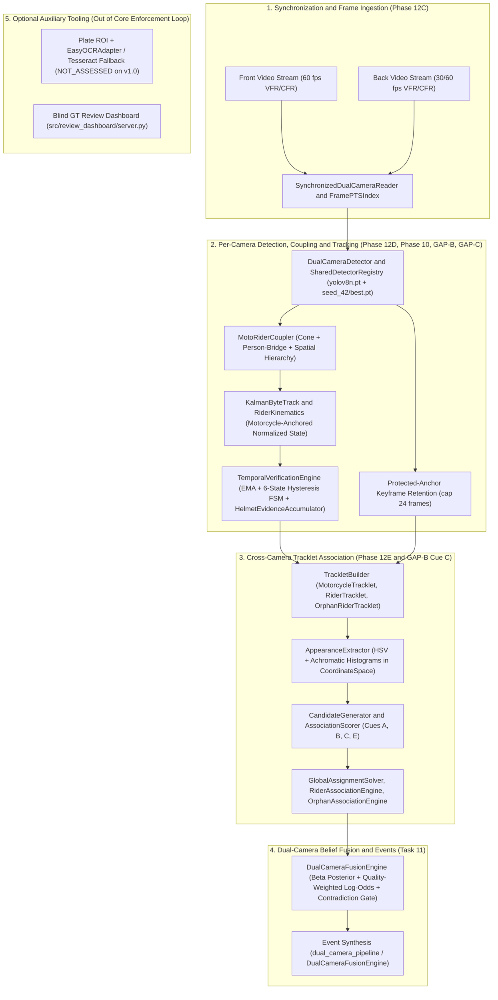
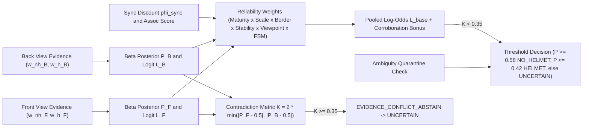

# Final Integrated System Architecture

**Project:** An Integrated Dual-Camera Framework for Context-Aware Motorcycle Helmet Violation Detection with Confidence-Aware Temporal Verification  
**Repository:** `Dual-Camera-Helmet-Violation-Detection` (`main`)  
**Status:** Final Integrated System Documentation (Phases 1–12 & Tasks `TASK-04`, `TASK-06/06A`, `TASK-09/09A/09B`, `TASK-10`, `TASK-11`, `TASK-12`)

---

## 1. Architectural Overview & Core Design Philosophy

Real-world roadside helmet violation enforcement must overcome two coupled failure modes simultaneously:
1. **Spatial–Perspective Domain Collapse:** Detectors trained exclusively on mobile street photography collapse under overhead CCTV camera geometry and vice versa. Furthermore, single opposing roadside cameras frequently suffer occlusion of either the pillion rider or driver helmet state.
2. **Temporal Jitter & Cross-View Corruption:** Frame-level helmet classifiers flicker under motion blur, visor reflections, or short occlusions, while naive multi-view concatenation merges false cross-camera associations or masks cross-view contradictions.

To resolve these failures without sacrificing auditability, the implemented system separates **per-camera evidence extraction** from **cross-camera identity association** and **Bayesian log-odds belief fusion**, enforcing explicit abstention states (`UNCERTAIN`, `AMBIGUOUS_ABSTAIN`, `INSUFFICIENT_EVIDENCE`, `INSUFFICIENT_VISUAL_EVIDENCE`) wherever geometry, sample support, or cross-view agreement is insufficient.

---

## 2. Subsystem Decomposition & Verified Module Map

### 2.1 Dual-Camera Time Synchronization & PTS Indexing (Phase 12C)
- **Modules:** [`pts_index.py`](../../src/synchronization/pts_index.py) ([`FramePTSIndex`](../../src/synchronization/pts_index.py#L37), [`PTSLookupResult`](../../src/synchronization/pts_index.py#L25)), [`synchronized_reader.py`](../../src/synchronization/synchronized_reader.py).
- **Metrological Four-Way Separation:** Explicitly decouples:
  1. **Initial recording offset** ($\Delta t_{\text{rec}}$) from Phase 11.6 acoustic envelope cross-correlation (`-2.380 s` to `+6.695 s`);
  2. **Frame discretization residual** ($\delta_{\text{pts},F}, \delta_{\text{pts},B}$) between continuous canonical ticks (`60 Hz`, $\Delta t = 16.667\text{ ms}$) and actual sequential container PTS timestamps;
  3. **Inter-camera synchronization uncertainty** ($\epsilon_{\text{sync}}$: `3.0–10.0 ms` sub-frame across 21 pairs; `18.0–38.0 ms` near-frame across 4 pairs);
  4. **Physical CMOS rolling-shutter exposure phase** (`container_pts_alignment_not_physical_exposure_genlock`).
- **Sequential PTS Lookup:** Avoids `cv2.CAP_PROP_POS_FRAMES` random seeks (which produced up to `2,870.00 ms` seek error in VFR `pair_013_back.mp4`), matching OpenCV sequential `CAP_PROP_POS_MSEC` to `ffprobe` rational PTS (`t_norm[k] = (PTS[k] - PTS[0]) * b_num / b_den`) within `0.000000 ms` across all 50 videos. Clock-rate drift ($\dot{\delta}_{\text{clock}}$) is logged and bounded into `labelled_bound_eps_plus_abs_drift_ms`, not warped in post.

### 2.2 Per-Camera Dual-Model Detection & Registry (Phase 12D, D2 Fix)
- **Modules:** [`camera_detector.py`](../../src/detection/camera_detector.py), [`vehicle_detector_adapter.py`](../../src/models/vehicle_detector_adapter.py), [`helmet_detector_adapter.py`](../../src/models/helmet_detector_adapter.py), [`dual_camera_pipeline.py`](../../src/pipeline/dual_camera_pipeline.py).
- **Dual-Detector Design:**
  - **Vehicle & Person Detector:** Official COCO-pretrained `yolov8n.pt` (`sha256: f59b3d83...`), detecting `person` (`class_id=0`) and `motorcycle` (`class_id=3`) at dual ByteTrack thresholds (`conf_threshold_high=0.45`, `conf_threshold_low=0.18`, NMS IoU `0.45`).
  - **Helmet State Detector:** Multi-domain trained `EXP-COMBINED` `seed_42` checkpoint ([`best.pt`](../../results/phase9_multiseed/exp_combined/seed_42/weights/best.pt), `sha256: 0929a882...`), detecting `no_helmet` (`class_id=0`) and `helmet` (`class_id=1`) at `conf_threshold=0.25`, NMS IoU `0.45`.
  - **Defect D2 Cache Isolation:** [`SharedDetectorRegistry`](../../src/detection/camera_detector.py#L140) keys cached detector instances by `f"{device_key}:{float(conf_threshold):.4f}"` so distinct confidence thresholds never collide on stale cached adapters.

### 2.3 Hierarchical Coupling, Motorcycle-Anchored Tracking & GAP-C (Phase 12D, TASK-09/09A/09B)
- **Modules:** [`camera_tracker.py`](../../src/tracking/camera_tracker.py), [`moto_rider_coupler.py`](../../src/tracking/moto_rider_coupler.py), [`kalman_bytetrack.py`](../../src/tracking/kalman_bytetrack.py), [`rider_kinematics.py`](../../src/tracking/rider_kinematics.py).
- **Three-Level Hierarchy:**
  1. **Motorcycle Tracks:** Kalman-ByteTrack two-stage association (`stage1_iou_threshold=0.25`, `stage2_iou_threshold=0.20`, `min_confirm_hits=2`, `max_lost_frames=10`) tracking parent two-wheelers in native pixel space (`3840x2160` default, non-negative frame clamping).
  2. **Hierarchical Motorcycle–Rider Coupling:** [`MotoRiderCoupler`](../../src/tracking/moto_rider_coupler.py) scores candidate head detections inside an upper spatial cone (`head_upper_cone_height_ratio=1.25`, `head_horizontal_expansion_ratio=0.25`, `max_head_center_below_moto_ratio=0.55`), bridged optionally via mounted `person` boxes (`person_mount_min_iou=0.12`, `head_in_person_upper_ratio=0.45`), enforcing `min_coupling_score=0.35` and `ambiguity_margin_threshold=0.08` (`max_riders_per_motorcycle=3`).
  3. **GAP-C Motorcycle-Relative Kinematics, Conflict Unlocking & Role Consensus:**
     - **GAP-C1 (`rider_kinematics.py`):** Projects rider heads into dimensionless parent-motorcycle-normalized coordinates $(u, v, \tilde{w}, \tilde{h})$ with damped relative velocity prediction (`vel_damping`, `pos_alpha`, `size_alpha`, `vel_beta` via [`RelativeKinematicsConfig`](../../src/tracking/rider_kinematics.py#L17)) so rapid motorcycle translation does not break back-camera rider subtracks.
     - **GAP-C2 (Conflict Unlocking & Finite Coasting):** Duplicate/sibling suppression (`duplicate_head_iou_threshold=0.55`, `sibling_overlap_max_iou=0.35`, `conflict_distinct_min_rel_dist=0.58`) unlocks stalled multi-rider conflict assignments, while finite coasting (`max_rider_coast_frames=15`, `tentative_rider_coast_frames=3`) bridges transient occlusions without creating unbounded stale trajectories.
     - **GAP-C3 (Longitudinal Role Consensus):** Multi-frame motion-aligned longitudinal rank voting (`min_role_consensus_frames=3`, `role_min_moto_speed_px=8.0`, `role_min_proj_sep_px=8.0`) stabilizes semantic `driver` vs. `pillion_1` / `pillion_2` role assignments across cameras, including rear-view depth inversion.
     - **GAP-C4 (Orphan Lifecycle Gating):** Uncoupled head detections enter [`OrphanRiderTracklet`](../../src/association/tracklet_models.py) lifecycle tracking with `orphan_min_confirm_hits=2`, `orphan_tentative_max_lost_frames=4`, and `export_confirmed_orphans_only=true`, eliminating 1-hit spurious orphan clutter.

### 2.4 Confidence-Aware Temporal Verification & Evidence Export (Phase 10, TASK-04, D3 Fix)
- **Modules:** [`temporal_engine.py`](../../src/temporal/temporal_engine.py), [`rider_tracker.py`](../../src/temporal/rider_tracker.py), [`confidence_aggregator.py`](../../src/temporal/confidence_aggregator.py), [`state_machine.py`](../../src/temporal/state_machine.py), [`violation_decision.py`](../../src/temporal/violation_decision.py).
- **6-State Finite State Machine:** `UNKNOWN` $\to$ `HELMET_CONFIRMED` / `NO_HELMET_SUSPECTED` $\to$ `NO_HELMET_CONFIRMED`, plus occlusion branching (`TEMPORARILY_OCCLUDED` up to `max_occlusion_frames=5` and `TRACK_LOST` at `15` frames).
- **Dual-Threshold Hysteresis:** Escalation requires aggregated `no_helmet` score $\ge 0.70$ (`confirm_threshold`) across `confirm_frames=5`; de-escalation requires dropping below `clear_threshold=0.40` (or `helmet >= 0.65` for 3 frames). [`TemporalVerificationEngine`](../../src/temporal/temporal_engine.py) and [`RiderTracker`](../../src/temporal/rider_tracker.py) forward `ema_alpha=0.35` via shared `_create_track` (D3 fix).
- **TASK-04 `HelmetEvidenceAccumulator`:** Exports genuine coupled observation statistics (`coupled_helmet_count`, `coupled_no_helmet_count`, `coupled_confidence_weights`, `coupled_state_switches`, `track_helmet_state`, `helmet_state_provenance`) decoupled from Kalman coasting window flushes (`WINDOW_FLUSH_ZERO_MASS`), solving the Stage J 73-track `UNCERTAIN` starvation problem without altering online Phase 10 alerts.

### 2.5 Keyframe Retention, Coordinate Scaling & Appearance Cue C (TASK-06/06A, TASK-10)
- **Modules:** [`coordinate_space.py`](../../src/association/coordinate_space.py), [`appearance_features.py`](../../src/association/appearance_features.py), [`tracklet_builder.py`](../../src/association/tracklet_builder.py), [`dual_camera_pipeline.py`](../../src/pipeline/dual_camera_pipeline.py).
- **Protected-Anchor Keyframe Retention (cap = 24 frames/stream):** Retains strictly observed frames within a 24-frame memory budget, protecting sole-observation keyframe anchors shared across co-occurring tracks (`TASK-06A`) so no track loses its last valid appearance frame under eviction.
- **Explicit Native-to-Stored Scaling:** [`crop_native_box`](../../src/association/coordinate_space.py#L72) maps native detection boxes (`3840x2160`) to stored keyframe resolution (`1280x720` or `3840x2160`) via axis-specific scale factors $(s_x = W_{\text{img}} / W_{\text{nat}}, s_y = H_{\text{img}} / H_{\text{nat}})$ with scaled minimum crop floors (`>= 8 px` when downscaled) and explicit rejection codes (`COORDINATE_SPACE_MISMATCH_UNKNOWN_NATIVE_DIMENSIONS`, `BOX_OUT_OF_FRAME`, `EMPTY_IMAGE`, `ZERO_AREA_CROP`).
- **Azimuth-Invariant Appearance Descriptor (Cue C):** Extracts normalized HSV (`12x4` Hue/Saturation bins for chromatic pixels `S >= 45`) + achromatic V (`8` bins for `S < 45`) histograms across three zones weighted `(0.30 cranial_cap, 0.45 upper_torso, 0.25 moto_chassis)`, compared via Bhattacharyya coefficient — never encoding `helmet`/`no_helmet` class labels and never sampling Kalman-predicted frames.

### 2.6 Multi-Cue Cross-Camera Tracklet Association (Phase 12E, D1 Fix)
- **Modules:** [`cross_camera_association.py`](../../src/association/cross_camera_association.py), [`transit_time_model.py`](../../src/association/transit_time_model.py), [`association_features.py`](../../src/association/association_features.py), [`association_scorer.py`](../../src/association/association_scorer.py), [`global_assignment.py`](../../src/association/global_assignment.py), [`rider_association.py`](../../src/association/rider_association.py), [`orphan_association.py`](../../src/association/orphan_association.py).

| Cue | Config Weight | Availability Condition & Mathematical Behavior | Configuration Key (`configs/cross_camera_association_config.yaml`) |
|---|---:|---|---|
| **Cue A: Temporal Transit** | `0.45` | Always active; bidirectional corridor `[-3.50, +6.00] s`, expected `+0.75 s`, `sigma=1.50 s`, hard gate `s_A >= 0.20` | `transit_time_model` |
| **Cue B: Rider Cardinality** | `0.25` | Modal rider count match (`1.00`), partial pillion occlusion `|diff|=1` (`0.65`), unexplained `|diff|=1` (`0.35`), `>=2` (`0.08`) | `rider_cardinality` |
| **Cue C: Appearance (HSV+V)** | `0.15` | Active only when both tracklets satisfy crop size, sharpness `>=12.0`, quality `>=0.35`; otherwise renormalized out | `appearance_features` |
| **Cue D: Lane/Spatial** | `0.05` *(disabled)* | Hard-disabled (`enabled: false`) unless explicit cross-camera calibration is supplied (renormalized out by default) | `lane_spatial_context` |
| **Cue E: Convoy Order** | `0.10` | Active when `>= 2` motorcycles co-occur inside `5.00 s` window with `>= 0.25 s` intra-camera separation | `convoy_order` |

- **Missing-Cue Renormalization & Decision Gating:** Only active cues enter the weight denominator (`min_active_cues_required=2`), preventing unavailable appearance or uncalibrated spatial coordinates from penalizing valid links. [`GlobalAssignmentSolver`](../../src/association/global_assignment.py) applies Hungarian linear assignment (`scipy.optimize.linear_sum_assignment`) over composite scores and requires score `>= 0.62`, row/column margin `>= 0.10`, and pairwise `2x2` swap margin before emitting `LINKED`; borderline pairs emit `AMBIGUOUS_ABSTAIN` or `INSUFFICIENT_EVIDENCE` (observed `< 2` frames). Within `LINKED` motorcycles, [`RiderAssociationEngine`](../../src/association/rider_association.py) aligns rider slots (`min_rider_association_score=0.60`, `ambiguity_margin=0.12`). [`OrphanAssociationEngine`](../../src/association/orphan_association.py) blocks extreme cross-kind (`orphan <-> unmatched_moto_rider`) duration asymmetry (`obs_min < 15` and `obs_min / obs_max < 0.20`) unless strong positive appearance evidence (`appearance_score >= 0.85`, preventing uncalibrated opposing-view HSV overlap from bypassing the guard; Defect D1 fix).

### 2.7 Dual-Camera Belief Fusion & Contradiction Gating (TASK-11, D4 Fix)
- **Modules:** [`evidence_fusion.py`](../../src/fusion/evidence_fusion.py), [`dual_camera_fusion.py`](../../src/fusion/dual_camera_fusion.py), [`dual_camera_pipeline.py`](../../src/pipeline/dual_camera_pipeline.py) (`--fusion-mode {legacy,dual_fused,front_only,back_only}`).

For each camera view $c \in \{\text{front}, \text{back}\}$ with genuine coupled confidence weights $(w_{\text{nh},c}, w_{\text{h},c})$ and symmetric Beta prior $\alpha_0 = 1.0$:
1. **Per-View Posterior & Log-Odds:**
   $$P_c(\text{no\_helmet}) = \frac{w_{\text{nh},c} + \alpha_0}{w_{\text{nh},c} + w_{\text{h},c} + 2\alpha_0}, \qquad L_c = \log\!\left(\frac{P_c}{1 - P_c}\right)$$
2. **Quality-Aware Reliability Weight:**
   $$q_c = \underbrace{\frac{n_c}{n_c + 4.0}}_{\text{maturity}} \cdot \underbrace{\min\!\left(1, \max\!\left(0.25, \frac{\bar{A}_c}{1600}\right)\right)}_{\text{scale quality}} \cdot (1 - 0.35 f_{\text{border},c}) \cdot \underbrace{\max\!\left(0.5, 1 - 0.5 \cdot \text{flip\_rate}_c\right)}_{\text{stability}} \cdot \gamma_c \cdot m_{\text{fsm},c}$$
   with $\gamma_{\text{front}} = 1.10$, $\gamma_{\text{back}} = 0.95$, $m_{\text{fsm},c} = 1.08$ when Phase 10 confirmed.
3. **Sync-Discounted Pooling & Directional Corroboration ($\beta = 0.20$):**
   $$c_{\text{assoc}} = s_{\text{assoc}} \cdot \max\!\left(0.80, \exp\!\left(-0.003 \cdot \max(0, \epsilon_{\text{sync}} + \bar{\delta}_{\text{pts}} - 16.67)\right)\right)$$
   $$L_{\text{base}} = \frac{q_F L_F + c_{\text{assoc}} q_B L_B}{q_F + c_{\text{assoc}} q_B}, \qquad L_{\text{fused}} = L_{\text{base}} + \mathbb{I}(L_F L_B > 0)\cdot \operatorname{sgn}(L_{\text{base}}) \cdot 0.20\,c_{\text{assoc}} \min(|L_F|, |L_B|)$$
4. **Conflict & Quarantine Gates:** Whenever opposing posteriors fall on opposite sides of $0.5$ with $K_{\text{conflict}} = 2 \min(|P_F - 0.5|, |P_B - 0.5|) \ge 0.35$, the fusion engine vetoes citation (`EVIDENCE_CONFLICT_ABSTAIN` $\to$ `UNCERTAIN`). Ambiguous motorcycle/rider associations are quarantined (`AMBIGUOUS_ASSOC_ABSTAIN`), or optionally split into single-view events under `split_ambiguous_moto_to_single_view_events=True`.

### 2.8 Auxiliary Modules (License Plate ROI/OCR & Blind Review Dashboard)
- **License Plate & OCR Stack:** [`plate_detector_adapter.py`](../../src/models/plate_detector_adapter.py) + [`ocr_adapter.py`](../../src/models/ocr_adapter.py) ([`EasyOCRAdapter`](../../src/models/ocr_adapter.py#L49), Tesseract backup, config [`ocr_config.yaml`](../../configs/ocr_config.yaml)). Present as modular local inference tooling; **not integrated into `dual_camera_pipeline.py`** (`70/70` `v1.0` events remain `plate_visibility_tier: NOT_ASSESSED`).
- **Blind Human Review Dashboard:** [`server.py`](../../src/review_dashboard/server.py), [`blind_api.py`](../../src/review_dashboard/blind_api.py), [`storage.py`](../../src/review_dashboard/storage.py), [`video_service.py`](../../src/review_dashboard/video_service.py), [`static/app.js`](../../src/review_dashboard/static/app.js). Enforces strict role isolation (`reviewer_1`, `reviewer_2`, `adjudicator`) and byte-range video streaming over the `92`-item `v1.1` workqueue without leaking model outputs.

---

## 3. Configuration & End-to-End Traceability Summary

| Subsystem | Authoritative Config / Schema | Primary Production Module(s) |
|---|---|---|
| Per-Camera Detection & Tracking | [`configs/tracking_config.yaml`](../../configs/tracking_config.yaml) | [`camera_detector.py`](../../src/detection/camera_detector.py), [`camera_tracker.py`](../../src/tracking/camera_tracker.py), [`rider_kinematics.py`](../../src/tracking/rider_kinematics.py) |
| Phase 10 Temporal FSM | [`configs/temporal_config.yaml`](../../configs/temporal_config.yaml) | [`temporal_engine.py`](../../src/temporal/temporal_engine.py), [`state_machine.py`](../../src/temporal/state_machine.py), [`confidence_aggregator.py`](../../src/temporal/confidence_aggregator.py) |
| PTS Video Synchronization | `SynchronizedDualCameraReader` | [`pts_index.py`](../../src/synchronization/pts_index.py), [`synchronized_reader.py`](../../src/synchronization/synchronized_reader.py) |
| Cross-Camera Association & Cue C | [`configs/cross_camera_association_config.yaml`](../../configs/cross_camera_association_config.yaml) | [`cross_camera_association.py`](../../src/association/cross_camera_association.py), [`appearance_features.py`](../../src/association/appearance_features.py), [`coordinate_space.py`](../../src/association/coordinate_space.py) |
| Dual-Camera Fusion | [`FusionConfig`](../../src/fusion/evidence_fusion.py) (`dual_camera_pipeline.py`) | [`evidence_fusion.py`](../../src/fusion/evidence_fusion.py), [`dual_camera_fusion.py`](../../src/fusion/dual_camera_fusion.py) |
| Model Inventory & OCR | [`configs/model_registry.yaml`](../../configs/model_registry.yaml), [`configs/ocr_config.yaml`](../../configs/ocr_config.yaml) | [`ocr_adapter.py`](../../src/models/ocr_adapter.py), [`plate_detector_adapter.py`](../../src/models/plate_detector_adapter.py) |
| Blind GT Review Tooling | [`DashboardConfig`](../../src/review_dashboard/config.py) | [`server.py`](../../src/review_dashboard/server.py), [`blind_api.py`](../../src/review_dashboard/blind_api.py) |
