# Helmet Track-Level Failure Analysis — Post-Completion Task 4

**Date:** 2026-11-12 · **Status:** Final · **Scope:** forensic breakdown of the Stage K helmet
track-level agreement of 64.1% (134/209 decided GT rider tracks)

**Dataset label:** the ground truth used here is the frozen release
`dual_camera_gt_v1.0_ai_assisted_audited` — **AI_ASSISTED_AUDITED, not human-verified**.
No frozen artifact (release, annotation package, Pass 1 outputs, videos, Phase 11 metadata)
was modified for this analysis; all work products are new files
(`work/postcompletion/`, this report, `track_failure_examples/`).

---

## 1. Executive summary

The 64.1% track-level agreement decomposes into three completely different phenomena, and
the dominant one is **not a classification failure**:

| Outcome | Count | Share of 209 |
|---|---:|---:|
| AGREE | 134 | 64.1% |
| PIPELINE_UNCERTAIN (pipeline abstained) | 73 | 34.9% |
| HARD_DISAGREE — false HELMET | 1 | 0.5% |
| HARD_DISAGREE — false NO_HELMET | 1 | 0.5% |

1. **72 of the 75 non-agreements are an aggregation/export artifact.** The pipeline's
   track-level state is read from a 10-frame sliding-window EMA aggregate *at the end of
   the pair run*. Any rider subtrack whose last coupled head observation is ≥10 stepped
   frames before the end of its parent motorcycle track's life has an empty window and
   exports `{helmet: 0.0, no_helmet: 0.0}` → UNCERTAIN — no matter how much evidence it
   accumulated earlier. This separation is **perfect** in the data: all 73 abstained
   tracks have a tail gap ≥ 10 frames (median 66, max 285); every agreed subtrack has a
   tail gap < 10 (median 0). For **72 of the 73** abstained tracks, the majority of the
   pipeline's own coupled observations already matched the GT state (65 of 73 unanimous).
   The evidence existed and pointed the right way; the export-time window discarded it.
2. **Where the pipeline did express a decided state, it was right 98.5% of the time**
   (134/136). Decided motorcycle subtracks agree 12/12.
3. **The 2 hard disagreements are both pair_004 front orphan tracks**, and neither is an
   aggregation error: one is a genuine mid-track helmet-*donning* transition that a
   one-state-per-track summary cannot represent (§7.1), the other is a detector
   observation error that the audit corrections had already fixed on the GT side (§7.2).
4. **Driver/pillion role confusion: none found. Track fragmentation: none found** in the
   scored data (§8) — the predicted coupled-observation frame set is identical to the GT
   head-observation frame set for all 209/209 tracks.

The structural asymmetry behind the headline number: motorcycle **subtracks** agree only
14.1% (12/85) because they are stepped — and their windows flushed — for the entire
remaining life of the parent motorcycle track, whereas **orphan** tracks agree 98.4%
(122/124) because the orphan lifecycle terminates them after at most 9 consecutive
unmatched frames, one frame short of the 10-slot window, so their aggregates can never
flush (§4.3).

---

## 2. Method

- **Exact Stage K reproduction first.** The breakdown re-implements Stage K's extraction
  verbatim (`work/stageK/extract.py`, `evaluate.py` track-level block): GT decided tracks
  are release rider (sub)tracks with `gt_helmet_state ∈ {helmet, no_helmet}`; the
  predicted state is the protocol §5 rule over the Stage J `tracks_final.json`
  `aggregated_confidence` (`UNCERTAIN iff max < 0.5`, missing key → UNCERTAIN; HELMET wins
  ties). The reproduction matches Stage K's published confusion **exactly**
  (`work/postcompletion/reproduction_check.json`): helmet→{HELMET 38, NO_HELMET 1,
  UNCERTAIN 18}; no_helmet→{HELMET 1, NO_HELMET 96, UNCERTAIN 55}; agreement 134/209.
- **Enrichment per track** (all values in `work/postcompletion/helmet_track_breakdown.csv`,
  one row per decided GT track, 209 rows): GT/pred per-observation state distributions and
  temporal flip counts; validity-layer placement counts (coupled vs propagated rows,
  `rider_frame_validity.csv`); Stage J summary diagnostics (hits, age, abstained updates,
  aggregated confidence); and the **tail gap** = parent track's last stepped frame
  (from Stage J `track_frames.jsonl`) minus the subtrack's last coupled frame.
- **Code-path reading:** `repo/src/temporal/confidence_aggregator.py` (EMAAggregator),
  `repo/src/temporal/rider_tracker.py`, `repo/src/tracking/camera_tracker.py`
  (RiderSubTrack / MotoTrack update propagation), `repo/configs/tracking_config.yaml`
  (aggregator = EMA, sliding_window_size = 10, alpha = 0.35).
- **Visual evidence:** 8 example tracks, 9 frames, extracted by sequential decode only
  (no frame-index seeking) into `track_failure_examples/`; full frames downscaled to
  1280 px wide with the GT head bbox outlined in red, plus native-resolution crops.
  Frame references are in §9 and `work/postcompletion/examples_manifest.json`.

---

## 3. Outcome table (all 209 decided GT rider tracks)

| Slice | AGREE | UNCERTAIN | FALSE_HELMET | FALSE_NO_HELMET | Total |
|---|---:|---:|---:|---:|---:|
| **All** | **134** | **73** | **1** | **1** | **209** |
| GT = HELMET | 38 | 18 | — | 1 | 57 |
| GT = NO_HELMET | 96 | 55 | 1 | — | 152 |
| Motorcycle subtracks | 12 | 73 | 0 | 0 | 85 |
| Orphan tracks | 122 | 0 | 1 | 1 | 124 |
| Driver (slot 0) | 11 | 57 | — | — | 68 |
| Pillion_1 (slot 1) | 1 | 14 | — | — | 15 |
| Ambiguous slot 0 / 1 | 0 | 1 / 1 | — | — | 2 |
| Front camera | 73 | 46 | 1 | 1 | 121 |
| Back camera | 61 | 27 | 0 | 0 | 88 |
| GT provenance AI_DIRECT | 130 | 67 | 1 | 0 | 198 |
| GT provenance MANUAL_CORRECTION | 4 | 6 | 0 | 1 | 11 |

Abstentions occur in **all 25 pairs** (1–7 per pair; pair_010 and pair_019 worst with 7
each) — a system-wide structural effect, not a per-pair anomaly.

---

## 4. The mechanism: why 73 tracks abstained

### 4.1 The aggregation rule, mechanically

Each rider subtrack owns a Phase 10 `Track` whose EMA aggregator keeps a sliding window
of the **last 10 updates** (`sliding_window_size: 10`). Every frame in which the subtrack
is not coupled to a head observation appends an `is_detected=False` observation to that
window — this includes frames where the parent motorcycle is itself unmatched
(`MotoTrack.update_unmatched` propagates to all subtracks) and frames where coupling was
*abstained* due to cross-subtrack spatial ambiguity. `EMAAggregator.get_aggregated_confidence()`
returns `{helmet: 0.0, no_helmet: 0.0}` when no detected observation remains in the
window; with ≥1 detected observation in the window the two outputs sum to 1, so
`max ≥ 0.5` always holds and the track is decided. The summaries in `tracks_final.json`
are exported **at the end of the pair run**.

Therefore, for any subtrack present in the Stage J output:

> **pred state is UNCERTAIN ⟺ the subtrack's final 10 stepped frames contained zero
> coupled head observations.**

Two corollaries verified in the data: the `AGGREGATION_THRESHOLD` sub-cause (non-zero
mass below 0.5) occurs **0 times** — it is arithmetically impossible under this
aggregator — and no decided GT track was missing from the Stage J summaries
(`PRED_TRACK_MISSING` = 0). All 73 abstentions carry `ac = {0.0, 0.0}` exactly.

### 4.2 The tail gap separates the outcomes perfectly

| Group | Tail gap (frames) |  |  |
|---|---|---|---|
|  | min | median | max |
| PIPELINE_UNCERTAIN subtracks (73) | ≥ 10 (all) | 66 | 285 |
| AGREE subtracks (12) | 0 | 0 | 9 |

The motorcycle typically remains tracked (the bike is still visible / Kalman-propagated)
long after head coupling stops — the rider's head leaves the coupling geometry, is
occluded, or coupling abstains — and every one of those frames flushes the window
further. Median evidence loss: the median abstained track had its last coupling **66
frames** (≈1.1–2.2 s) before its parent track ended.

### 4.3 Why orphans never abstain

All **130** orphan tracks in the Stage J outputs have `time_since_update ≤ 9` at export
(124 exactly 9; the rest were still active at video end). The orphan lifecycle removes a
track after at most 9 consecutive unmatched frames — one frame short of the 10-slot
window — so an orphan's final window always retains ≥1 detected observation and its
aggregate always has mass. Orphans: 122 AGREE / 2 disagree / **0 abstain**. Subtracks,
stepped for the parent's whole life: 12 AGREE / 0 disagree / **73 abstain**.

### 4.4 Sub-causes inside the 73 abstentions

All 73 share the primary cause `AGGREGATION_ABSTENTION_ZERO_MASS`. Contributing profiles
(overlapping, from the CSV):

| Sub-profile | Count | Reading |
|---|---:|---|
| Sparse evidence (≤3 coupled hits in total) | 40 | Little evidence existed *and* it flushed; e.g. pair_019 `front_moto_0002_rider_s0`: 1 observation, 268 abstained updates, tail gap 272 |
| Evidence-rich (≥10 coupled hits) | 32 | Substantial evidence discarded purely by the tail flush; e.g. pair_024 `front_moto_0001_rider_s1`: **84/84 observations no_helmet**, tail gap 226 (§9, E2) |
| High abstained updates (≥50) | 20 | Cross-subtrack ambiguity appends accelerated the flush (pair_002 s0: 271 abstentions) |
| Obs-majority already = GT state | 72 | The pipeline's own observations, majority-voted, would have matched GT |
| Unanimous observations | 65 | No conflicting observation at all — pure window loss |

Coupled fraction alone does **not** explain the abstentions (median 0.053 for abstained
vs 0.20 for agreed, but 26 abstained tracks have coupled_fraction ≥ 0.5 — they coupled
plenty, just early). The deterministic variable is the tail gap, i.e. *when* coupling
ended relative to the parent track's life — not how much evidence existed.

---

## 5. Cause taxonomy (primary cause per track, from the CSV)

| primary_cause | Count | Definition |
|---|---:|---|
| NONE (agree) | 134 | Pred decided state = GT state |
| AGGREGATION_ABSTENTION_ZERO_MASS | 73 | `aggregated_confidence = {0, 0}` at export: final 10-update window held no detected observation (§4) |
| TEMPORAL_INCONSISTENCY | 1 | Genuine mid-track state transition (helmet donning) that a single track state cannot represent (§7.1) |
| DETECTOR_OBSERVATION_ERROR | 1 | Detector observations themselves wrong on the majority of a sparse track; GT state rests on audit visual verification (§7.2) |
| AGGREGATION_THRESHOLD | 0 | Non-zero mass < 0.5 — arithmetically impossible under the EMA outputs (§4.1) |
| ROLE_CONFUSION | 0 | Pred state attributable to the sibling rider's observations — none found (§8.1) |
| FRAGMENTATION | 0 | Pred/GT track identity not 1:1 — none found in scored data (§8.2) |
| PRED_TRACK_MISSING | 0 | GT (sub)track absent from Stage J summaries — none |

---

## 6. Pair_002 analysis

Stage K noted the abstentions include "all pair_002 subtracks". Precisely: pair_002 has
**7** decided GT tracks; its **3 motorcycle subtracks are all UNCERTAIN**, while its 4
orphan tracks all AGREE:

| Camera | Track | GT | Pred | Coupled obs | Tail gap |
|---|---|---|---|---:|---:|
| front | front_moto_0001_rider_s0 (driver) | NO_HELMET | UNCERTAIN | 10 | 285 |
| front | front_moto_0001_rider_s1 (pillion) | NO_HELMET | UNCERTAIN | 2 | 285 |
| back | back_moto_0001_rider_s0 (driver) | HELMET | UNCERTAIN | 2 | 123 |
| front | front_orphan_0001…0004 | NO_HELMET ×4 | NO_HELMET ×4 | 1–4 | — |

Pair_002 aggravates the generic mechanism in three ways: (i) it is the pair whose rider
boxes Stage B found **spatially unusable** (SB-002; the exported s0 subtrack bbox is a
degenerate ≈1.5×2 px Kalman remnant), which degrades coupling geometry; (ii) the driver
subtrack accumulated **271 abstained updates** — cross-subtrack ambiguity appends, each
one also flushing the window; (iii) its GT driver state is a Pass 2 **set-constant
correction** (direct observations were a noisy low-confidence helmet/no_helmet mix,
7:3 for helmet), so even a majority vote of the raw observations would have disagreed
with GT — pair_002 s0 is the **only** one of the 73 abstentions whose observation
majority opposes the GT state. The back-camera driver's GT state (HELMET) rests on just
2 coupled observations. Pair_002 is thus the extreme case of every weakness at once —
sparse noisy evidence, broken spatial boxes, ambiguity abstentions, and a 285-frame tail
— but its abstentions are produced by the same window-flush mechanism as the other 70,
not by a pair-specific defect.

---

## 7. The two hard disagreements (both pair_004, front camera, orphan tracks)

### 7.1 `pair_004 / front_orphan_0003` — pred HELMET vs GT NO_HELMET (false helmet)

A **genuine helmet-donning transition**, and one of the two donning tracks Stage C
flagged (SB-003). GT observations: frames 31–37 all `no_helmet`; frames 39–40
`occluded_unknown` (Stage C's marks); frames 41–42 `helmet` — the rider puts a helmet
**on** mid-track (visual evidence §9, E5: at f35 the rider is raising the helmet beside
his bare head; at f42 it is on). The frozen GT carries a single track state
(`no_helmet`, AI_DIRECT), and Stage C/E explicitly recorded that states inside the
donning window are **not endorsed**. The pipeline's coupled history counts f39–40 as
helmet, giving it 4 consecutive helmet observations at the track's end; the EMA's
recency weighting yields `helmet 0.6755`. Both sides describe part of the truth; the
failure is the **one-state-per-track representation**, which cannot express a transition.
Cause: `TEMPORAL_INCONSISTENCY`. (The sibling donning track `front_orphan_0001` is also
inside the 209 with GT `no_helmet`; it AGREES — its EMA ended at no_helmet 0.6924.)

### 7.2 `pair_004 / front_orphan_0005` — pred NO_HELMET vs GT HELMET (false no-helmet)

GT state HELMET was set by a Stage C **SET_CONSTANT_HELMET_STATE** correction (SB-003)
after visual verification of the coupled frames — and the f80 frame in §9 (E6) confirms
the rider wears a black full-face helmet. The raw detector observations, however, are
1 helmet (conf 0.346, f80) against 3 no_helmet (conf 0.276–0.297, f81/89/91): sparse
(4 observations, coupled_fraction 0.2) and low-confidence. The EMA faithfully aggregated
its inputs to `no_helmet 0.5559`. The aggregation behaved as designed; the **detector's
observations were wrong** on 3 of 4 looks at a distant, small head. Cause:
`DETECTOR_OBSERVATION_ERROR` — a model error that the human-audit-equivalent correction
layer had already repaired on the GT side.

**Note on the donning-orphan membership question:** both pair_004 donning orphans
(0001, 0003) **are inside the 209** — the frozen release carries `gt_helmet_state =
no_helmet` for both, even though 6 of their observations were marked `occluded_unknown`
in Stage C. Their set-constant siblings 0005/0006/0007 are likewise inside; 0006 and
0007 AGREE (their observation majorities support HELMET), 0005 is §7.2.

---

## 8. Role confusion and fragmentation

### 8.1 Driver/pillion identity confusion — **none found**

Method: for every parent motorcycle with ≥2 decided GT subtracks (23 such parents), a
confusion candidate requires a decided pred state that differs from the track's own GT
state **and** equals a sibling subtrack's GT state. Candidates: **0**. The two hard
disagreements are orphan tracks (no sibling exists). Structurally this is expected:
each subtrack aggregates only its own Phase 10 track, and §8.2 shows the observation
streams were never cross-assigned in the scored data. Slot *roles* in the GT
(driver 68 / pillion_1 15 / ambiguous 2 among decided subtracks) match the pred
summaries' slot assignment by construction of the shared track IDs.

### 8.2 Track fragmentation — **none found in the scored data**

For all **209/209** decided tracks, the set of frames in the Stage J coupled history is
**identical** to the set of GT head-observation frames, and every GT (sub)track ID has
exactly one pred summary with the same ID — the GT↔pred identity mapping is exactly 1:1,
with no split, merged, or re-slotted tracks. **Caveat (GT construction):** Stage J
bit-reproduces Pass 1 and the GT was built from Pass 1 tracks, so this check verifies
that Stage K compared like with like; fragmentation *inside* Pass 1's own tracking
cannot be detected by this comparison and is out of scope here. (Pass 2's audit did
flag 27 fragment motorcycle tracks with ≤3 hits as a tracking-quality note; none of them
created a second decided rider identity in the release.)

### 8.3 Temporal inconsistency in the observation streams

Across the 209 tracks there are **141 GT observation-level state flips in 18 tracks**
(pred side: 143). Stage B/C already dispositioned most: the Pass 2 set-constant
corrections (8 subtracks) and Stage C corrections (3 orphans) replaced flip-noise with
audited constant states. The residual picture: 8 flip tracks AGREE, 8 are among the
abstentions, and 2 are the §7 disagreements. Flip noise is overwhelmingly low-confidence
detector jitter (e.g. pair_002 s0's early frames alternate helmet/no_helmet at
conf ≈ 0.25–0.27), not real state changes — the one verified real change is the §7.1
donning. A related GT-construction effect: of the 11 decided tracks whose GT state
comes from a MANUAL_CORRECTION, only 4 agree, 6 were flushed to UNCERTAIN, and 1 is
§7.2 — audit knowledge encoded in GT track states is largely invisible to a metric
whose pipeline side can only see raw observations through a 10-frame window.

---

## 9. Worked examples (visual evidence)

Frames were extracted by sequential decode from the original videos. Full frames
(1280 px wide, GT head bbox outlined red) and native-resolution crops are in
`track_failure_examples/`; timestamps are the GT observations' per-camera normalized
PTS (`pts_norm_sec`). The track-level diagnostics are from
`helmet_track_breakdown.csv`.

### E1 — Pair_002 subtrack abstention (ambiguity-accelerated flush)
`pair_002`, front, `front_moto_0001_rider_s0` (driver). GT NO_HELMET (set-constant
correction) → pred UNCERTAIN. 10 coupled obs (helmet 7 / no_helmet 3, low conf),
**271 abstained updates**, tail gap **285**. Frame 0 (pts_norm 0.000 s, obs "helmet"
conf 0.268): the driver is visibly bare-headed — the detector's helmet call on this
frame is itself noise.

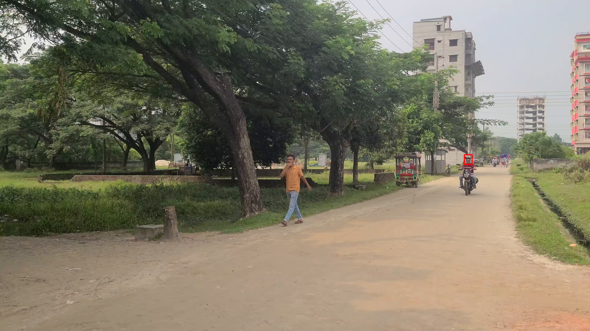
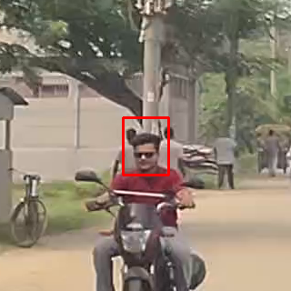

### E2 — Evidence-rich flush: unanimous evidence discarded
`pair_024`, front, `front_moto_0001_rider_s1` (pillion). GT NO_HELMET → pred UNCERTAIN.
**84/84 coupled observations no_helmet**, tail gap **226**. Frame 246 (pts_norm
4.099 s, obs no_helmet conf 0.293): the pillion is plainly bare-headed. Nothing about
this track was ever ambiguous — its evidence simply ended 226 frames before its parent
motorcycle track did.

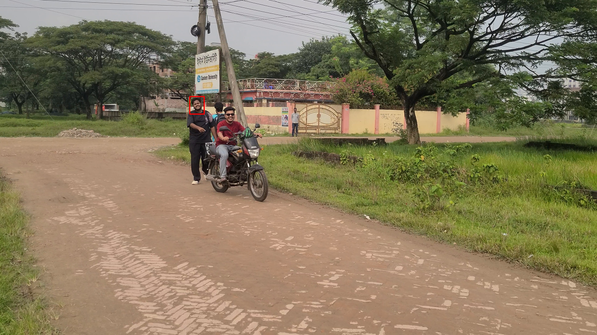
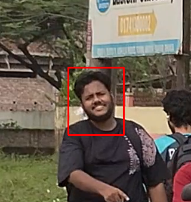

### E3 — Sparse evidence + abstention flood (front)
`pair_019`, front, `front_moto_0002_rider_s0` (driver). GT NO_HELMET → pred UNCERTAIN.
**1 coupled observation** in the track's whole life, **268 abstained updates**, tail
gap 272, coupled_fraction 0.0037. Frame 99 (pts_norm 1.650 s, obs no_helmet conf
0.261) is the single coupled look the pipeline ever got.

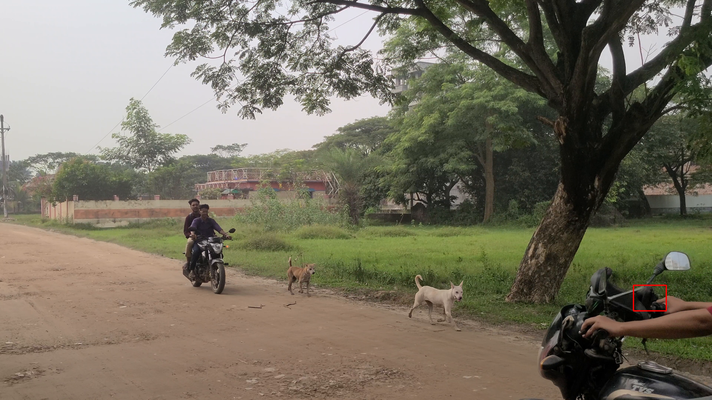
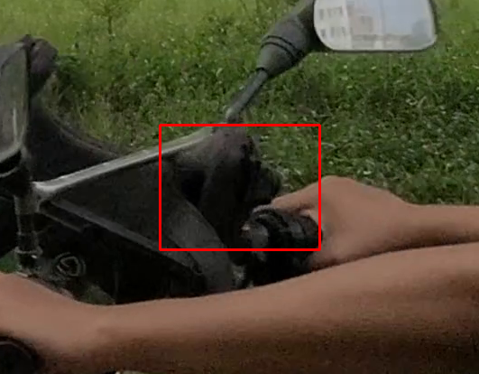

### E4 — Sparse evidence + abstention flood (back camera)
`pair_012`, back, `back_moto_0002_rider_s0` (driver). GT NO_HELMET → pred UNCERTAIN.
1 coupled observation, 167 abstained updates, tail gap 174. Frame 271 (pts_norm
4.522 s, obs no_helmet conf 0.300) — the head is at the extreme left frame edge
(bbox x from 0), illustrating the marginal geometry behind the coupling scarcity.

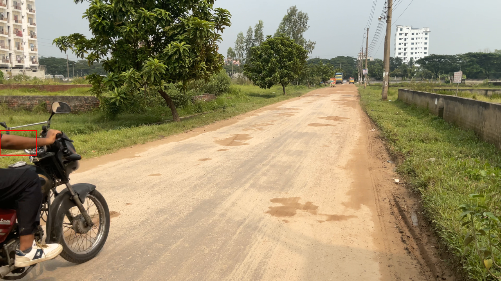
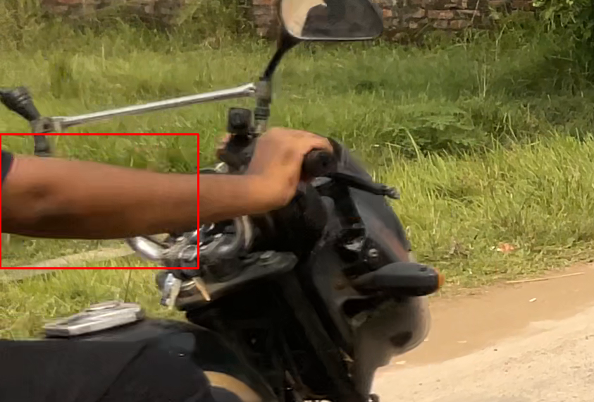

### E5 — The donning transition (§7.1)
`pair_004`, front, `front_orphan_0003`. GT NO_HELMET → pred HELMET.
Frame 35 (pts_norm 0.583 s, obs no_helmet conf 0.395): the rider holds the helmet up
beside his bare head, mid-donning. Frame 42 (pts_norm 0.700 s, obs helmet conf 0.570):
the helmet is on. A single track state cannot represent both frames truthfully.

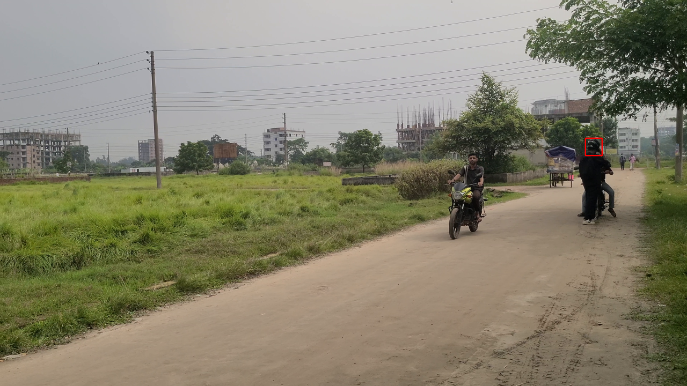
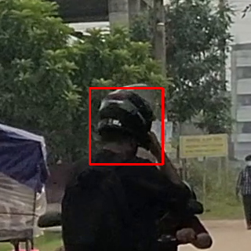
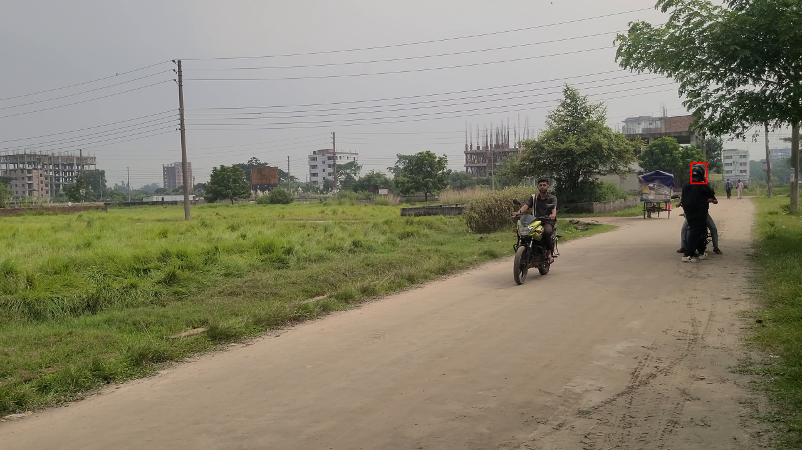
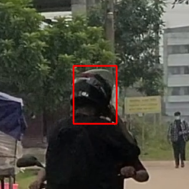

### E6 — Detector observation error (§7.2)
`pair_004`, front, `front_orphan_0005`. GT HELMET (Stage C set-constant, visually
verified) → pred NO_HELMET (ac no_helmet 0.5559 from 3 low-conf no_helmet obs).
Frame 80 (pts_norm 1.333 s, obs helmet conf 0.346) — the one observation the detector
got right: a black full-face helmet is unambiguous in the crop.

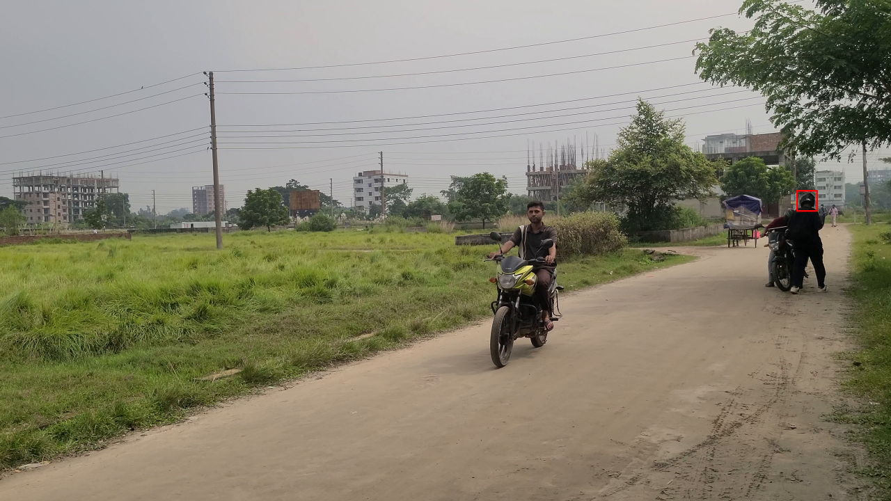
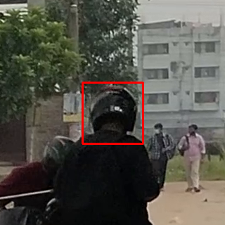

### E7 — AGREE control, motorcycle subtrack
`pair_006`, front, `front_moto_0001_rider_s0` (driver). GT NO_HELMET → pred NO_HELMET.
132 coupled observations, coupled_fraction 0.978, tail gap **3** — coupling continued
to within 3 frames of the parent track's end, so the window still held evidence at
export. Frame 129 (pts_norm 2.149 s, obs no_helmet conf 0.815).

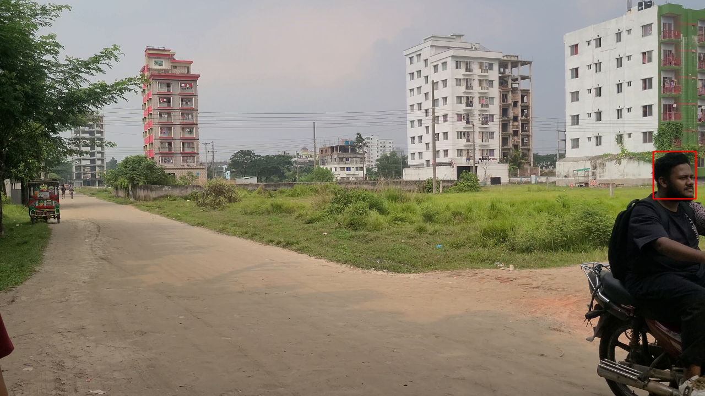
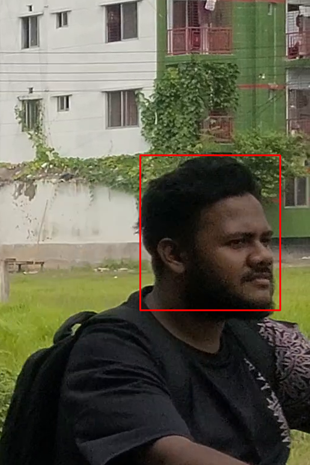

### E8 — AGREE control, orphan with mixed observations
`pair_004`, front, `front_orphan_0007`. GT HELMET → pred HELMET (ac helmet 0.6846).
14 coupled observations with real flip noise (helmet 10 / no_helmet 4) — the EMA
absorbed the jitter because the track terminated (tsu 9) with evidence still in its
window. Frame 118 (pts_norm 1.966 s, obs helmet conf 0.269).

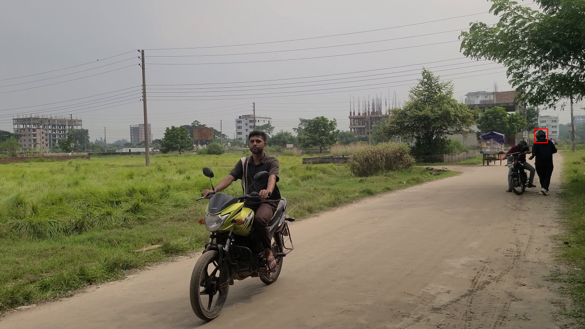
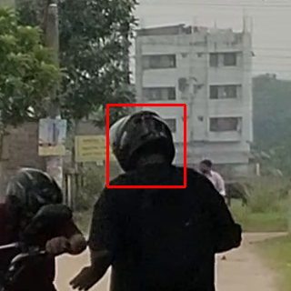

---

## 10. Conclusions — separating the three error classes

**Aggregation error (dominant; 73 of 75 non-agreements).** The track-level metric reads
a *sliding-window* aggregate at end-of-run. That design is reasonable for online
violation alerting (Phase 10's purpose), but as an offline track summary it silently
expires: any rider whose coupling ends ≥10 frames before the parent track ends is
reported UNCERTAIN regardless of accumulated evidence. The 64.1% headline therefore
measures **export-window coverage more than classification quality**. A faithful
track-level summary would snapshot the aggregate at the last coupled frame (or keep a
non-expiring accumulator alongside the windowed one). This is a finding about the
evaluation surface, recorded here without modifying any frozen code or artifact.

**Model (detector) error (1 hard disagreement + background noise).** The Phase 9 head
detector emits low-confidence, flip-prone observations on distant/small heads
(§7.2: 3 of 4 observations wrong on one track; 141 flips over 18 tracks overall).
Where observations exist and survive in the window, the EMA handles the jitter well
(E8); where they are sparse, single wrong observations can dominate — but in this
evaluation those cases surfaced as abstentions, not errors, thanks to the same window.

**GT-construction / representation effects (1 hard disagreement + systematic caveats).**
(i) One-state-per-track cannot represent the verified donning transition (§7.1); the GT
side itself flags those states as not endorsed. (ii) 11 decided GT states encode audit
corrections (set-constant/manual) that no observation-only pipeline can reproduce —
6 of the 11 were additionally flushed. (iii) The GT↔pred identity is 1:1 by
construction (shared Pass 1 lineage), so this analysis can attribute *divergence*
cleanly but cannot detect tracking defects internal to Pass 1 itself.

**Reframed headline:** the pipeline expressed a decided track state for 136 of 209 GT
tracks and matched GT on 134 of them (**98.5%**); it abstained on 73, in 72 of which
its own observation majority already agreed with GT. The honest summary of Stage K's
64.1% is: *track-level classification is accurate where the aggregation window is
alive; the window is usually dead by export time for motorcycle subtracks.*

---

## 11. Artifacts

| Artifact | Path |
|---|---|
| This report | `repo/docs/phase12/HELMET_TRACK_LEVEL_FAILURE_ANALYSIS.md` |
| Per-track breakdown (209 rows) | `work/postcompletion/helmet_track_breakdown.csv` |
| Example frames (9 full + 9 crops) | `repo/docs/phase12/track_failure_examples/` |
| Example manifest (frame refs, PTS, bboxes) | `work/postcompletion/examples_manifest.json` |
| Stage K reproduction check | `work/postcompletion/reproduction_check.json` |
| Cross-tab summary | `work/postcompletion/analysis_summary.json` |
| Disagreement detail | `work/postcompletion/disagreements.json` |
| Analysis code | `work/postcompletion/analyze_tracks.py`, `crosstabs.py`, `extract_examples.py` |
| Progress checkpoint | `work/postcompletion/TASK4_PROGRESS.md` |

*The frozen annotation release was not changed. The GT remains AI_ASSISTED_AUDITED —
AI-generated and AI-audited, never human-verified.*
