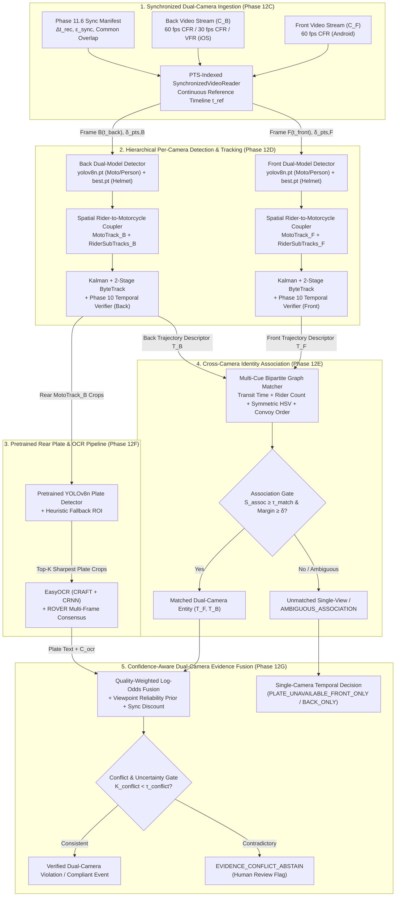

# PHASE 12B — DUAL-CAMERA ARCHITECTURE & IMPLEMENTATION PLAN

**Project:** An Integrated Dual-Camera Framework for Context-Aware Motorcycle Helmet Violation Detection with Confidence-Aware Temporal Verification  
**Repository:** `https://github.com/mohammad-sayem-uddin/Dual-Camera-Helmet-Violation-Detection` (`main` branch)  
**Architect & Lead Engineer:** Gemini 4 Argon  
**Prerequisite Baseline:** Commit `ae7426c` (Phase 12A Environment & Adapter Readiness)  
**Scope:** Architectural specification, formal mathematical formulations, module boundaries, hardware memory planning, and sequential implementation roadmap (Phases 12C–12J). *No production fusion or tracking code is executed in Phase 12B.*

---

## 1. Overall System Architecture

The dual-camera framework processes two opposing, unsynchronized consumer smartphone recordings—a **Front Camera ($C_F$)** capturing oncoming traffic (anterior view: headlight, rider face/chest, front helmet shell) and a **Back Camera ($C_B$)** capturing receding traffic (posterior view: taillight, rear license plate, rider back/occipital helmet shell)—and synthesizes them into a unified, metrologically traceable violation record.

---

## 2. Module Boundaries and Directory Structure

To preserve all verified Phase 9, Phase 10, Phase 11, and Phase 12A artifacts without breaking existing tests, the system enforces strict package boundaries:

| Package / Module | Status | Responsibility & Interface Contract |
| :--- | :--- | :--- |
| `src/temporal/` (`rider_tracker.py`, `confidence_aggregator.py`, `state_machine.py`, `violation_decision.py`, `temporal_engine.py`) | **Frozen Baseline (Phase 10)** | Single-camera head tracking, EMA/windowed confidence smoothing, hysteresis state machine (`COMPLIANT`, `CANDIDATE_VIOLATION`, `CONFIRMED_VIOLATION`), and cooldown deduplication. Preserved untouched for ablation comparability. |
| `src/video/` (`video_reader.py`, `frame_timestamp.py`) | **Upgrade in Phase 12C** | Low-level OpenCV video decoding and exact container Presentation Timestamp (`CAP_PROP_POS_MSEC` / `pkt_pts_time`) table construction. |
| `src/synchronization/` (`synchronized_reader.py`, `pts_index.py`) | **Upgrade in Phase 12C** | Continuous-time reference timeline ($t_{\text{ref}}$) stepping, nearest-PTS binary search retrieval, exposure residual ($\delta_{\text{pts}}$) tracking, and propagation of Phase 11.6 synchronization uncertainty ($\epsilon_{\text{sync}}$). |
| `src/models/` (`helmet_detector_adapter.py`, `plate_detector_adapter.py`, `ocr_adapter.py`, `vehicle_detector_adapter.py`) | **Extend in Phase 12D & 12F** | Hardware-aware (Apple M1 MPS) inference wrappers for Phase 9 `best.pt` (2-class helmet), COCO `yolov8n.pt` (person/motorcycle), pretrained YOLOv8n license plate detector, and EasyOCR. |
| `src/tracking/` (`moto_rider_coupler.py`, `kalman_bytetrack.py`, `camera_track_manager.py`) | **New in Phase 12D** | Hierarchical grouping of `motorcycle`, `person`, and `helmet`/`no_helmet` detections into composite `MotoTrack` and `RiderSubTrack` entities per camera. |
| `src/association/` (`feature_extractor.py`, `scoring_matrix.py`, `bipartite_matcher.py`) | **New in Phase 12E** | Extraction of view-invariant trajectory descriptors, kinematic transit-time scoring, symmetric anatomical HSV color histograms, Hungarian assignment, and explicit `UNMATCHED` / `AMBIGUOUS` abstention gates. |
| `src/ocr/` (`plate_quality_selector.py`, `plate_rectifier.py`, `rover_aggregator.py`) | **New in Phase 12F** | Laplacian sharpness + area scoring, Top-$K$ crop selection per Back `MotoTrack`, CLAHE preprocessing, and character-level ROVER voting across frames. |
| `src/fusion/` (`evidence_quality.py`, `log_odds_fuser.py`, `conflict_detector.py`, `dual_camera_decision.py`) | **New in Phase 12G** | Quality-weighted log-odds fusion across Front and Back rider tracks, contradiction detection, abstention state machine, and audit record serialization. |
| `src/pipeline/` (`dual_camera_engine.py`, `ablation_runner.py`, `visualizer.py`) | **New in Phase 12H–12I** | End-to-end orchestrator running all 5 ablation modes (`FRONT_ONLY`, `BACK_ONLY`, `DUAL_NO_OCR`, `DUAL_WITH_OCR`, `DUAL_INSTANTANEOUS_NO_TEMPORAL`) and generating side-by-side synchronized annotated audit videos. |

---

## 3. End-to-End Data Flow and Typed Data Structures

At every canonical evaluation timestamp $t_{\text{ref}} \in [t_{\text{start}}, t_{\text{end}}]$, data flows through five strongly typed stages:

1. **Synchronized Frame Tuple (`SyncedFramePair`)**:
   - `t_ref_sec: float` (Common reference time anchored to Back camera stream start $t_{\text{back}} = 0$).
   - `front_frame: np.ndarray`, `t_front_actual_sec: float`, `delta_pts_front_ms: float`.
   - `back_frame: np.ndarray`, `t_back_actual_sec: float`, `delta_pts_back_ms: float`.
   - `sync_uncertainty_ms: float` ($\epsilon_{\text{sync}}$ from Phase 11.6 manifest), `sync_tier: str` (`"sub-frame"` or `"near-frame"`).
2. **Per-Camera Composite Detection (`CameraFrameObservation`)**:
   - Contains raw `motorcycle` boxes, `person` boxes, and `helmet`/`no_helmet` boxes, linked via `MotoRiderCoupler` into `MotorcycleDetection` objects, each holding $K \in \{1, 2, 3\}$ ordered `RiderHeadDetection` objects (sorted from driver to pillion).
3. **Per-Camera Trajectory (`MotoTrack`)**:
   - `camera_id: Literal["front", "back"]`, `moto_track_id: int`.
   - `t_enter_ref: float`, `t_exit_ref: float`, `bbox_history: List[Tuple[float, np.ndarray]]`.
   - `rider_subtracks: List[RiderSubTrack]` — each wrapping a Phase 10 `ConfidenceAggregator` and `TemporalStateMachine`.
   - `appearance_descriptor: ViewInvariantDescriptor` (cranial HSV histogram, upper-torso HSV histogram, lateral chassis HSV histogram, normalized velocity vector, lateral lane bin).
   - `plate_evidence: Optional[AggregatedPlateEvidence]` (populated on Back camera tracks only).
4. **Cross-Camera Match Result (`CrossCameraLink`)**:
   - `front_moto_id: Optional[int]`, `back_moto_id: Optional[int]`.
   - `assoc_status: Literal["MATCHED", "UNMATCHED_FRONT_ONLY", "UNMATCHED_BACK_ONLY", "AMBIGUOUS_ABSTAIN"]`.
   - `assoc_score: float` ($S_{\text{assoc}} \in [0, 1]$), `second_best_margin: float` ($\Delta S_{\text{margin}}$).
   - `component_scores: Dict[str, float]` (`s_time`, `s_occ`, `s_color`, `s_order`, `s_lane`).
5. **Fused Dual-Camera Decision (`DualCameraViolationRecord`)**:
   - `pair_id: str`, `global_event_id: str`, `assoc_status: str`, `assoc_confidence: float`.
   - Per-rider fused posteriors $P_{\text{fused}}(\text{no\_helmet})$, conflict metric $K_{\text{conflict}}$, final state (`VERIFIED_VIOLATION`, `VERIFIED_COMPLIANT`, `SINGLE_VIEW_VIOLATION`, `EVIDENCE_CONFLICT_ABSTAIN`, `LOW_CONFIDENCE_ABSTAIN`), and attached license plate record (`plate_text`, `plate_conf`, `plate_status`).

---

## 4. Synchronized Video Reading and Timestamp Alignment Method (Phase 12C)

### 4.1 Critical Empirical Discovery: Variable Frame Rate (VFR) & Frame-Rate Asymmetry
During our Phase 12B forensic inspection of all 25 video pairs in `data/dual_camera_test_v1/` using `ffprobe` and OpenCV `CAP_PROP_POS_MSEC`, we discovered three critical container properties that invalidate naive frame-index seeking (`frame_idx = round(t * avg_fps)`):

1. **Severe VFR Dynamic Throttling in `pair_013_back.mp4` and `pair_014_back.mp4`**:
   - While all 25 Front videos run at ~60 fps (`59.72–60.02` fps), `pair_013_back.mp4` (`avg_fps = 40.17`, 608 frames over `15.118 s`) dynamically switches between 60 fps ($\Delta t = 16.67\text{ ms}$) and 30 fps ($\Delta t = 33.33\text{ ms}$) mid-clip. Computing timestamps via `frame_idx / avg_fps` produces a **catastrophic maximum timestamp error of `2,527.07 ms` (2.53 seconds)** relative to true container Presentation Timestamps (`CAP_PROP_POS_MSEC` / `pkt_pts_time`).
   - Similarly, `pair_014_back.mp4` (`avg_fps = 48.51`, 276 frames over `5.673 s`) exhibits a maximum nominal-FPS timestamp error of **`826.01 ms` (0.83 seconds)**.
2. **60 fps vs. 30 fps Asymmetry in `pair_015` through `pair_018`**:
   - `pair_015_back.mp4` (`29.97` fps), `pair_016_back.mp4` (`30.01` fps), `pair_017_back.mp4` (`30.04` fps), and `pair_018_back.mp4` (`29.96` fps) were recorded at 30 fps while their paired Front videos were recorded at 60 fps. Stepping both cameras by integer frame index would cause 2× temporal speed divergence.
3. **Android Container Audio-Lead Stream Offset**:
   - On several Android Front videos (e.g., `pair_004_front` `+47 ms`, `pair_008_front` `+31 ms`, `pair_015_front` `+72 ms`), `ffprobe` raw `pkt_pts_time` includes an initial audio-stream lead offset, whereas OpenCV `CAP_PROP_POS_MSEC` normalizes the first video frame to `0.000 s`.

### 4.2 Mathematical Formulation of PTS-Indexed Synchronization
To eliminate VFR drift and frame-rate mismatch completely, Phase 12C replaces nominal-FPS indexing with **Exact Presentation Timestamp (PTS) Table Indexing**:

1. **Stream-Normalized PTS Lookup Table**:
   Upon opening a video file $c \in \{F, B\}$ with $N_c$ frames, `VideoReader` builds a monotonically increasing array of relative presentation timestamps normalized to the first video frame:
   $$\mathbf{T}_c = \left[ t_c[0],\, t_c[1],\, \dots,\, t_c[N_c - 1] \right], \quad t_c[k] = \frac{\text{POS\_MSEC}(k) - \text{POS\_MSEC}(0)}{1000.0}$$
2. **Sign-Verified Cross-Camera Clock Mapping**:
   Per the Phase 11/11.5/11.6 synchronization manifest (`synchronization_metadata.json`), let $\Delta t_{\text{rec}}$ denote `global_offset_sec`. The common reference clock $t_{\text{ref}}$ is anchored to the Back camera timeline ($t_{\text{back}} = t_{\text{ref}}$), and the corresponding Front camera timestamp is:
   $$t_{\text{front}}(t_{\text{ref}}) = t_{\text{ref}} - \Delta t_{\text{rec}}$$
   The valid common overlap interval is:
   $$t_{\text{ref}} \in \left[ t_{\text{start,ref}},\, t_{\text{end,ref}} \right] = \left[ \max(0,\, \Delta t_{\text{rec}}),\, \min\left(t_B[N_B-1],\, t_F[N_F-1] + \Delta t_{\text{rec}}\right) \right]$$
3. **Canonical Reference Tick & Nearest-PTS Retrieval**:
   The `SynchronizedVideoReader` steps $t_{\text{ref}}$ across $[t_{\text{start,ref}}, t_{\text{end,ref}}]$ at a configurable canonical tick $\Delta t_{\text{tick}}$ (default $\Delta t_{\text{tick}} = 1/60\text{ s} \approx 16.667\text{ ms}$, or driven by the union of unique frame timestamps). For any target camera time $t_c^{\text{target}}$, the optimal frame index $k_c^*$ is selected via binary search (`np.searchsorted`):
   $$k_c^* = \arg\min_{k \in \{0, \dots, N_c-1\}} \left| t_c[k] - t_c^{\text{target}} \right|, \quad \delta_{\text{pts},c} = \left| t_c[k_c^*] - t_c^{\text{target}} \right|$$
   - Because reading moves monotonically forward in time, `SynchronizedVideoReader` uses a **Sequential Forward Decoder Buffer** (`cap.grab()` / `cap.retrieve()`) rather than random `cv2.CAP_PROP_POS_FRAMES` seeks—avoiding H.264/HEVC GOP keyframe decoding overhead and guaranteeing exact frame accuracy on VFR streams.
   - When a 30 fps Back stream is paired with a 60 fps Front stream (`pair_015`–`pair_018`), `SyncedFramePair` carries a boolean flag `is_new_back_frame: bool` (and `is_new_front_frame: bool`) so that per-camera object detection and tracking execute **only once per unique physical frame**, preventing duplicate observations in the temporal window!

---

## 5. Per-Camera Detection and Tracking Architecture (Phase 12D)

### 5.1 Why Head-Only Detection Is Insufficient for Multi-Camera Fusion
Our Phase 9 production checkpoint (`results/phase9_multiseed/exp_combined/seed_42/weights/best.pt`) is a specialized 2-class cranial detector (`0: no_helmet`, `1: helmet`). While ideal for head classification, head boxes alone cannot:
1. Determine whether two heads belong to a **driver and pillion passenger on the same motorcycle** versus two separate motorcycles riding side-by-side.
2. Extract motorcycle chassis visual features (fuel tank/fairing color, headlight/taillight geometry) needed for cross-camera matching.
3. Localize the rear license plate region, which sits on the rear mudguard far below the rider's head.

### 5.2 Dual-Model Hierarchical Detection (`yolov8n.pt` + `best.pt`)
Each unique physical frame from camera $c \in \{F, B\}$ is processed through two lightweight YOLOv8n models residing in shared Apple M1 MPS memory:
1. **Vehicle & Rider Body Detector (`yolov8n.pt`, official COCO weights in repo root)**:
   - Filtered strictly to COCO classes `0: person` ($p \ge 0.25$) and `3: motorcycle` ($p \ge 0.25$).
2. **Cranial Helmet Detector (`best.pt`, Phase 9 Seed 42 `exp_combined`)**:
   - Detects `0: no_helmet` and `1: helmet` ($p \ge 0.20$).

### 5.3 Spatial Rider-to-Motorcycle Coupler (`MotoRiderCoupler`)
Given a set of motorcycle boxes $\mathcal{M} = \{B_m^{\text{moto}}\}$, person boxes $\mathcal{P} = \{B_p^{\text{pers}}\}$, and head boxes $\mathcal{H} = \{B_h^{\text{head}}\}$ in the same frame:
1. **Person-to-Motorcycle Mounting**: A person $p$ is mounted on motorcycle $m$ if their horizontal center falls within the expanded lateral span of $B_m^{\text{moto}}$ and their lower torso overlaps the upper saddle region of $B_m^{\text{moto}}$ ($\text{IoU}(B_p^{\text{pers}}, B_m^{\text{moto}}) \ge 0.15$ or intersection-over-person-area $\ge 0.30$).
2. **Head-to-Rider/Motorcycle Assignment**: A head box $B_h^{\text{head}}$ is linked to motorcycle $m$ by maximizing a composite geometric affinity:
   $$A_{\text{mount}}(h, m) = 0.5 \cdot \text{IoA}\left(B_h^{\text{head}},\, B_m^{\text{upper\_cone}}\right) + 0.5 \cdot \max_{p \in \mathcal{P}_m} \text{IoA}\left(B_h^{\text{head}},\, B_p^{\text{upper\_35\%}}\right)$$
   where $\text{IoA}(X, Y) = \frac{|X \cap Y|}{|X|}$ is the Intersection over Head Area and $B_m^{\text{upper\_cone}}$ is the plausible rider-head envelope extending $1.2 \times \text{height}(B_m^{\text{moto}})$ above the motorcycle bounding box.
3. **Unmounted Fallback (`OrphanHeadTrack`)**: If a motorcycle chassis is occluded by a car or frame boundary and only the rider's head is visible, the head still spawns an `OrphanRiderTrack` so zero helmet violations are missed.

### 5.4 Two-Stage Kalman ByteTrack + Phase 10 Temporal Verification
- **Motorcycle-Level Tracking**: `MotoTrack` instances are tracked across frames using an 8-state Constant-Velocity Kalman Filter $[u, v, s, r, \dot{u}, \dot{v}, \dot{s}, 0]^T$ and Two-Stage ByteTrack association (Stage 1 matches detections with $p \ge 0.45$ via combined Mahalanobis + Generalized IoU distance; Stage 2 matches occluded/blurred detections with $0.20 \le p < 0.45$ via IoU).
- **Rider Sub-Track Ordering & Phase 10 Integration**: Within each `MotoTrack`, the $K \in \{1, 2, 3\}$ mounted heads are persistently ordered (using relative vertical head height and lateral offset) into `RiderSubTrack` slots (`slot=0: Driver`, `slot=1: Pillion 1`, `slot=2: Pillion 2`). Each `RiderSubTrack` feeds its per-frame `(class_id, confidence)` directly into an instance of the verified Phase 10 `ConfidenceAggregator` (`method="ema"`, $\alpha=0.4$, `window_size=5`) and `TemporalStateMachine` (`min_confirm_frames=5`, `ema_threshold=0.55`, `max_occluded_frames=8`).

---

## 6. Cross-Camera Identity Association Architecture (Phase 12E)

### 6.1 The Opposing-Viewpoint Challenge
In our setup, $C_F$ observes the **anterior aspect** of oncoming motorcycles while $C_B$ observes the **posterior aspect** of receding motorcycles after they pass through the capture zone. Standard deep Re-ID embeddings (e.g., OSNet/ResNet50 trained on Market-1501) suffer severe domain collapse under $180^\circ$ anterior-to-posterior inversion on motorcycles because the front view is dominated by the headlight, front mudguard, handlebars, and rider chest, whereas the back view is dominated by the taillight, rear license plate, exhaust, and rider back.

### 6.2 Five View-Invariant Spatio-Temporal & Appearance Cues
Instead of black-box Re-ID embeddings, we formulate cross-camera association between a completed (or active sliding-window) Front trajectory $T_i^F \in \mathcal{T}_F$ and Back trajectory $T_j^B \in \mathcal{T}_B$ using five physically grounded, view-symmetric compatibility scores:

1. **Kinematic Transit-Time Compatibility ($S_{\text{time}}(i, j) \in [0, 1]$)**:
   Let $t_{\text{pass}}^F(i)$ be the reference timestamp when motorcycle $i$ reaches its maximum bounding-box scale (closest approach / exit) in the Front camera, and $t_{\text{pass}}^B(j)$ be the reference timestamp when motorcycle $j$ appears at maximum scale (entry / closest approach) in the Back camera. Depending on whether the cameras face inward toward a shared midpoint or outward away from each other, the signed transit interval $\Delta \tau_{ij} = t_{\text{pass}}^B(j) - t_{\text{pass}}^F(i)$ must fall within the physical baseline transit window $[\tau_{\min} - \epsilon_{\text{sync}},\, \tau_{\max} + \epsilon_{\text{sync}}]$:
   $$S_{\text{time}}(i, j) = \exp\left( -\frac{\left(\Delta \tau_{ij} - \mu_{\tau}(v_i^F, v_j^B)\right)^2}{2\left(\sigma_{\tau}^2 + \epsilon_{\text{sync}}^2\right)} \right)$$
   where $\mu_{\tau}(v_i^F, v_j^B)$ is expected transit time given estimated apparent scale-change rate $\frac{d\sqrt{A}}{dt}$, and $\epsilon_{\text{sync}}$ is the Phase 11.6 synchronization uncertainty (automatically widening tolerance for the 4 near-frame pairs).Hard gate: if $|\Delta \tau_{ij} - \mu_{\tau}| > \Delta \tau_{\text{max\_gate}}$ (e.g., $> 4.5\text{ s}$), $S_{\text{time}}(i, j) = 0$.

2. **Rider Occupancy Cardinality & Helmet Pattern Compatibility ($S_{\text{occ}}(i, j) \in [0, 1]$)**:
   The median number of mounted riders $\hat{K}_i^F = \text{median}_t K_i^F(t)$ and $\hat{K}_j^B = \text{median}_t K_j^B(t)$ is an invariant topological property of the motorcycle across views:
   $$S_{\text{occ}}(i, j) = \begin{cases} 1.0 & \text{if } \hat{K}_i^F = \hat{K}_j^B \\ 0.45 & \text{if } |\hat{K}_i^F - \hat{K}_j^B| = 1 \text{ (partial pillion occlusion in one view)} \\ 0.05 & \text{if } |\hat{K}_i^F - \hat{K}_j^B| \ge 2 \end{cases}$$

3. **View-Symmetric Anatomical Chromatic Similarity ($S_{\text{color}}(i, j) \in [0, 1]$)**:
   While anterior and posterior textures differ, **color distributions of circumferential garments and helmet shells** remain invariant across $180^\circ$ rotation when illumination brightness ($V$ channel) is discounted. For each track, we extract quality-weighted, L1-normalized Hue-Saturation (2D HS, $16 \times 8$ bins) + achromatic (white/grey/black, 8 bins) histograms from three view-symmetric zones:
   - **Zone 1 (Cranial / Helmet Shell, weight $0.45$)**: Inner $70\%$ core of the upper $75\%$ of each rider's head box (excludes facial skin in front view and neck in back view).
   - **Zone 2 (Upper Torso / Shoulder Garment, weight $0.35$)**: Region immediately below the head box ($1.0 \times$ to $2.2 \times$ head height), corresponding to the rider's shirt/jacket visible from both chest and back.
   - **Zone 3 (Motorcycle Upper Chassis / Lateral Fairing, weight $0.20$)**: Middle $50\%$ of the motorcycle box excluding black tires and asphalt background.
   Similarity is computed via the complement of the Bhattacharyya distance $D_B(H_i^F, H_j^B)$:
   $$S_{\text{color}}(i, j) = \sum_{z \in \{1,2,3\}} w_z \sqrt{\sum_{b} \sqrt{H_{i,z}^F(b) \cdot H_{j,z}^B(b)}}$$

4. **Cross-Camera Lateral Lane & Trajectory Geometry ($S_{\text{lane}}(i, j) \in [0, 1]$)**:
   Under opposing viewpoints ($C_F$ facing oncoming traffic, $C_B$ facing receding traffic along the same road corridor), image horizontal coordinates undergo mirror inversion ($x_{\text{norm}}^B \approx 1 - x_{\text{norm}}^F$ when cameras face each other, or $x_{\text{norm}}^B \approx x_{\text{norm}}^F$ when co-aligned along the same roadside). Using per-pair camera orientation metadata, normalized horizontal road corridor position at pass-through is compared via a Gaussian kernel.

5. **Multi-Vehicle Convoy Ordering & Inter-Arrival Spacing ($S_{\text{order}}(i, j) \in [0, 1]$)**:
   When $M \ge 2$ motorcycles pass within a short window ($\le 5\text{ s}$), their relative temporal sequence and inter-vehicle spacing $\Delta t_{i, i+1}^F \approx \Delta t_{j, j+1}^B$ penalize rank inversions (overtaking within the short baseline is rare and bounded by relative velocity difference).

### 6.3 Composite Association Score, Bipartite Assignment & Explicit Abstention
The composite affinity between $T_i^F$ and $T_j^B$ is:
$$S_{\text{assoc}}(i, j) = \mathbb{I}\!\left[S_{\text{time}}(i, j) > 0\right] \cdot \left( w_t S_{\text{time}}(i, j) + w_o S_{\text{occ}}(i, j) + w_c S_{\text{color}}(i, j) + w_l S_{\text{lane}}(i, j) + w_r S_{\text{order}}(i, j) \right)$$
with default weights $(w_t, w_o, w_c, w_l, w_r) = (0.35, 0.20, 0.25, 0.10, 0.10)$.

Over a sliding association window, we solve the maximum-weight bipartite matching problem using the **Jonker-Volgenant / Hungarian algorithm** (`scipy.optimize.linear_sum_assignment`) augmented with dummy slack nodes of threshold cost $\tau_{\text{match}} = 0.55$. A matched pair $(i^*, j^*)$ is accepted as `MATCHED` **if and only if** both conditions hold:
1. **Absolute Quality Gate**: $S_{\text{assoc}}(i^*, j^*) \ge \tau_{\text{match}}$ ($0.55$).
2. **Unambiguous Margin Gate**: Let $S_{\text{2nd}}(i^*, j^*) = \max\left(\max_{k \neq j^*} S_{\text{assoc}}(i^*, k),\, \max_{m \neq i^*} S_{\text{assoc}}(m, j^*)\right)$. If dense traffic produces two nearly identical motorcycles within the same transit window such that:
   $$S_{\text{assoc}}(i^*, j^*) - S_{\text{2nd}}(i^*, j^*) < \delta_{\text{margin}} \quad (\delta_{\text{margin}} = 0.10)$$
   the system **refuses to guess** and transitions both tracks to `AMBIGUOUS_ABSTAIN` (reporting single-camera helmet states independently without transferring the rear license plate across the uncertain link).

---

## 7. OCR / License Plate Recognition Integration Strategy (Phase 12F)

### 7.1 Strict Adherence to Pretrained-Only Constraint
No custom OCR or plate detector training is performed. However, the Phase 12A `HeuristicPlateDetector` (which blindly crops the bottom-central region of a bounding box) is insufficient as a primary detector because motorcycle pitch, viewing angle, and mudguard geometry vary across frames.

### 7.2 Two-Stage Pretrained Localization & Multi-Frame OCR Consensus
1. **Stage 1 — Pretrained YOLOv8n License Plate Detector + Heuristic Fallback**:
   - **Primary Detector**: Within the bounding box of each Back-camera `MotoTrack` ($C_B$), we run a **pretrained YOLOv8n License Plate Detection model** (standard Ultralytics YOLOv8n architecture pretrained on open license plate datasets, e.g., `keremberke/yolov8n-license-plate-detection` / `yasirfaizahmed/license-plate-object-detection` cached in `models/pretrained/yolov8n_license_plate.pt`, ~6.2 MB). Because it runs only on Back-camera motorcycle crops (typically 1–2 per frame at $320 \times 320$), it adds $< 4\text{ ms}$ latency on Apple M1 MPS.
   - **Secondary Fallback**: If the pretrained plate detector returns no box above $p \ge 0.25$ on a confirmed Back-camera violation track, `HeuristicPlateDetector` proposes the lower rear sub-box ($y \in [0.55, 0.95],\, x \in [0.20, 0.80]$ of `MotoTrack` bbox) tagged with `detector_mode = "heuristic_fallback"`.
2. **Stage 2 — Sharpness-Guided Top-$K$ Crop Selection (`PlateQualitySelector`)**:
   - Running EasyOCR on every frame of a 60 fps video would stall the pipeline ($\sim 80\text{ ms}$ per crop). Instead, as a Back `MotoTrack` progresses through the scene, candidate plate crops are scored in $< 0.2\text{ ms}$ using a **Composite Legibility Score**:
     $$Q_{\text{plate}}(t) = \text{clip}\!\left(\frac{A_{\text{plate}}(t)}{2500\text{ px}^2},\, 0,\, 1\right) \cdot \text{clip}\!\left(\frac{\text{Var}(\nabla^2 I_{\text{plate}}(t))}{150.0},\, 0,\, 1\right) \cdot p_{\text{det}}(t)$$
     where $A_{\text{plate}}$ is pixel area and $\text{Var}(\nabla^2 I_{\text{plate}})$ is the variance of the Laplacian (motion blur filter).
   - Crops with width $< 28\text{ px}$ or height $< 12\text{ px}$ are immediately rejected as `UNREADABLE_LOW_RES`.
   - Only the **Top-$K$ ($K=5$) highest-quality crops** across the entire trajectory of a Back `MotoTrack` are sent to OCR upon track completion or violation confirmation.
3. **Stage 3 — Preprocessing & Dual-Engine OCR (`EasyOCR` Primary + `Tesseract` Backup)**:
   - Each selected crop undergoes $2\times$ bicubic super-resolution resize, grayscale conversion, and Contrast-Limited Adaptive Histogram Equalization (`CLAHE`, `clipLimit=2.0`, `tileGridSize=(4,4)`).
   - **Primary Engine**: Pretrained `EasyOCR` (`craft_mlt_25k.pth` detector + `english_g2.pth` recognizer, plus optional `'bn'` Bengali script support for local Bangladeshi plates).
   - **Temporal Consensus (Character-Level ROVER Voting)**: Across the $K \le 5$ crops of the same `MotoTrack`, OCR string hypotheses $(s_k, c_k)$ are aligned via Levenshtein edit distance and merged into a consensus string $\hat{S}_{\text{plate}}$ with aggregated confidence $C_{\text{ocr}}$.
4. **Strict Evidentiary Role of Plate OCR**:
   - Plate OCR is attached **solely to Back `MotoTrack` ($C_B$)**. It is linked to a Front camera observation **only if** the cross-camera matcher independently confirms `assoc_status == "MATCHED"` ($S_{\text{assoc}} \ge 0.55$, margin $\ge 0.10$). If a plate is blurred or illegible ($C_{\text{ocr}} < 0.40$), the violation is still logged with `plate_status = "UNREADABLE_BLUR_OR_OCCLUSION"`—OCR failure never suppresses a verified helmet violation.

---

## 8. Confidence-Aware Dual-Camera Evidence Fusion Strategy (Phase 12G)

### 8.1 Observation Quality & Synchronization Uncertainty Weighting
Within each camera $c \in \{F, B\}$, frame observation $t$ for rider slot $r$ has raw detector probability $p_{c,r,t}(\text{no\_helmet})$. Rather than treating tiny distant boxes equally with close-up observations, we compute an **Observation Quality Weight** $q_{c,r,t} \in [0.1, 1.0]$:
$$q_{c,r,t} = \underbrace{\min\!\left(1.0,\, \frac{A_{\text{head}}(c,r,t)}{1600\text{ px}^2}\right)}_{\text{Scale reliability}} \cdot \underbrace{\left(1 - 0.5 \cdot \mathbb{I}[\text{border\_clipped}]\right)}_{\text{Truncation penalty}} \cdot \underbrace{\min\!\left(1.0,\, \frac{\text{Var}(\nabla^2 I_{\text{head}})}{100.0}\right)}_{\text{Motion blur factor}}$$

For camera $c$, let $P_{c,r}(\text{no\_helmet}) \in (0, 1)$ denote the quality-weighted temporal posterior produced by the camera's Phase 10 temporal verifier over its $N_{c,r}$ valid observations, with track stability weight:
$$W_{c,r} = \min\!\left(1.0,\, \frac{N_{c,r}}{N_{\text{min\_confirm}}}\right) \cdot \bar{q}_{c,r} \cdot \gamma_c$$
where $\gamma_F = 1.10$ and $\gamma_B = 0.95$ encode the empirical **Viewpoint Asymmetry Prior** (Front camera has direct visibility of the face/forehead to distinguish bare heads from caps/hoods, whereas Back camera observes the occiput).

### 8.2 Synchronization Residual Discount Factor
From Phase 11.6, each video pair has a known synchronization residual bound $\epsilon_{\text{sync}}$ ($\le 10.0\text{ ms}$ for the 21 sub-frame pairs; $18.0\text{--}38.0\text{ ms}$ for the 4 near-frame pairs `pair_004`, `pair_005`, `pair_008`, `pair_015`), plus instantaneous PTS discretization offset $\delta_{\text{pts}} = \delta_{\text{pts},F} + \delta_{\text{pts},B}$. We define the **Synchronization Reliability Factor** $\phi_{\text{sync}} \in (0.80, 1.0]$:
$$\phi_{\text{sync}}(\epsilon_{\text{sync}}, \bar{\delta}_{\text{pts}}) = \exp\left(-\lambda_{\text{sync}} \max\left(0,\, \epsilon_{\text{sync}} + \bar{\delta}_{\text{pts}} - 16.67\text{ ms}\right)\right), \quad \lambda_{\text{sync}} = 0.003\text{ ms}^{-1}$$
For sub-frame pairs ($\epsilon_{\text{sync}} \le 10\text{ ms}$), $\phi_{\text{sync}} = 1.0$. For near-frame pairs ($\epsilon_{\text{sync}} = 38\text{ ms}$), $\phi_{\text{sync}} \approx 0.93$, slightly tempering cross-camera bonus weight without discarding valid track-level fusion.

### 8.3 Quality-Weighted Log-Odds Belief Fusion
Convert each camera's temporal posterior $P_{c,r}$ into log-odds $L_{c,r} = \ln\frac{P_{c,r}}{1 - P_{c,r}}$ around prior $L_0 = 0$. When Front track $i$ and Back track $j$ are matched with association confidence $C_{\text{assoc}} = S_{\text{assoc}}(i, j) \cdot \phi_{\text{sync}}$, the fused log-odds for rider $r$ is:
$$L_{\text{fused},r} = \frac{W_{F,r} \cdot L_{F,r} + C_{\text{assoc}} \cdot W_{B,r} \cdot L_{B,r}}{W_{F,r} + C_{\text{assoc}} \cdot W_{B,r}} + \beta_{\text{corrob}} \cdot \mathbb{I}\!\left[\text{sign}(L_{F,r}) = \text{sign}(L_{B,r})\right] \cdot C_{\text{assoc}} \cdot \min(|L_{F,r}|, |L_{B,r}|)$$
where $\beta_{\text{corrob}} = 0.20$ provides a bounded **Multi-View Corroboration Boost** when both independent viewpoints agree on the rider's state, and the fused posterior is recovered via the sigmoid function:
$$P_{\text{fused},r}(\text{no\_helmet}) = \frac{1}{1 + \exp(-L_{\text{fused},r})}$$

---

## 9. Abstention, Contradiction, and Uncertainty Handling

A core scientific requirement of this architecture is that **uncertainty must never be hidden behind forced binary guesses**. We define a formal **Contradiction Metric ($K_{\text{conflict}} \in [0, 1]$)** between matched Front and Back rider posteriors:
$$K_{\text{conflict}}(F, B) = \mathbb{I}\!\left[\left(P_{F,r} - 0.5\right)\left(P_{B,r} - 0.5\right) < 0\right] \cdot 2 \min\!\left(|P_{F,r} - 0.5|,\, |P_{B,r} - 0.5|\right)$$

This drives a deterministic 6-state Evidentiary Decision Taxonomy:

| Decision State | Trigger Condition | Operational Meaning & Output Action |
| :--- | :--- | :--- |
| `VERIFIED_DUAL_VIOLATION` | `MATCHED` $\land$ $K_{\text{conflict}} < 0.35$ $\land$ $P_{\text{fused},r} \ge 0.60$ $\land$ $\ge 1$ view confirmed | High-confidence violation corroborated across synchronized views; rear license plate attached if legible. |
| `VERIFIED_DUAL_COMPLIANT` | `MATCHED` $\land$ $K_{\text{conflict}} < 0.35$ $\land$ $P_{\text{fused},r} \le 0.40$ | Rider verified as wearing a helmet across synchronized views. |
| `SINGLE_VIEW_VIOLATION_FRONT` | `UNMATCHED_FRONT_ONLY` $\land$ $P_{F,r} \ge 0.65$ $\land$ Phase 10 confirmed | Violation confirmed in Front view only (e.g., motorcycle exited or was occluded in Back view); `plate_status = "UNAVAILABLE_FRONT_ONLY"`. |
| `SINGLE_VIEW_VIOLATION_BACK` | `UNMATCHED_BACK_ONLY` $\land$ $P_{B,r} \ge 0.65$ $\land$ Phase 10 confirmed | Violation confirmed in Back view only; rear license plate attached if legible. |
| `EVIDENCE_CONFLICT_ABSTAIN` | `MATCHED` $\land$ $K_{\text{conflict}} \ge 0.35$ (both views confident but opposite) | **Explicit Abstention**: Front and Back cameras strongly disagree (e.g., turban/cap ambiguity or false cross-camera link). Flagged for human review; no automated citation issued. |
| `AMBIGUOUS_ASSOC_ABSTAIN` | Cross-camera margin $\Delta S_{\text{margin}} < 0.10$ or $0.40 < P_{\text{fused},r} < 0.60$ | **Explicit Abstention**: Dense convoy ambiguity prevents guaranteed identity link between Front violation and Back plate. Single-view evidence logged separately without cross-linking plate. |

---

## 10. Ground-Truth Annotation Protocol Summary

Because `data/dual_camera_test_v1/` currently contains only synchronization metadata (`synchronization_metadata.json`), **no quantitative accuracy, F1, precision/recall, or cross-camera IDF1 claim is permitted until manual ground-truth annotations are completed** per `docs/phase12/PHASE12B_DATA_ANNOTATION_PROTOCOL.md`. In brief:
- Every motorcycle pass across all 25 pairs (`pair_001`–`pair_025`) is manually annotated in `data/dual_camera_test_v1/annotations/dual_camera_gt_v1.json`.
- Annotations record: (1) Front track entry/exit timestamps and bounding boxes at key frames, (2) Back track entry/exit timestamps and bounding boxes, (3) ground-truth cross-camera identity link (`gt_link_id` or `SINGLE_VIEW_ONLY`), (4) per-rider ground-truth helmet state (`helmet`, `no_helmet`, `ambiguous_occluded`) by rider slot (`driver`, `pillion_1`, `pillion_2`), and (5) rear license plate visibility tier (`CLEAR`, `BLURRED`, `OCCLUDED`, `NOT_VISIBLE`) and human-transcribed plate characters.

---

## 11. Quantitative Evaluation Metrics (Phase 12I)

Once ground truth is annotated, the framework is evaluated across five orthogonal metric families:
1. **Per-Camera & Fused Violation Detection Metrics**:
   - Rider-level and Motorcycle-Event-level Precision, Recall, $F_1$-score, False Positive Rate (FPR), and Risk-Coverage curves (accuracy vs. abstention rate).
2. **Temporal Stability Metrics (extending Phase 10)**:
   - Label Flip Rate per Rider Trajectory ($\text{FlipRate} = \frac{\text{state transitions}}{\text{track length} - 1}$), Duplicate Violation Suppression Ratio, and Confirmation Latency (frames/ms from entry to decision).
3. **Cross-Camera Identity Association Metrics**:
   - Cross-Camera Association Precision ($\text{AP}_{\text{assoc}}$), Recall ($\text{AR}_{\text{assoc}}$), Cross-Camera $F_1$ ($\text{IDF1}_{\text{cross}}$), Wrong-Link Rate (false plate-to-rider attachment rate), and Ambiguity Abstention Precision.
4. **License Plate & OCR Metrics (Evaluated Strictly on Readable Ground-Truth Subset)**:
   - Plate Localization Recall ($\text{IoU} \ge 0.5$), Character Error Rate ($\text{CER}$ via normalized Levenshtein distance), Exact Plate Match Accuracy, and Partial Match Accuracy ($\ge 75\%$ characters correct).
5. **Stratified Synchronization Quality Analysis**:
   - Separate reporting on the **21 Sub-Frame Synchronized Pairs** ($\epsilon_{\text{sync}} \le 10\text{ ms}$) versus the **4 Near-Frame Pairs** (`pair_004`, `pair_005`, `pair_008`, `pair_015`, $\epsilon_{\text{sync}} \in [18, 38]\text{ ms}$) and the **6 VFR / 30-fps Pairs** (`pair_013`–`pair_018`).

---

## 12. Hardware and Memory Constraints on Apple M1 (8 GB Unified RAM)

Our local workstation is an Apple MacBook Pro M1 with **8.0 GB unified memory** (CPU + GPU shared). Loading multiple models naively or buffering full 1080p video clips in RAM will trigger macOS swap thrashing or Out-Of-Memory (OOM) crashes.

### Memory Budget & Execution Schedule (< 1.85 GB Peak RSS)

| Component | Resident Memory (MB) | Execution Strategy on Apple M1 (`mps` / `cpu`) |
| :--- | :---: | :--- |
| Python 3.11 + PyTorch 2.14 MPS Context + OpenCV | ~420 MB | Initialized once at startup (`torch.mps.set_per_process_memory_fraction(0.50)`). |
| `best.pt` (YOLOv8n Helmet Detector, FP32/FP16 on MPS) | ~45 MB | Persistent singleton in MPS memory; processes `[Front, Back]` as a single batch of $2 \times 640 \times 640$ images (`~26 ms` total per pair tick). |
| `yolov8n.pt` (COCO Vehicle/Person Detector on MPS) | ~45 MB | Persistent singleton in MPS memory; batched $2 \times 640 \times 640$ inference (`~26 ms` total per pair tick). |
| Pretrained YOLOv8n Plate Detector (`yolov8n_license_plate.pt`) | ~45 MB | Persistent singleton; invoked **only** on Back-camera `MotoTrack` crops (`320x320`, `< 4 ms`). |
| `EasyOCR` (`craft_mlt_25k` + `english_g2`) | ~380 MB | Lazy-loaded singleton; invoked **only** on Top-$K$ ($K \le 5$) sharpest plate crops at track completion (never per-frame!). |
| Streaming Dual-Video Frame Buffers | ~35 MB | Strict streaming iterator (`SynchronizedVideoReader`); holds at most 2 decoded $1080\text{p}$ RGB frames ($2 \times 6.2\text{ MB}$) + small plate crops in RAM at any instant. |
| Tracking, Association & Fusion State | ~25 MB | Lightweight NumPy arrays and dataclasses; periodic `gc.collect()` and `torch.mps.empty_cache()` between video pairs. |
| **Total Peak Footprint** | **~995 MB** | Safely below the **1.85 GB** target ceiling, leaving > 6 GB for macOS and system processes. |

---

## 13. Failure Modes and Limitations

1. **VFR Container Frame-Drop Anomalies (`pair_013_back`, `pair_014_back`)**:
   - *Failure Mode*: iOS thermal/exposure throttling drops frame rate from 60 fps to 30 fps mid-video.
   - *Architectural Mitigation*: Resolved by Phase 12C's PTS lookup table (`CAP_PROP_POS_MSEC`), reducing timestamp alignment error from $2,527\text{ ms}$ to $\le 16.7\text{ ms}$ (half a 30 fps frame interval).
2. **Dense Convoy / Identical Motorcycle Ambiguity**:
   - *Failure Mode*: Two riders wearing black helmets on dark motorcycles pass within $0.5\text{ s}$ of each other.
   - *Architectural Mitigation*: The Margin Gate ($\Delta S_{\text{margin}} \ge 0.10$) detects indistinguishable assignment costs and outputs `AMBIGUOUS_ASSOC_ABSTAIN`, preventing false plate attribution.
3. **Motion Blur & Extreme Oblique Angle on Rear License Plates**:
   - *Failure Mode*: Fast-moving motorcycles ($> 50\text{ km/h}$) under shutter speeds $> 1/120\text{ s}$ exhibit severe motion blur on small Bangladeshi rear plates, or mudguards obscure characters.
   - *Architectural Mitigation*: `PlateQualitySelector` filters out blurred crops via Laplacian variance and explicitly labels unrecoverable tracks as `UNREADABLE_BLUR_OR_OCCLUSION` rather than hallucinating characters.
4. **Headgear Visual Ambiguity (Caps, Turbans, Hoods, Hair Buns)**:
   - *Failure Mode*: A white cap or dark hood resembles a helmet from the posterior view ($C_B$) while clearly exposing an unprotected face in the anterior view ($C_F$).
   - *Architectural Mitigation*: Asymmetric viewpoint weighting ($\gamma_F > \gamma_B$) plus the Contradiction Gate ($K_{\text{conflict}} \ge 0.35$) routes strong front-vs-back disagreements to `EVIDENCE_CONFLICT_ABSTAIN`.

---

## 14. Research Novelty and Thesis Contribution Statement

This architecture establishes four defensible scientific contributions suitable for thesis examination and peer-reviewed publication:
1. **Metrologically Traceable Consumer Dual-Camera Synchronization under VFR/CFR Heterogeneity**: Bridges Phase 11.6's four-way synchronization error taxonomy ($\Delta t_{\text{rec}}, \dot{\delta}_{\text{clock}}, \tau_{\text{prop}}, \epsilon_{\text{sync}}$) directly into continuous-time PTS frame retrieval and downstream fusion confidence discounting ($\phi_{\text{sync}}$).
2. **Hierarchical Motorcycle-Rider Spatial Coupling with Opposing-Viewpoint Trajectory Matching**: Formulates $180^\circ$ anterior-to-posterior cross-camera association without requiring calibrated 3D camera extrinsics or fragile view-dependent Re-ID networks, combining kinematic transit-time bounds, rider occupancy cardinality, and view-symmetric anatomical chromatic histograms.
3. **Quality-Weighted Log-Odds Evidence Fusion with Formal Conflict & Abstention Gates**: Replaces naive probability averaging with observation-quality-weighted log-odds fusion that explicitly detects anterior-posterior semantic contradictions ($K_{\text{conflict}}$) and convoy assignment ambiguities ($\Delta S_{\text{margin}}$), abstaining rather than fabricating citations.
4. **Selective Top-$K$ Sharpness-Guided Pretrained ANPR**: Decouples high-frame-rate helmet verification (60 fps) from heavy OCR inference by ranking rear plate crops over the trajectory lifecycle and performing character-level ROVER consensus on only the top $K=5$ sharpest frames.

---

## 15. Sequential Implementation Roadmap (Phases 12C–12J)

Each subsequent phase is strictly gated by unit tests, integration verification, and researcher review:

- **Phase 12C — Synchronized Dual-Camera Frame Reader & PTS Alignment Engine**:
  - Upgrade `VideoReader` and `SynchronizedVideoReader` to build exact per-frame PTS tables (`CAP_PROP_POS_MSEC`), handle VFR (`pair_013_back`, `pair_014_back`) and 30/60 fps mismatch (`pair_015`–`pair_018`), implement sequential forward grabbing, and verify zero-drift alignment across all 25 pairs.
- **Phase 12D — Hierarchical Per-Camera Detection, Rider-Motorcycle Coupling & Tracking**:
  - Implement `VehicleDetectorAdapter` (`yolov8n.pt`), `MotoRiderCoupler`, and `KalmanByteTracker` integrated with Phase 10's `ConfidenceAggregator` and `TemporalStateMachine` per rider slot.
- **Phase 12E — Opposing-View Cross-Camera Identity Association Module**:
  - Implement `ViewInvariantDescriptor`, kinematic transit-time scoring with $\epsilon_{\text{sync}}$ adaptation, symmetric anatomical HSV histograms, Hungarian matcher, and `AMBIGUOUS_ABSTAIN` margin gating.
- **Phase 12F — Two-Stage Pretrained Rear License Plate Localization & Top-$K$ EasyOCR Consensus**:
  - Integrate pretrained YOLOv8n plate detector + heuristic fallback, `PlateQualitySelector` (Laplacian sharpness + area), CLAHE enhancement, and ROVER character consensus.
- **Phase 12G — Confidence-Aware Dual-Camera Evidence Fusion & Conflict Abstention**:
  - Implement `LogOddsFuser`, synchronization residual discounting ($\phi_{\text{sync}}$), contradiction detector ($K_{\text{conflict}}$), and the 6-state decision taxonomy.
- **Phase 12H — Manual Ground-Truth Annotation Tooling & Benchmark Dataset Annotation**:
  - Build deterministic CLI/HTML annotation helper to generate human-verified ground truth for all 25 pairs (`data/dual_camera_test_v1/annotations/dual_camera_gt_v1.json`).
- **Phase 12I — Full Benchmark Evaluation & 5-Way Ablation Study**:
  - Execute formal ablations (`FRONT_ONLY`, `BACK_ONLY`, `DUAL_NO_OCR`, `DUAL_WITH_OCR`, `DUAL_NO_TEMPORAL`) across all 25 pairs, stratified by synchronization tier (21 sub-frame vs. 4 near-frame).
- **Phase 12J — Qualitative Audit Visualizations, Thesis Figures & Final Reproducibility Package**:
  - Generate synchronized side-by-side annotated MP4 audit videos, failure case galleries, publication-ready LaTeX tables, and final repository verification.
