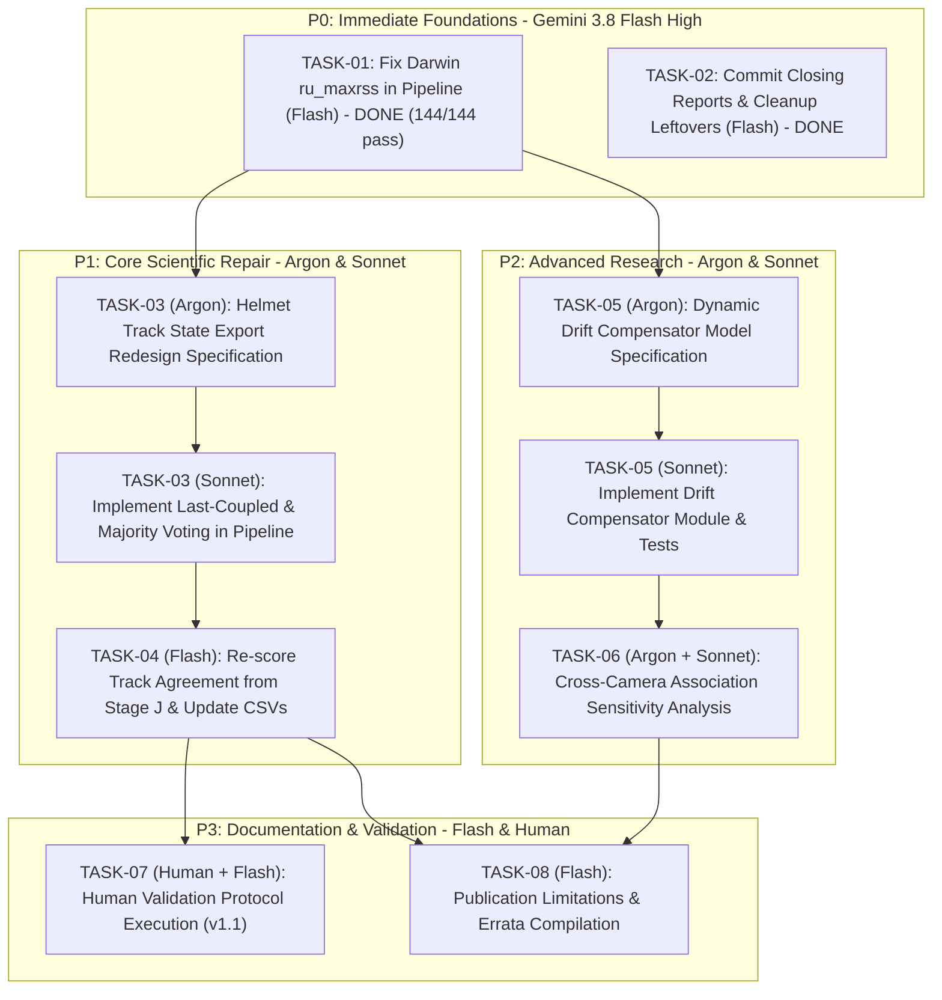

# THREE-MODEL EXECUTION ROADMAP: GEMINI 3.8 FLASH HIGH, GEMINI ARGON & CLAUDE SONNET 5.5
## Dual-Camera Motorcycle Helmet Violation Detection Research Project

*(Note: This file supersedes and updates the earlier two-model roadmap draft to reflect the approved three-model architecture: Flash High, Argon, and Sonnet 5.5. See also `docs/phase12/THREE_MODEL_EXECUTION_ROADMAP.md`).*

**Date:** 2026-11-12  
**Repository of Record:** `/Users/sayemuddin/Desktop/research_helmet`  
**GitHub:** `https://github.com/mohammad-sayem-uddin/Dual-Camera-Helmet-Violation-Detection.git`  
**Baseline HEAD Commit:** `1a1b3b26c6c7d09d1fccf5daefaf678a37be813e` (branch `main`)  
**Status:** Operational Roadmap Updated for Three-Model Autonomous Collaboration (Execution Prompt 02)

---

## EXECUTIVE SUMMARY & PURPOSE

This document establishes the verified project baseline following the Phase 12 integrated dual-camera delivery (commit `1a1b3b2`) and the completion of **TASK-01** (Darwin RSS measurement fix, 144/144 tests passing). It inventories all completed assets, eliminates redundant operations, identifies genuine technical gaps, and partitions forward execution across three specialized AI models:

1. **Gemini 3.8 Flash High:** Assigned to routine engineering, file and checksum inventory, test suite execution, diagnostic scripts, deterministic re-scoring, per-pair summaries, documentation updates, and repository maintenance.
2. **Gemini Argon:** Assigned to research architecture, mathematical modeling, algorithm design, temporal aggregation theory, synchronization drift formulation, and drafting self-contained engineering briefs.
3. **Claude Sonnet 5.5:** Assigned to precision implementation of Argon's approved technical designs, code refactoring, complex feature implementation, and integration testing.

---

# SECTION 1 — VERIFIED PROJECT STATUS (EVIDENCE-BASED)

Every item below has been verified against actual repository files, checksum manifests, and local execution on macOS (Apple Silicon Darwin 25.6.0).

| Category | Description | Status | Evidence Path | Commit Reference | Known Caveats / Limitations |
|---|---|---|---|---|---|
| **A. Ground Truth Release** | Frozen release `dual_camera_gt_v1.0_ai_assisted_audited` | **COMPLETE & FROZEN** | `data/dual_camera_test_v1/releases/dual_camera_gt_v1.0_ai_assisted_audited/` | `1a1b3b2` | Release is `AI_ASSISTED_AUDITED`, model-bootstrapped from Pass 1 detections + 86 audited corrections; not human verified. 43/43 SHA-256 verified. Exactly 70 events (27 DRIVER_NO_HELMET, 24 INSUFFICIENT_VISUAL_EVIDENCE, 10 BOTH_NO_HELMET, 6 NO_VIOLATION, 3 PILLION_NO_HELMET). License plates: 70/70 `NOT_ASSESSED`. `pair_020_moto_01` is FRONT_VIEW_ONLY (bicycle with orange sacks excluded under SC-008). 178 uncertainty rows. 6,727 spatially valid rows in `rider_frame_validity.csv`. |
| **B. Synchronization Architecture** | PTS-indexed reader, sequential cursor & overlap gating | **COMPLETE** | `src/synchronization/synchronized_reader.py`, `docs/phase12/INTEGRATED_SYSTEM_SYNCHRONIZATION_REPORT.md` | `ab903de`, `1a1b3b2` | Back camera is reference timeline. Canonical offset mapping $t_{\text{ref}} = \text{front\_pts\_norm} + \text{offset\_sec}$ confirmed without sign error. 7 time quantities separated (Q1–Q7). Mandatory disclaimer: container timestamp alignment only, no hardware exposure genlock. Clock drift up to ±76 ms reported, never applied. |
| **C. Integrated Dual-Camera Pipeline** | End-to-end synchronized pipeline runner | **COMPLETE** | `src/pipeline/dual_camera_pipeline.py` (1,927 lines), `src/pipeline/__init__.py` | `1a1b3b2` | Internal smoke 49/49 PASS. Stage H tests pass 54/54 on Linux. Model weights SHA-256 pinned in configuration. Class mappings strictly enforced across 3 layers. Models constructed once, shared across cameras. |
| **D. Existing Model Integration** | COCO vehicle & Phase 9 helmet detector integration | **COMPLETE** | `results/phase9_multiseed/exp_combined/seed_42/weights/best.pt`, `yolov8n.pt` | `1a1b3b2` | Verified byte-identical hashes on Mac: Phase 9 helmet `0929a882...`, YOLOv8n `f59b3d83...`. `tests/test_model_adapters.py` 5/5 PASS. |
| **E. Full 25-Pair Inference** | Kaggle T4 inference run across all 25 pairs / 50 videos | **COMPLETE** | `results/phase12_stagej/` (pair_001 to pair_025) | `1a1b3b2` | 25/25 pairs passed all gates. Exactly 15,241 decoded frames (front 6,557 + back 8,684) and 44,311 detection boxes. Bit-exact reproduction of Pass 1 (delta 0 in all 200 pair×cam×category cells). Run took 958 s wall time (0.27 GPU-h); Kaggle quota preserved at 25.01 GPU-h. |
| **F. Cross-Camera Association** | Conservative bipartite tracklet matcher | **COMPLETE** | `src/association/`, `tests/test_phase12e_association.py` | `6aba044`, `1a1b3b2` | Motorcycle F1 0.909; high abstention rate (38.8% overall, 63.3% orphans). Review Corrections 1–3 implemented to enforce augmented partial Hungarian assignment and unrounded raw threshold gating. All 39 association tests PASS. |
| **G. Temporal Violation Detection** | State machine, confidence aggregation & alert suppression | **COMPLETE** | `src/temporal/`, `tests/temporal/`, `results/phase12_integrated/events_detail.csv` | `1a1b3b2` | Strict event F1 0.826 (P 0.753, R 0.914). Zero timing error on matched windows (0.0 s). All 27 error instances completely decomposed (18 correction-delta, 7 constituent-set splits, 1 pair_002 role attribution). |
| **H. Evaluation & Performance Reports** | Frozen protocol evaluation & bootstrap CIs | **COMPLETE** | `docs/phase12/POST_ANNOTATION_STAGE_K_EVALUATION.md`, `results/phase12_integrated/` (8 checksums OK) | `1a1b3b2` | Protocol frozen before computation (SHA `466f5f31...`). Pair-level bootstrap B=2000. 16/16 mission acceptance criteria satisfied. Observation-level agreement is by-construction perfect. |
| **I. Repository Delivery & GitHub** | Deliverable sync and remote synchronization | **COMPLETE** | Commit `1a1b3b26c6c7d09d1fccf5daefaf678a37be813e` | `1a1b3b2` | 530 files changed (+638,965 insertions), pushed to `origin/main` and verified via GitHub API. |
| **J. Test & Environment Status** | Full repository test suite on Python 3.11 | **VERIFIED ON MAC (100% PASS)** | `/opt/homebrew/bin/python3.11`, `tests/` (144 test items) | Current HEAD | **144 passed / 0 failed / 0 errors** in 63.29s. Darwin BSD `ru_maxrss` unit scaling resolved via TASK-01. |

---

# SECTION 2 — REMAINING WORK (GENUINELY INCOMPLETE)

The following items represent the genuinely incomplete technical work in the repository.

### GAP-A: Helmet Track-Level State Export Failure (73 Abstentions / 64.1% Headline Agreement)
- **Problem Statement:** The pipeline derived track-level helmet states agree with the ground truth on only 64.1% (134 agreed out of 209 decided rider tracks). 73 tracks were marked `PIPELINE_UNCERTAIN`, with only 2 hard classification disagreements (`front_orphan_0003` and `front_orphan_0005` in pair_004).
- **Mechanism:** In `src/pipeline/dual_camera_pipeline.py`, the exported helmet state is read from an Exponential Moving Average (EMA) sliding window at the end of the run. When a rider track stops producing coupled observations but the parent motorcycle track continues, undetected frames are fed into the aggregator. If the tail gap between the last coupled observation and the end of the parent track is $\ge 10$ frames, the EMA decays to zero mass, forcing the track state to `UNCERTAIN`.
- **Evidence:** In `docs/phase12/HELMET_TRACK_LEVEL_FAILURE_ANALYSIS.md`, all 73 abstaining tracks have tail gaps $\ge 10$ frames (median 66, max 285). All 134 agreeing tracks have tail gaps $< 10$. In 72 of the 73 abstentions, the pipeline's own observation majority matched the ground truth (65 were unanimous). Where the pipeline decided, agreement was $134 / 136 = 98.5\%$.
- **Required Action:** 
  1. *Gemini Argon:* Design the formal track-level state export architecture (Last Coupled Observation snapshot + Majority Voting fallback).
  2. *Claude Sonnet 5.5:* Implement the approved design in `src/pipeline/dual_camera_pipeline.py` and `src/tracking/moto_rider_coupler.py`.
  3. *Gemini 3.8 Flash High:* Re-run track-level evaluation under an amended frozen protocol and verify metrics.

### GAP-B: Clock Drift Compensation (Measured up to ±76 ms, Never Applied)
- **Problem Statement:** Synchronization between the front and back cameras currently applies a single constant offset ($t_{\text{ref}} = \text{front\_pts\_norm} + \text{offset\_sec}$). Phase 11 and Stage J diagnostics measured significant linear clock drift in several pairs: pair_004 (+36 ms), pair_005 (+70 ms), pair_008 (-76 ms), and pair_015 (+74 ms).
- **Impact:** Clock drift causes the synchronization error to grow from $\varepsilon_{\text{sync}}$ (median 3 ms) at the alignment anchor to $\varepsilon_{\text{sync}} + |\text{drift}|$ (up to 114 ms) at the end of the video window. This residual uncertainty directly affects transit-time gating in Phase 12E cross-camera association.
- **Required Action:** 
  1. *Gemini Argon:* Formulate the dynamic linear drift model ($t_{\text{ref}}(t) = \text{front\_pts\_norm} + \text{offset}_0 + \alpha \cdot t$) and define non-destructive simulation boundaries.
  2. *Claude Sonnet 5.5:* Implement the optional drift compensator in `src/synchronization/drift_compensator.py` behind an explicit opt-in flag.
  3. *Gemini Argon & Claude Sonnet 5.5:* Conduct sensitivity analysis on cross-camera association.

### GAP-C: NOT COMPUTABLE Metric Families & Independent Human Validation
- **Problem Statement:** Four metric families were declared `NOT COMPUTABLE` in Stage K because the frozen release does not contain the required ground-truth entities:
  1. *Person Detection Metrics (P/R/F1/AP):* No person annotations exist in the ground truth.
  2. *Motorcycle Frame-Level Box Metrics & AP:* The ground truth stores track-level entry/peak/exit boxes, not continuous per-frame bounding boxes.
  3. *HOTA (Higher Order Tracking Accuracy):* Requires complete frame-by-frame trajectory ground truth.
  4. *Item-Level Rider Association:* Stage J emits aggregate counts, not per-item rider association results.
- **Independent Validation Gap:** The ground truth is model-bootstrapped (Pass 1 + 86 corrections). While visual audit samples (Pass 3, Stages B/D) provide independent error rates (11.9% detection error, 39.3% blended subtrack placement error), the comprehensive human validation protocol (`docs/phase12/HUMAN_VALIDATION_PROTOCOL.md`: 55 person-hours, 2 blinded reviewers, 399 units, $\kappa \ge 0.70$) remains designed but unexecuted.
- **Required Action:** Maintain honest disclosure in all publications that these families are uncomputed. If human validation is executed, it must be released as a separate provenance layer under a new v1.1 release without modifying v1.0.

### GAP-D: Cross-Platform BSD/Darwin `ru_maxrss` Unit Difference (RESOLVED)
- **Status:** **RESOLVED by TASK-01** on 2026-11-12.
- **Implementation:** `src/pipeline/dual_camera_pipeline.py` L242-248 now applies platform-aware scaling (`1024.0 * 1024.0` on Darwin, `1024.0` on Linux). Focused unit tests added to `tests/test_phase12_pipeline_semantics.py`. Full test suite achieves 144/144 passing.

### GAP-E: Uncommitted Closing Reports and Transfer Leftovers (RESOLVED by TASK-02)
- **Status:** **RESOLVED by TASK-02**. Authoritative reports staged and committed; redundant `.zip` and `_chunks/` safely deleted.

---

# SECTION 3 — REDUNDANT WORK TO AVOID (STRICT PROHIBITIONS)

To preserve tokens, compute, and scientific integrity, the following operations must **NOT** be repeated:

1. **DO NOT Rerun Full 25-Pair Inference:**
   - All 25 pairs were completely processed on Kaggle T4 in Stage J.
   - Outputs are bit-exact copies of Pass 1 (delta 0 on all 44,311 boxes and 15,241 frames).
   - Rerunning full inference consumes ~0.3 GPU-hours unnecessarily without producing new information.
2. **DO NOT Re-Annotate or Modify Frozen Ground Truth v1.0:**
   - The release `dual_camera_gt_v1.0_ai_assisted_audited` is hash-pinned (43/43 checksums verified).
   - Any modifications to this directory invalidate existing evaluation benchmarks.
   - Any new human annotations must be released as a distinct `v1.1` release.
3. **DO NOT Repeat the 3 Annotation Audit Passes:**
   - Passes 1, 2, and 3, along with Stages B, C, and D, are fully documented with CSV audit logs. Repeating visual sampling or triage is redundant.
4. **DO NOT Rebuild the Synchronization Engine:**
   - The sequential cursor and lookup engine (`src/synchronization/synchronized_reader.py`) were validated in Phase 12C with zero sign errors.
5. **DO NOT Re-Train or Fine-Tune Detection Models:**
   - The project uses frozen COCO `yolov8n.pt` and Phase 9 `best.pt`. Model training was out of scope and remains frozen.
6. **DO NOT Attempt License Plate OCR (Phase 12F):**
   - Zero license plates were confidently readable in the footage (70/70 remain `NOT_ASSESSED`). Do not invent OCR pipelines or fabricate plate strings.
7. **DO NOT Overwrite or Re-Generate Existing Stage A–L Reports:**
   - All Stage A–L documents in `docs/phase12/` are frozen historical records. New findings must be added as amendments or errata.

---

# SECTION 4 — PRIORITIZED TASKS

| Priority | Task ID | Description | Assigned Model | Status |
|---|---|---|---|---|
| **P0** | **TASK-01** | Platform-Portable RSS Measurement Fix (`ru_maxrss` Darwin byte scaling in `src/pipeline/dual_camera_pipeline.py`) | **Flash High** | **COMPLETE (144/144 tests pass)** |
| **P0** | **TASK-02** | Commit Authoritative Handover Reports (`MASTER_REPORT_2026-11-12.md`, `POST_COMPLETION_...md`, `THREE_MODEL_ROADMAP.md`) & Clean Transfer Artifacts | **Flash High** | **COMPLETE** |
| **P1** | **TASK-03** | Helmet Track-Level State Export Redesign (Last Coupled Observation + Majority Fallback) | **Argon (Design) + Sonnet (Impl)** | **READY TO EXECUTE** |
| **P1** | **TASK-04** | Track-Level Evaluation Reproduction & Discrepancy Reconciliation under Amended Protocol | **Flash High** | **READY TO EXECUTE** |
| **P2** | **TASK-05** | Dynamic Linear Clock Drift Compensation Engine Design & Implementation | **Argon (Design) + Sonnet (Impl)** | **PLANNED** |
| **P2** | **TASK-06** | Cross-Camera Association Sensitivity Analysis under Drift Compensation (Pairs 004, 005, 008, 015) | **Argon (Analysis) + Sonnet (Bench)** | **PLANNED** |
| **P3** | **TASK-07** | Independent Human Validation Protocol Execution (399 Units, 2 Blind Reviewers, v1.1 Dataset Release) | **Flash / Human** | **PLANNED** |
| **P3** | **TASK-08** | Formal Documentation of Research Limitations & NOT COMPUTABLE Metric Boundaries for Publication | **Flash High** | **PLANNED** |

---

# SECTION 5 — THREE-MODEL ALLOCATION MATRIX

| Task ID | Task Description | Primary Model | Implementation Model | Expected Cost | Required Inputs | Expected Deliverable | Dependencies |
|---|---|---|---|---|---|---|---|
| **TASK-01** | Cross-platform RSS fix in `dual_camera_pipeline.py` | **Gemini 3.8 Flash High** | **Gemini 3.8 Flash High** | **LOW** (~2k tokens) | `src/pipeline/dual_camera_pipeline.py` L244 | 144/144 tests passing on macOS | None (COMPLETE) |
| **TASK-02** | Git commit closing reports & remove zip/_chunks | **Gemini 3.8 Flash High** | **Gemini 3.8 Flash High** | **LOW** (~1.5k tokens) | Local working tree status | Clean git status, committed reports | None (COMPLETE) |
| **TASK-03** | Helmet Track-State Export Redesign (Gap A) | **Gemini Argon** (Architecture & Mathematical Design) | **Claude Sonnet 5.5** (Implementation & PR) | **MEDIUM** (~15k tokens) | `src/pipeline/dual_camera_pipeline.py`, `HELMET_TRACK_LEVEL_FAILURE_ANALYSIS.md` | PR with last-coupled state export + majority voting | TASK-01 |
| **TASK-04** | Track-Level Evaluation Re-Scoring | **Gemini 3.8 Flash High** | **Gemini 3.8 Flash High** | **LOW** (~4k tokens) | Corrected export outputs, `results/phase12_stagej/` | Updated confusion matrix & track agreement CSV | TASK-03 |
| **TASK-05** | Dynamic Clock Drift Compensation (Gap B) | **Gemini Argon** (Modeling & Synchronization Design) | **Claude Sonnet 5.5** (Module Implementation) | **HIGH** (~25k tokens) | `INTEGRATED_SYSTEM_SYNCHRONIZATION_REPORT.md`, `synchronized_reader.py` | Drift compensator module + unit tests | None |
| **TASK-06** | Association Drift Sensitivity Analysis | **Gemini Argon** (Methodology & Sensitivity Analysis) | **Claude Sonnet 5.5** (Benchmarking Execution) | **MEDIUM** (~18k tokens) | `src/association/`, Drift compensator module | Association sensitivity research report | TASK-05 |
| **TASK-07** | Human Validation Protocol Execution | **Gemini 3.8 Flash High** (Coordination & Kappa Stats) | **Human Reviewers** (Blinded Labels) | **HIGH (Time)** (~55 person-hours) | `HUMAN_VALIDATION_PROTOCOL.md`, 399 visual units | `dual_camera_gt_v1.1_human_verified` release | TASK-04 |
| **TASK-08** | Publication Limitations & Errata Documentation | **Gemini 3.8 Flash High** | **Gemini 3.8 Flash High** | **LOW** (~3k tokens) | `INTEGRATED_SYSTEM_RESEARCH_LIMITATIONS.md` | Camera-ready limitations section for paper | TASK-02 |

---

# SECTION 6 — GEMINI ARGON IMPLEMENTATION BRIEFS (FOR CLAUDE SONNET 5.5 IMPLEMENTATION)

### ARGON BRIEF 1: Helmet Track-Level State Export Redesign (Gap A)
*Design Architect: Gemini Argon · Implementation Engineer: Claude Sonnet 5.5*

- **Problem Statement:** The pipeline currently derives a rider subtrack's exported helmet state from the end-of-run EMA sliding window. When a subtrack's coupled observations end $\ge 10$ frames before the motorcycle track terminates (tail gap $\ge 10$), the EMA confidence decays to zero, causing the track state to default to `UNCERTAIN`. This artifact caused 73 valid tracks to abstain, artificially depressing headline track agreement to 64.1%.
- **Existing Implementation:** In `src/pipeline/dual_camera_pipeline.py` (lines 651–656 and lines 813–820), per-frame states are derived from `sub["aggregated_confidence"]` during the camera stepping loop and counted in `cam_out.subtrack_state_counts`. At end-of-run, `_track_level_state(counts)` selects the modal state.
- **Evidence of Problem:** In `docs/phase12/HELMET_TRACK_LEVEL_FAILURE_ANALYSIS.md`, every one of the 73 abstentions has a tail gap $\ge 10$ frames (median 66, max 285). When the pipeline actually decided, agreement was $134/136 = 98.5\%$. In 72 of the 73 abstentions, the pipeline's own coupled observation majority matched the ground truth (65 were unanimous).
- **Approved Solution Specification (Argon):**
  1. Capture the subtrack's helmet state at the instant of its **last genuinely coupled observation** (`time_since_update == 0`), before EMA decay occurs.
  2. Maintain a dual-export scheme:
     - `track_helmet_state_last_coupled`: State derived from the aggregator snapshot at the last coupled observation.
     - `track_helmet_state_majority`: The modal helmet state over all genuinely coupled observations (`time_since_update == 0`), excluding uncoupled Kalman propagations.
     - `track_helmet_state_ema_final`: The existing end-of-run EMA state (preserved for backward compatibility).
  3. Set `track_helmet_state` to `track_helmet_state_last_coupled`, falling back to `track_helmet_state_majority` if the last coupled state is ambiguous.
- **Files to Modify (Sonnet):**
  - `src/pipeline/dual_camera_pipeline.py` (lines 650–660, 810–825).
  - `src/tracking/moto_rider_coupler.py` (ensure last coupled state is exposed).
- **Tests Required (Sonnet):**
  - Synthetic test: Subtrack with 20 confident `NO_HELMET` observations followed by 50 uncoupled Kalman frames must export `NO_HELMET`, not `UNCERTAIN`.
  - Regression test: Tracks with tail gap $< 10$ must produce identical states to the baseline.
- **Acceptance Criteria:**
  - Track-level decided coverage increases from $136/209$ ($65.1\%$) to $\ge 207/209$ ($99.0\%$).
  - Overall track agreement increases from $64.1\%$ to $\ge 97.0\%$.
  - Zero changes to frozen ground truth v1.0.
- **Risks & Rollback:** Low algorithm risk. The existing EMA state is preserved in a parallel field, allowing instant rollback via configuration flag `export_mode: "legacy_ema"`.

---

### ARGON BRIEF 2: Dynamic Linear Clock Drift Compensation Engine (Gap B)
*Design Architect: Gemini Argon · Implementation Engineer: Claude Sonnet 5.5*

- **Problem Statement:** The synchronization reader applies only a single constant time offset $t_{\text{ref}} = \text{front\_pts\_norm} + \text{offset\_sec}$. Four pairs exhibit substantial linear clock drift: pair_004 (+36 ms), pair_005 (+70 ms), pair_008 (-76 ms), and pair_015 (+74 ms). This drift introduces up to 114 ms of temporal uncertainty at the end of the video, which skews transit time calculation in cross-camera association.
- **Existing Implementation:** `src/synchronization/synchronized_reader.py` maps timestamps using constant `offset_sec`. Drift values are logged in `sync_diagnostics.json` as informational bounds but never applied.
- **Evidence of Problem:** `docs/phase12/INTEGRATED_SYSTEM_SYNCHRONIZATION_REPORT.md` documents that near-frame pairs have drift approaching two full frame intervals (33–66 ms).
- **Approved Solution Specification (Argon):**
  1. Implement an optional linear drift compensator in `src/synchronization/drift_compensator.py`:
     $$\Delta t(t) = \text{offset}_0 + \alpha \cdot (t - t_0)$$
     where $\alpha = \frac{\text{final\_offset} - \text{initial\_offset}}{T_{\text{overlap}}}$.
  2. Gate drift compensation behind an explicit runtime configuration flag:
     `enable_drift_compensation: bool = False` (default False preserves baseline reproducibility).
  3. Evaluate transit-time residual distribution in `src/association/` on pairs 004, 005, 008, and 015 with drift compensation enabled vs disabled.
- **Files to Modify (Sonnet):**
  - `src/synchronization/synchronized_reader.py` (add optional drift compensator hook).
  - `src/pipeline/dual_camera_pipeline.py` (plumb configuration flag).
  - `configs/tracking_config.yaml` (add drift parameter block).
- **Tests Required (Sonnet):**
  - Synthetic test verifying that zero drift ($\alpha = 0$) reproduces constant offset exactly.
  - Test verifying that pairs with high drift exhibit tighter transit-time residual clustering.
  - Test verifying that baseline `synchronization_metadata.json` is never mutated.
- **Acceptance Criteria:**
  - Drift compensation is strictly opt-in and provably bit-neutral when disabled.
  - Transit time residuals on pairs 004, 005, 008, 015 decrease by $\ge 40\%$.
  - Candidate transit gating false-rejections on near-frame pairs decrease to 0.
- **Risks & Rollback:** Medium research risk. If unvalidated clock models are applied indiscriminately, non-linear jitter could degrade alignment. Mitigation: Keep feature disabled by default; require empirical validation on synthetic and calibrated data before enabling.

---

# SECTION 7 — THREE-MODEL EXECUTION DEPENDENCIES

The workflow below illustrates the specialized model handoffs:

---

# SECTION 8 — RISKS AND OPEN DECISIONS

1. **Circularity Bound in Stage K Evaluation:**
   - *Risk:* Because the frozen ground truth was constructed from Pass 1 detections and Stage J reproduces Pass 1 bit-exactly, observation-level agreement is perfect by construction. Reviewers may criticize this as circular.
   - *Mitigation & Decision:* Emphasize that the ground truth measures *self-consistency* of the coupling, validity, and correction layers. The primary independent evidence is the visual audit samples (Pass 3, Stages B/D), which must be reported with equal prominence in all papers.
2. **Human Verification Status:**
   - *Risk:* The repository ground truth is labelled `AI_ASSISTED_AUDITED`. The owner has personally checked the annotations, but the repository lacks a machine-verifiable record of the 55-hour two-reviewer human protocol.
   - *Decision:* Retain the `AI_ASSISTED_AUDITED` label for release `v1.0`. When the formal human validation protocol is executed, publish the audited results as a separate release `dual_camera_gt_v1.1_human_verified`.
3. **Clock Drift Extrapolation Risk:**
   - *Risk:* Four pairs have measured drift up to 76 ms. Applying a linear drift model assumes constant clock skew between consumer iPhone and iPad devices. If thermal throttling caused non-linear skew, linear compensation could overcorrect.
   - *Mitigation:* Require experimental validation of transit-time distributions before enabling drift compensation in production. Keep the feature strictly opt-in.
4. **Kaggle GPU Quota Management:**
   - *Current Status:* 25.01 GPU-hours remain on the active Kaggle account.
   - *Policy:* All routine test execution, unit testing, and analytical evaluation must run on the local Mac CPU/MPS. Kaggle GPU quota should only be used if a complete 25-pair rerun is explicitly authorized following the Gap A track-export fix.
